

# 🦊 Azhou AI Hub

**Agent skills that stay useful after the demo.**

Small enough to edit. Strict enough to verify. Neutral enough to run across harnesses.

[简体中文](README.zh-CN.md) · [Install](docs/installation.md) · [Support matrix](docs/support-matrix.md) · [Contributing](CONTRIBUTING.md)

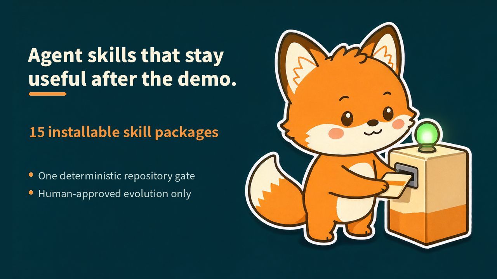

https://github.com/user-attachments/assets/35c1a361-d494-437f-ad6c-0049f6828fd3

<picture>
  <source media="(prefers-color-scheme: dark)" srcset="assets/github/readme-banner-install-dark.jpg">
  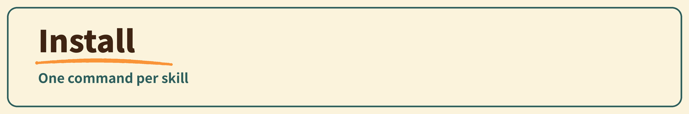
</picture>

### First install in Codex

Have Codex signed in and Node.js with `npx` available. In a terminal, open the project folder where you want to use Ask Azhou and run this command. It installs into that project.

~~~bash
npx skills add TeFuirnever/azhou-ai-hub --skill super-ask-azhou --agent codex
~~~

Open a new Codex chat in that project and try the following question.

> `$super-ask-azhou` I have a Mermaid diagram and want to turn it into an interactive architecture diagram. Which Hub Skill should I use?

Look for a recommendation of `super-archify`. If Ask Azhou is missing, check the [first-install guide](docs/installation.md#first-install-in-codex). For an existing installation, see [check, update, or uninstall](docs/installation.md#upgrade-or-uninstall).

More Skill install commands

~~~bash
npx skills add TeFuirnever/azhou-ai-hub --skill super-repo-pedant
npx skills add TeFuirnever/azhou-ai-hub --skill super-excalidraw-diagram
npx skills add TeFuirnever/azhou-ai-hub --skill super-azhou-info
npx skills add TeFuirnever/azhou-ai-hub --skill super-azhou-doctor
npx skills add TeFuirnever/azhou-ai-hub --skill super-azhou-setup
npx skills add TeFuirnever/azhou-ai-hub --skill super-azhou-verify
npx skills add TeFuirnever/azhou-ai-hub --skill super-eli5
npx skills add TeFuirnever/azhou-ai-hub --skill super-arch-doc
npx skills add TeFuirnever/azhou-ai-hub --skill super-session-insights
npx skills add TeFuirnever/azhou-ai-hub --skill super-asd-ste100
npx skills add TeFuirnever/azhou-ai-hub --skill super-archify
npx skills add TeFuirnever/azhou-ai-hub --skill super-lavish
npx skills add TeFuirnever/azhou-ai-hub --skill super-imagegen
npx skills add TeFuirnever/azhou-ai-hub --skill super-i-have-adhd
npx skills add TeFuirnever/azhou-ai-hub --skill super-gh-axi
~~~

Choose one installation method per skill. Package-manager installs resolve the mutable default branch, and the four `super-azhou-*` packages still require an explicit local checkout.

[Update or uninstall](docs/installation.md#upgrade-or-uninstall) · [Verify what you installed](docs/installation.md#verify-what-you-installed) · [Installation guide](docs/installation.md) · [Offline recovery](docs/installation.md#offline-recovery)

<picture>
  <source media="(prefers-color-scheme: dark)" srcset="assets/github/readme-banner-skills-dark.jpg">
  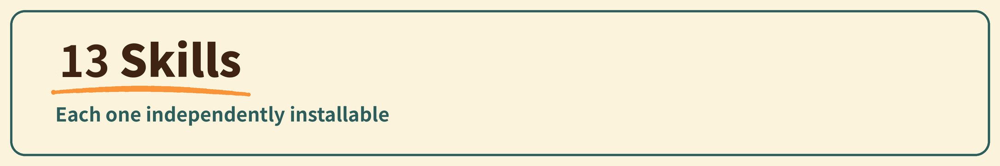
</picture>

| Skill | Real job | Verification basis |
|---|---|---|
| [Azhou Info](skills/super-azhou-info/SKILL.md) | Report checkout, runtime, support and provable Git revision facts without manufacturing release state. | Delegates to stable `info` / `version` JSON contracts; read-only package and repository-policy checks. |
| [Azhou Doctor](skills/super-azhou-doctor/SKILL.md) | Diagnose repository, explicit install target, optional Treehouse lease and host stale-install migration health without mutation. | Read-only doctor contract, real Treehouse 2.3.0 smoke, fail-closed target checks and the read-only host migration probe. |
| [Azhou Setup](skills/super-azhou-setup/SKILL.md) | Guide scoped installation, update and removal, including checkout-managed lifecycle operations. | Dry-run-first setup, mutation lock, identity guards, rollback and receipt regressions. |
| [Azhou Verify](skills/super-azhou-verify/SKILL.md) | Run the public full-repository integrity gate. | Delegates to repository policy, unit, benchmark-integrity and whitespace gates. |
| [Super Repo Pedant](skills/super-repo-pedant/SKILL.md) | At explicit task close, reconcile docs, project rules, handoff state and project-bound memory against current code. | 28/28 <code>neat-freak</code> capabilities accounted for against upstream <code>neat-freak</code> release v1.2.2 / skill 3.1.1; 4 registered behavior cases (registry/integrity coverage); fixed execution protocol and inventory proof. |
| [Excalidraw Diagram](skills/super-excalidraw-diagram/SKILL.md) | Create or edit an editable scene, render the real artifact, inspect it, and deliver CJK-safe SVG/PNG when requested. | 5 frozen benchmark cases; deterministic style, scene, overlap and same-DOM gates. Checked-in reference output proves wiring only, not model quality. |
| [Eli5](skills/super-eli5/SKILL.md) | Explain a topic like the reader knows nothing about it: one self-contained HTML artifact of big pictures and few words. | Upstream behavior sentence retained verbatim at the locked upstream commit with a reproducible SHA-256 source check. No behavior benchmark yet. |
| [Ask Azhou](skills/super-ask-azhou/SKILL.md) | Router for the whole catalog: describe the intent, get the skill, its mode, and its boundary. Recommendation-only. | Router pattern adapted from a pinned upstream; routing-map parity is a repository-gate check with a negative control. No behavior benchmark yet. |
| [Arch Doc](skills/super-arch-doc/SKILL.md) | Draft, calibrate and review an architecture design document from upstream sources. | Distilled from the MCC ARCH-2026-001 v0.1-v0.17 pipeline; deterministic scaffold (`new_doc.py`), closing-gate checker (`verify_doc.py`) and a golden scaffold case in `benchmarks/super-arch-doc/`. |
| [Session Insights](skills/super-session-insights/SKILL.md) | Fact-bound usage reports from local stores (Claude Code and Codex; zcode fails closed), plus explicitly requested reflection on selected redacted material authorized for model analysis. | Synthetic statistics wiring and reflection contract checks. No behavior benchmark yet. Reflection usefulness and independent semantic review remain unverified. |
| [ASD-STE100](skills/super-asd-ste100/SKILL.md) | Rewrite agent-facing English under ASD-STE100-derived controlled-English structural rules, preserving every hedge, fact and scope qualifier. | Faithfully imported at the locked upstream commit with pinned SHA-256 integrity tests; `skills/super-asd-ste100/scripts/ste-lint.py` is a deterministic stdlib gate covered by positive and negative tests. No behavior benchmark yet. |
| [Archify](skills/super-archify/SKILL.md) | Turn systems, plans, or codebases into interactive diagram maps — ten typed-JSON modes plus a Markdown-authored explainer mode — delivered as self-contained explorable HTML. | Synchronized to official stable v3.2.0 (<code>208acba8</code>) with SHA-256 integrity over the selected subtree; browser checks and visual review are reported separately for the actual artifact. No model-quality improvement is claimed. |
| [Lavish](skills/super-lavish/SKILL.md) | Turn complex or visual responses into reviewable HTML artifacts the user annotates in the browser; feedback returns to the agent through the locked <code>lavish-axi</code> CLI review loop. | Adopted at the locked upstream release <code>lavish-axi-v0.1.97</code> (commit <code>79aa0a18</code>): provenance pins the upstream skill SHA-256, npm integrity and tarball digest; the CLI is invoked through the locked <code>npx</code> baseline and is not vendored. Integrity tests pin the provenance and license copy. No behavior benchmark yet. |
| [Imagegen](skills/super-imagegen/SKILL.md) | Execute prepared local image-generation requests through the machine's installed private <code>azhou-imagegen</code> runtime: route the request, run the doctor gate, honor the runtime lock, and hand back outputs with an immutable receipt; refuses when the runtime is missing. | Contract-only package over a proprietary local runtime, with baseline hashes pinned in provenance and zero private bytes in the repository; fail-closed setup. No behavior benchmark yet. |
| [Rederive](skills/super-rederive/SKILL.md) | Practice understanding code by re-deriving its design through questions and real constraints. | Adapted from Eric Zou’s MIT-licensed upstream at a pinned commit. One exploratory lesson and a Codex opening were observed; comparative learning benefit and other hosts remain unverified. |
| [i-have-adhd](skills/super-i-have-adhd/SKILL.md) | Shape output for a reader with ADHD: next action first, bounded numbered steps, state restated every turn, tangents suppressed; stays on until the reader's stop phrase. | Adapted from the frozen upstream commit <code>1ecea199</code> (MIT) with the instruction body retained verbatim and both upstream SHA-256 digests pinned; integrity tests pin the provenance, license copy and the five Azhou presentation constraints. No behavior benchmark yet. |
| [Gh Axi](skills/super-gh-axi/SKILL.md) | Run GitHub operations through an agent-ergonomic wrapped CLI: issues, PRs, stacked PRs, discussions, CI runs and dispatch, releases, repos, labels, gists, Projects (v2), Actions secrets/variables, search and raw API, with project rules winning where a repository names its own recipe. | Adopted at the locked upstream release <code>gh-axi-v0.1.51</code> (commit <code>911a0868</code>) from [kunchenguid/gh-axi](https://github.com/kunchenguid/gh-axi): provenance pins the upstream skill SHA-256, npm integrity and tarball digest; the CLI is invoked through the locked <code>npx</code> baseline and is not vendored. Integrity tests pin the provenance and license copy. No behavior benchmark yet. |

<picture>
  <source media="(prefers-color-scheme: dark)" srcset="assets/github/readme-banner-try-dark.jpg">
  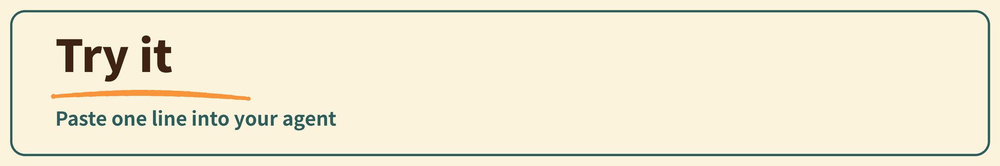
</picture>

| Skill | Copy this into your agent | What must come back |
|---|---|---|
| Super Repo Pedant | <code>This phase is done. Run super-repo-pedant reconcile.</code> | Reconciled knowledge surfaces, named checks, explicit holds and a stable receipt. [Run the demo](docs/demos/super-repo-pedant.md). |
| Excalidraw Diagram | <code>Use super-excalidraw-diagram to draw a login sequence. Deliver editable source and PNG.</code> | Editable <code>.excalidraw</code>, a real render/export, deterministic gates, visual review status and a stable receipt. [Run the demo](docs/demos/super-excalidraw-diagram.md). |
| Arch Doc | <code>Use super-arch-doc to draft this repository's architecture document from its upstream design docs.</code> | Research notes with per-fact provenance, a template scaffold with accounted diagram captions, PlantUML-only diagrams, deterministic closing gates and a stable receipt. [Run the demo](docs/demos/super-arch-doc.md). |

## Super Repo Pedant

> 🧹 Code is the only live answer. Everything else must align.

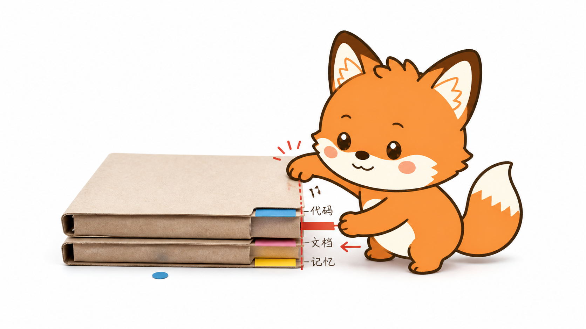

## Excalidraw Diagram

> ✏️ Make the structure carry the argument; use text as evidence.

[Setup](skills/super-excalidraw-diagram/references/setup.md) · [Provenance](skills/super-excalidraw-diagram/references/provenance.md)

## Arch Doc

> 🏛️ Every fact cites its source; every diagram earns its caption.

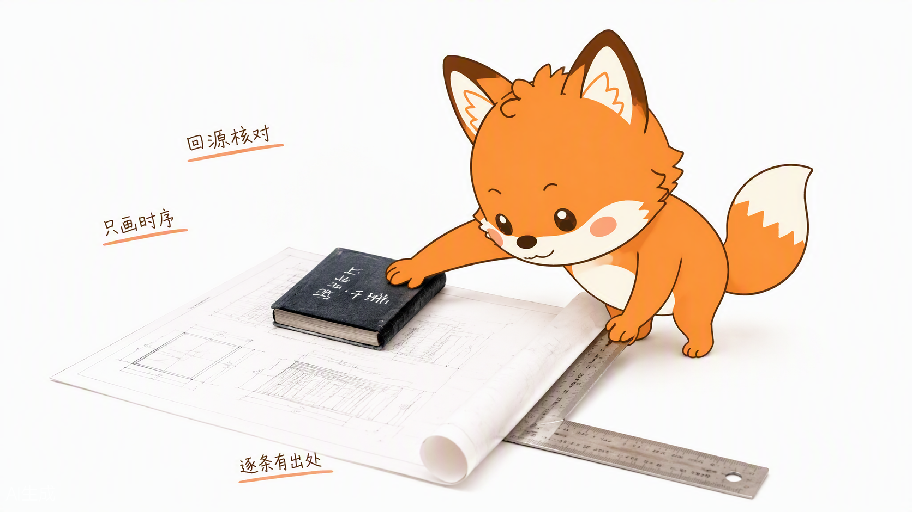

## Eli5

> 🖼️ Big pictures, few words — or an honest refusal.

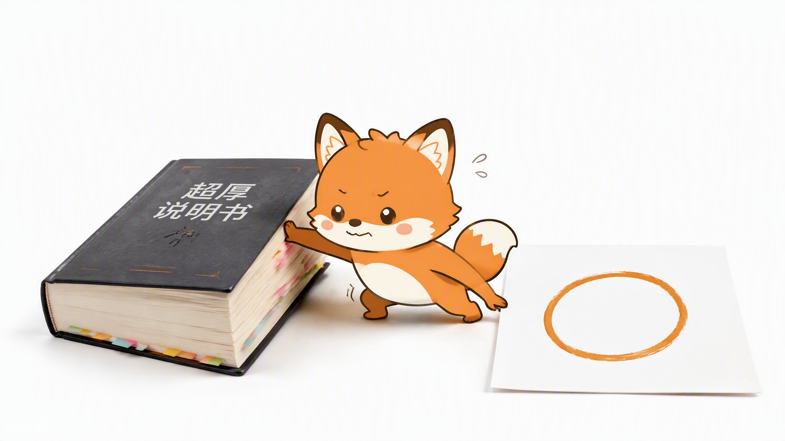

## Ask Azhou

> 🧭 Describe the intent, get the skill, its mode and its boundary.

In this checkout, ask “Ask Azhou, which skill can help me change old code that has no tests?” The router considers the book skills available in your workspace. You can also invoke a book directly by name.

## Session Insights

> 🔢 Aggregates leave the machine; raw transcripts never do.

## ASD-STE100

> 🎯 One meaning per word, one job per sentence — nothing for an agent to misread.

## Archify

> 🗺️ One map tells the whole system — hand it to the reader to explore.

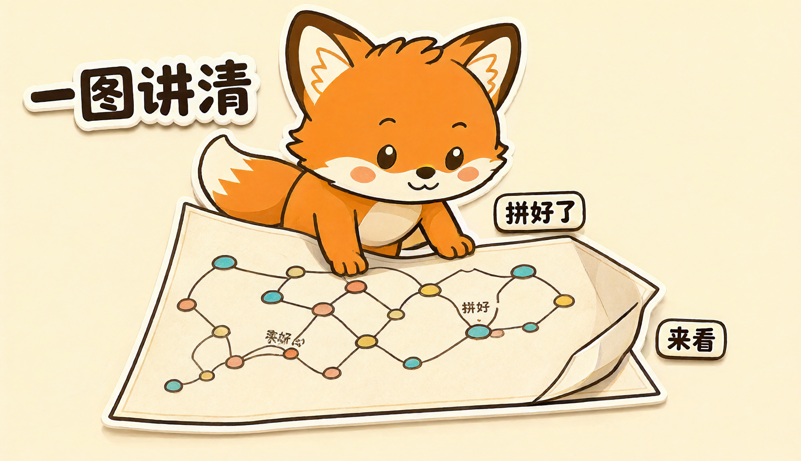

## Lavish

> 🔍 Circle what to change in the browser — the annotated feedback returns to the agent.

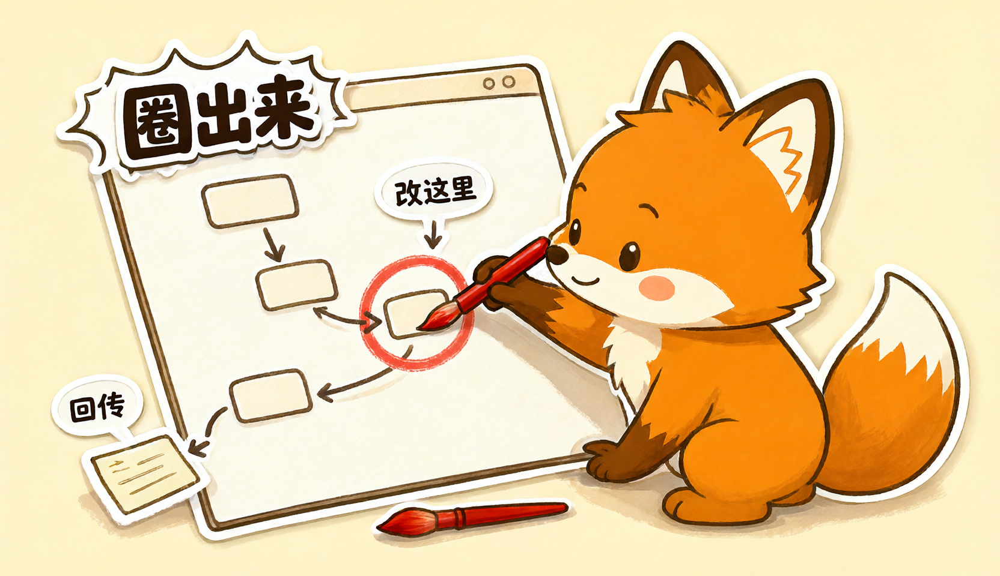

## Imagegen

> 🖼️ Local generation — draw offline, prove it with a receipt.

## i-have-adhd

> ✂️ Cut the pile into small steps — and do this card first.

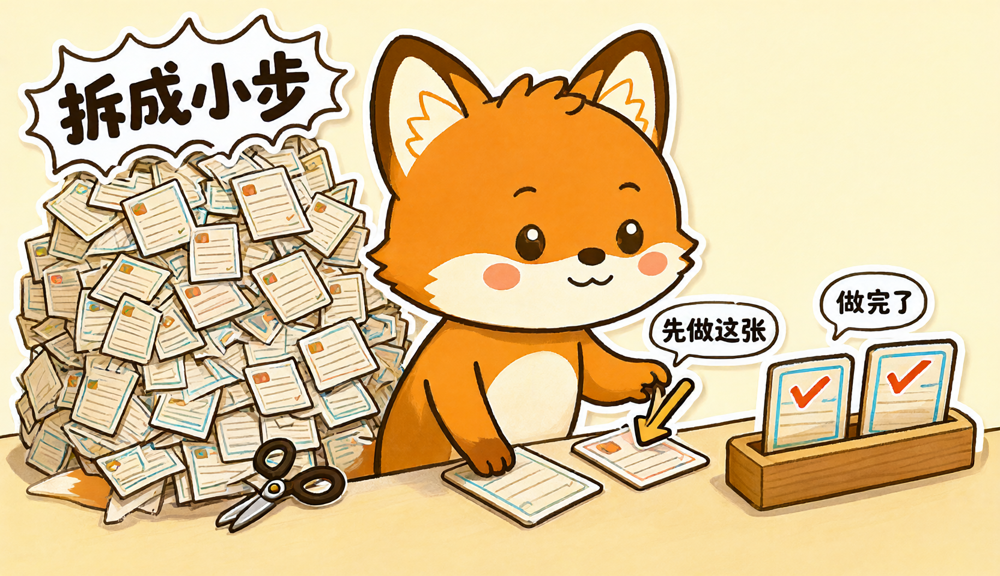

## Gh Axi

> ⚙️ Open the PR, join the queue, land the green check — GitHub work in one pass.

🦊 Effect previews generated with the Azhou Scenes skill. Repo Pedant and Excalidraw Diagram: machine colour gate passed; final identity, hand and text review remains a human checkpoint. Arch Doc, Eli5, Ask Azhou, Session Insights, ASD-STE100, Archify, Lavish, Imagegen, i-have-adhd and Gh Axi: human visual P0 approved; the formal colour gate still awaits the governed workspace audit.

<picture>
  <source media="(prefers-color-scheme: dark)" srcset="assets/github/readme-banner-trust-dark.jpg">
  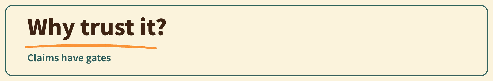
</picture>

- **Current behavior beats stale prose.** Code, machine configuration and real execution evidence define current truth; unimplemented specs stay visible as reminders.
- **Claims have gates.** The authoritative repository gate runs the complete deterministic test suite, a 4-case Super Repo Pedant suite, a 5-case Excalidraw benchmark integrity check, a Session Insights wiring-integrity suite on synthetic session stores, JSON/link/provenance/credential policy and whitespace checks.
- **Harness differences stay visible.** The maintained targets are Codex, Claude Code, MiMo Code (`mimo`), DeepSeek Harness (`dsh`) and zcode; other harnesses are temporarily unsupported. See the [support matrix](docs/support-matrix.md) and the [per-skill platform view](docs/skill-platform-view.md).
- **History cannot silently rewrite a live skill.** Promotion requires a regression, deterministic checks, paired majority, no safety regression and exact-diff human approval.
- **Sources remain attributable.** Upstream snapshots, vendored assets and excluded unlicensed prior art are recorded in [third-party notices](THIRD_PARTY_NOTICES.md).

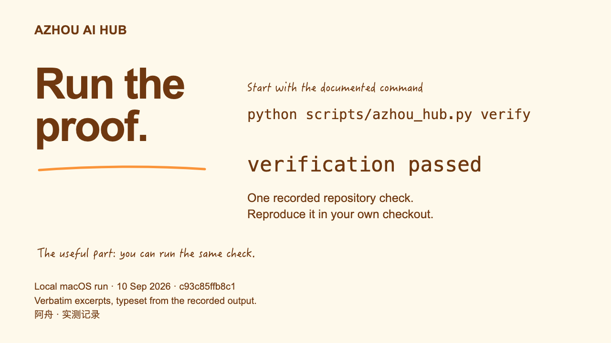

<picture>
  <source media="(prefers-color-scheme: dark)" srcset="assets/github/readme-banner-checkout-dark.jpg">
  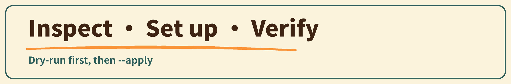
</picture>

Each adapter delegates to the checkout's zero-dependency Foundation CLI:

| Agent Skill | CLI authority | Change boundary |
|---|---|---|
| `super-azhou-info` | `info`, `version` | Read-only project, runtime, Git revision and dirty-state facts. |
| `super-azhou-doctor` | `doctor` | Read-only repository, explicit install-target, optional Treehouse lease and host stale-install migration diagnostics. With `--verify`, the verification subprocess has a 10-minute deadline and reports the last output line if available. |
| `super-azhou-setup` | `setup`, `repair`, `migrate`, `uninstall` | Dry-run first. Setup binds apply to the reviewed plan; repair, migrate and uninstall recheck current state when applied. |
| `super-azhou-verify` | `verify` | Runs the reproducible public repository-integrity gate and rejects captured Foundation setup JSON results that are malformed or non-passing. |

~~~bash
python scripts/azhou_hub.py info --json
python scripts/azhou_hub.py version --json
python scripts/azhou_hub.py doctor --json
python scripts/azhou_hub.py setup --skill super-repo-pedant --target /absolute/path/to/harness/skills --json
python scripts/azhou_hub.py verify
~~~

If Codex cannot find an installed Skill, use Doctor to check discovery for the current project. [Codex discovery guide](docs/installation.md#check-codex-discovery)

Managed uninstall retains the original receipt and a verified removal record; the target filesystem must support hard links. Doctor reports unexpected missing installations as failures. If uninstall reports a partial result, inspect the receipt and any reported record manually before retrying.

[Foundation CLI contract](docs/foundations.md)

<picture>
  <source media="(prefers-color-scheme: dark)" srcset="assets/github/readme-banner-integrations-dark.jpg">
  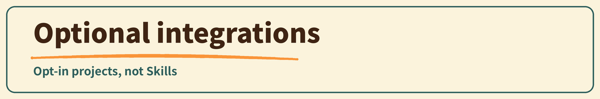
</picture>

Two complete projects live under `packages/`. These projects are not Skills, and installing a Hub Skill does not enable any integration.

| Entry | Complete project package | Current boundary |
|---|---|---|
| `pstack` | [pstack-agent-harness](packages/pstack-agent-harness/README.md) | `pstack-azhouzhou` 0.15.43 **candidate** (re-pinned 2026-11-18 from upstream `cursor/plugins` `0.15.43`; host installs remain at their receipt-recorded versions): native Codex/Claude plugins, zcode plugin with commands and bundled skills, and shared Skills discovery for MiMo and DeepSeek Harness (pstack shared-root serving on the maintainer host ended with the 2026-11-14 link retirement). A 2026-11-14 GUI probe verified the zcode command surface and, with the shared-root skill links of that day, the referenced skill loaded and drove the session; the bundled build was installed on 2026-11-14 and the shared-root links retired after verified plugin-bundled discovery, and after an app restart the same day a real GUI session loaded a bundled skill from the payload ([receipt](evidence/zcode-plugin-bundled-skills-2026-11-14.md)). A full bundled command→skill workflow run, a complete read-only pstack task run, hook trust, and release approval require separate evidence. |

| Entry | Complete project package | Current boundary |
|---|---|---|
| `agent-skin` | [Azhou AI Lab for Codex](packages/agent-skin/README.md) | Codex desktop identity with an assembled DeepSeek Harness plugin package; current source candidate `0.9.0/build 43`. Updates follow the [local install SOP](packages/agent-skin/docs/local-install-sop.md). Code is MIT; bundled Azhou artwork is CC BY-NC-ND 4.0. |

[Azhou Appearance](packages/agent-skin/docs/theme-appearance.md#appearance-file-boundary) accepts user-selected images and Azhou JSON presets. It does not import themes or migrate data from other projects.

The candidate [workspace theme slice](packages/agent-skin/docs/theme-appearance.md) supports one approved Azhou theme and workspace readability transparency, with saving and application reported separately. Full theme-library behavior, DSH theme support, and real-host visual acceptance remain unverified. Skip leaves an already-admitted background decode to finish only in its original workspace; waiting for a new shell is still cancelled. Theme settings use visible labels, native keyboard controls and explicit mask values or Follow theme.

On a Codex cold start, the launcher shows its own floating image cover without taking focus, then fades into the 12-second animation in the same native window. A local private cover can override the bundled default. It hands off after playback and workspace readiness. Switching to another app or Space releases the cover. A warm launch activates the existing Codex process without replay. DSH uses its own document gate. In the source, its embedded appearance settings stay open after saving and let Tab return to the host settings page. macOS CI verifies window ordering, player reveal and cleanup with a negative control. On the maintainer Mac, the PR #476 candidate was installed for acceptance; the user reported a successful cold start, page navigation and input. The loaded payload hash was not independently checked. The user later reported that the local build 43 cover and requested startup checks matched expectations. On the maintainer Mac, DSH build 43 was installed with a verified rollback; the desktop settings reported build 43 and the startup animation and wallpaper were observed. The installed builds and pending visual acceptance are tracked in the [support matrix](docs/support-matrix.md#optional-integrations) and [startup tests](packages/agent-skin/docs/testing.md).

🦊 Foundation CLI, pstack and Agent Skin previews: generated illustrations, not from the Azhou Scenes pipeline and without a colour gate; maintainer visual approval recorded 2026-11-12.

~~~bash
python scripts/azhou_hub.py integrations list --json
python scripts/azhou_hub.py integrations pstack --help
python scripts/azhou_hub.py integrations agent-skin --help
~~~

pstack keeps its upstream MIT notices. Agent Skin code is covered by the Hub root MIT license since its independent rewrite in #441. Its Azhou art in `packages/agent-skin/assets/azhou/` is CC BY-NC-ND 4.0, and the Azhou name, logo and character follow [TRADEMARKS.md](TRADEMARKS.md).

[Integration runbook](docs/integrations.md) · [Provenance](docs/integration-provenance.md) · [Support matrix](docs/support-matrix.md#optional-integrations)

Read-only host inventory on 2026-11-11 found the `0.15.37` pstack plugin **listed as installed** by Codex and Claude Code. A 2026-11-18 update brought the maintainer host's Claude Code plugin to `0.15.38` ([receipt](evidence/pstack-azhouzhou-claude-update-2026-11-18.md)), adding installed-file identity only. This is not source-byte attestation, a successful live pstack workflow, verified SessionStart trust, or release approval. See the [dated acceptance inventory](evidence/pstack-host-readonly-inventory-2026-11-11.md) and [mirror GAP audit](docs/research/2026-11-11-pstack-upstream-gap.md); the pristine upstream source was unchanged at that inventory and the patch queue is tracked at [patches/series](packages/pstack-agent-harness/patches/series).

During Hub pstack removal, keep the target `CODEX_HOME` free of concurrent native plugin and marketplace changes; the plan states this requirement but cannot verify other processes.

### Retired surfaces

Three surfaces left this repository in one physically deleted cut across 2026-11-11 and 2026-11-12: the maintained scope converged to the surfaces the maintainer actually supports, while every change was still paying gates, docs and review surface for code that no longer shipped as intended support. Last supported versions and what installed users do now:

- **agent-skin's ZCode host layer** — last supported version `0.9.0/build 41`. The ZCode driver, page adapter, tests, docs and CI legs are deleted; the Codex and DSH hosts and the shared core keep their behavior. An installed ZCode skin keeps working as a frozen install but receives no further builds; to retire one, restore the original launcher retained by its install transaction, or remove the Azhou entry together with its receipts.
- **Agent Orchestration Kit (model router)** — never released (`version: unreleased`); its final state is the tree removed on 2026-11-12, together with the model-router Hub entry and the coexistence checks, leaving no detection stubs. An installation still on a machine is no longer managed from this repository: remove it with the Kit's own uninstaller from the retained pre-deletion bytes. If you once installed the model router, uninstall it before installing pstack — the pstack adapter refuses a `config.toml` that still mentions the retired router without a Hub ownership receipt.
- **Legacy `codex-startup-animation` package** — last version `0.7.1/build 8`, removed on 2026-11-12. Agent Skin owns the current launcher source. Git history retains the legacy source.
- **Azhou Codex Pet** was retired on 2026-11-18. See the [retirement record](packages/agent-skin/evidence/azhou-pet-retirement-2026-11-18.md).

All old releases and tags are retained in full. The retired packages entered the repository after the newest published release, so for them the pre-deletion Git revisions — locatable through the removal dates and provenance commits recorded in the [provenance rows](docs/integration-provenance.md) — are the concrete uninstall anchor. Persisted/protocol identifiers that installed-state migrations depend on stay frozen under their historical names; the trade-off is recorded in [HUB-RET-001](docs/decisions/hub-retirement-physical-deletion.md).

## One architecture

~~~text
docs/skill-standard.md ── governs ──> skills/<name>/       installable runtime
          │                              │
          ├── allocates ─────────────> .azhou/<name>/      private runtime state
          ├── governs ───────────────> tests/              deterministic proof
          └── governs ───────────────> benchmarks/<name>/  isolated behavior evidence

history signals ──> isolated candidate ──> paired review ──> human promotion
                         never writes the live skill directly
~~~

The [Azhou Skill Standard](docs/skill-standard.md) is the single project authority. [Architecture](docs/architecture.md) explains the boundaries; [governance](GOVERNANCE.md) explains decisions.

## Develop

In Codex, open this checkout and type `$refactoring` to apply refactoring guidance to a change, or `$release-it` to review failure recovery. The 14 [book-inspired skills](THIRD_PARTY_NOTICES.md#agent-rules-books) ship with the repository and load their rules on demand.

Python 3.11+ is enough for the repository gate:

~~~bash
python scripts/verify.py
~~~

## Project

[Docs](docs/README.md) · [Principles](docs/principles.md) · [Roadmap](docs/roadmap.md) · [Changelog](CHANGELOG.md) · [Security policy](SECURITY.md) · [Support](SUPPORT.md) · [Contributing](CONTRIBUTING.md)

## License

Azhou-maintained code: [MIT](LICENSE). Azhou artwork: [CC BY-NC-ND 4.0](packages/agent-skin/assets/azhou/NOTICE.md). Name, logo and character: [TRADEMARKS.md](TRADEMARKS.md). Third-party components retain their own notices and licenses: [THIRD_PARTY_NOTICES.md](THIRD_PARTY_NOTICES.md).
