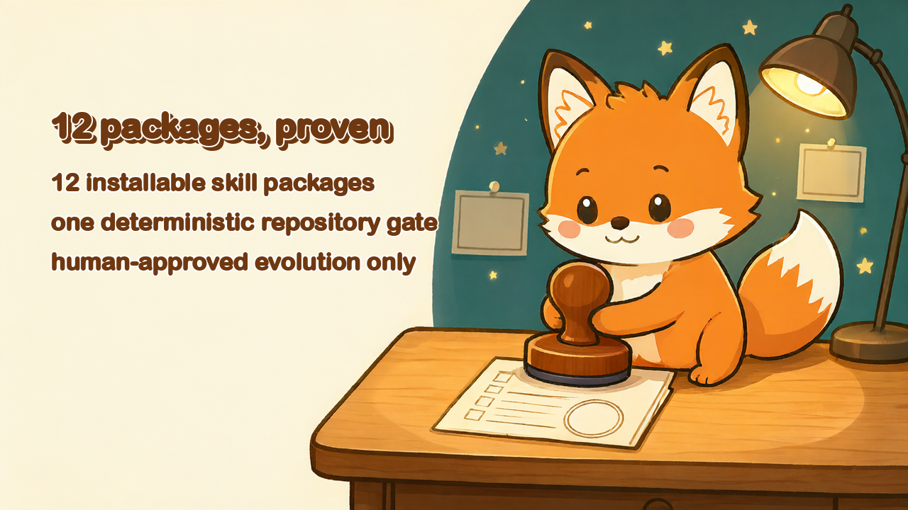
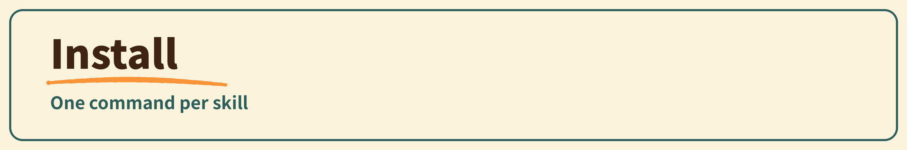
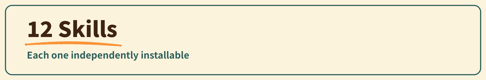
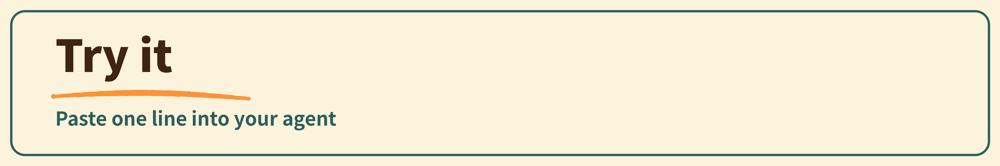
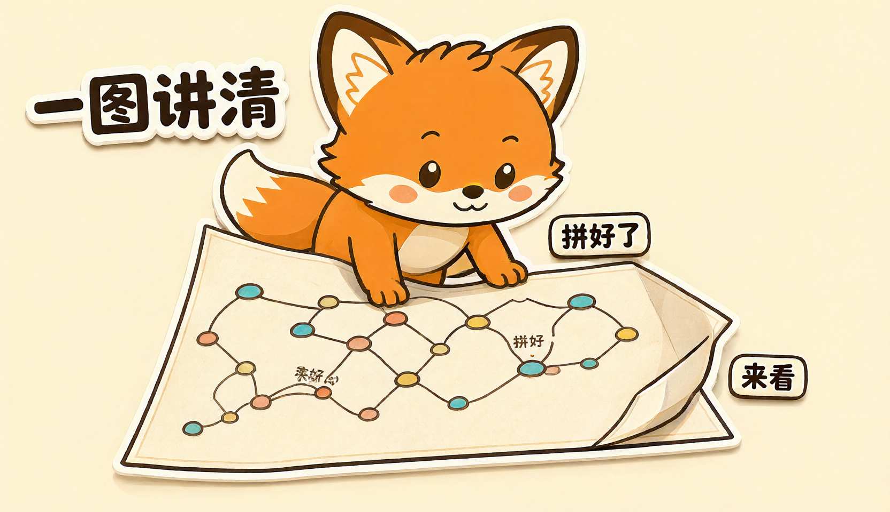
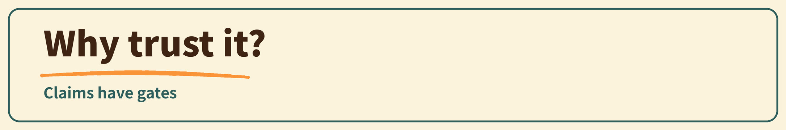
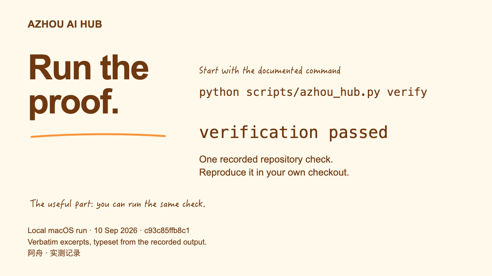
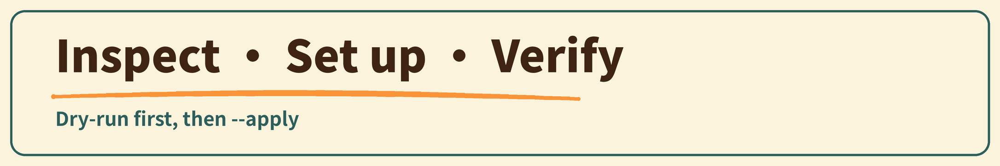
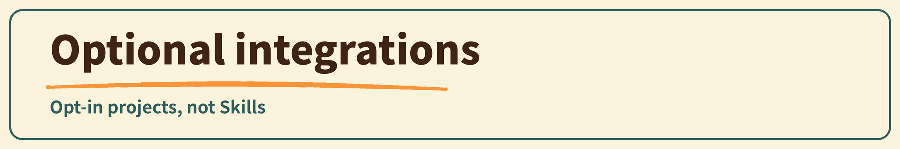

# 🦊 Azhou AI Hub

**Agent skills that stay useful after the demo.**

Small enough to edit. Strict enough to verify. Neutral enough to run across harnesses.

[简体中文](README.zh-CN.md) · [Install](docs/installation.md) · [Support matrix](docs/support-matrix.md) · [Contributing](CONTRIBUTING.md)

https://github.com/user-attachments/assets/35c1a361-d494-437f-ad6c-0049f6828fd3

<picture>
  <source media="(prefers-color-scheme: dark)" srcset="assets/github/readme-banner-install-dark.jpg">
  
</picture>

~~~bash
npx skills add TeFuirnever/azhou-ai-hub --skill super-repo-pedant
npx skills add TeFuirnever/azhou-ai-hub --skill super-excalidraw-diagram
npx skills add TeFuirnever/azhou-ai-hub --skill super-azhou-info
npx skills add TeFuirnever/azhou-ai-hub --skill super-azhou-doctor
npx skills add TeFuirnever/azhou-ai-hub --skill super-azhou-setup
npx skills add TeFuirnever/azhou-ai-hub --skill super-azhou-verify
npx skills add TeFuirnever/azhou-ai-hub --skill super-eli5
npx skills add TeFuirnever/azhou-ai-hub --skill super-ask-azhou
npx skills add TeFuirnever/azhou-ai-hub --skill super-arch-doc
npx skills add TeFuirnever/azhou-ai-hub --skill super-session-insights
npx skills add TeFuirnever/azhou-ai-hub --skill super-asd-ste100
npx skills add TeFuirnever/azhou-ai-hub --skill super-archify
~~~

Choose one installation method per skill. Package-manager installs resolve the mutable default branch, and the four `super-azhou-*` packages still require an explicit local checkout.

[Verify what you installed](docs/installation.md#verify-what-you-installed) · [Installation guide](docs/installation.md) · [Offline recovery](docs/installation.md#offline-recovery)

<picture>
  <source media="(prefers-color-scheme: dark)" srcset="assets/github/readme-banner-skills-dark.jpg">
  
</picture>

| Skill | Real job | Verification basis |
|---|---|---|
| [Azhou Info](skills/super-azhou-info/SKILL.md) | Report checkout, runtime, support and provable Git revision facts without manufacturing release state. | Delegates to stable `info` / `version` JSON contracts; read-only package and repository-policy checks. |
| [Azhou Doctor](skills/super-azhou-doctor/SKILL.md) | Diagnose repository, explicit install target, optional Treehouse lease and host stale-install migration health without mutation. | Read-only doctor contract, real Treehouse 2.3.0 smoke, fail-closed target checks and the read-only host migration probe. |
| [Azhou Setup](skills/super-azhou-setup/SKILL.md) | Plan and explicitly apply checkout-assisted install or receipt-owned lifecycle operations. | Dry-run-first setup, mutation lock, identity guards, rollback and receipt regressions. |
| [Azhou Verify](skills/super-azhou-verify/SKILL.md) | Run the public full-repository integrity gate. | Delegates to repository policy, unit, benchmark-integrity and whitespace gates. |
| [Super Repo Pedant](skills/super-repo-pedant/SKILL.md) | At explicit task close, reconcile docs, project rules, handoff state and project-bound memory against current code. | 28/28 <code>neat-freak</code> capabilities accounted for against upstream <code>neat-freak</code> release v1.2.0 / skill 3.1.1; 4 registered behavior cases (registry/integrity coverage); fixed execution protocol and inventory proof. |
| [Excalidraw Diagram](skills/super-excalidraw-diagram/SKILL.md) | Create or edit an editable scene, render the real artifact, inspect it, and deliver CJK-safe SVG/PNG when requested. | 5 frozen benchmark cases; deterministic style, scene, overlap and same-DOM gates. Checked-in reference output proves wiring only, not model quality. |
| [Eli5](skills/super-eli5/SKILL.md) | Explain a topic like the reader knows nothing about it: one self-contained HTML artifact of big pictures and few words. | Upstream behavior sentence retained verbatim at the locked upstream commit with a reproducible SHA-256 source check. No behavior benchmark yet. |
| [Ask Azhou](skills/super-ask-azhou/SKILL.md) | Router for the whole catalog: describe the intent, get the skill, its mode, and its boundary. Recommendation-only. | Router pattern adapted from a pinned upstream; routing-map parity is a repository-gate check with a negative control. No behavior benchmark yet. |
| [Arch Doc](skills/super-arch-doc/SKILL.md) | Draft, calibrate and review an architecture design document from upstream sources. | Distilled from the MCC ARCH-2026-001 v0.1-v0.17 pipeline; deterministic scaffold (`new_doc.py`), closing-gate checker (`verify_doc.py`) and a golden scaffold case in `benchmarks/super-arch-doc/`. |
| [Session Insights](skills/super-session-insights/SKILL.md) | Fact-bound usage insight reports from local agent session stores (Claude Code and Codex adapters; the zcode adapter fails closed); aggregates only, raw transcripts never leave the machine. | Wiring-integrity suite on synthetic stores with golden aggregates and privacy plus fail-closed negative controls. No behavior benchmark yet. |
| [ASD-STE100](skills/super-asd-ste100/SKILL.md) | Rewrite agent-facing English under ASD-STE100-derived controlled-English structural rules, preserving every hedge, fact and scope qualifier. | Faithfully imported at the locked upstream commit with pinned SHA-256 integrity tests; `scripts/ste-lint.py` is a deterministic stdlib gate covered by positive and negative tests. No behavior benchmark yet. |
| [Archify](skills/super-archify/SKILL.md) | Turn systems, plans, or codebases into interactive diagram maps — ten typed-JSON modes — delivered as self-contained explorable HTML. | Synchronized to official stable v3.2.0 (<code>208acba8</code>) with SHA-256 integrity over the selected subtree; browser checks and visual review are reported separately for the actual artifact. No model-quality improvement is claimed. |

<picture>
  <source media="(prefers-color-scheme: dark)" srcset="assets/github/readme-banner-try-dark.jpg">
  
</picture>

| Skill | Copy this into your agent | What must come back |
|---|---|---|
| Super Repo Pedant | <code>This phase is done. Run super-repo-pedant reconcile.</code> | Reconciled knowledge surfaces, named checks, explicit holds and a stable receipt. [Run the demo](docs/demos/super-repo-pedant.md). |
| Excalidraw Diagram | <code>Use super-excalidraw-diagram to draw a login sequence. Deliver editable source and PNG.</code> | Editable <code>.excalidraw</code>, a real render/export, deterministic gates, visual review status and a stable receipt. [Run the demo](docs/demos/super-excalidraw-diagram.md). |
| Arch Doc | <code>Use super-arch-doc to draft this repository's architecture document from its upstream design docs.</code> | Research notes with per-fact provenance, a template scaffold with accounted diagram captions, PlantUML-only diagrams, deterministic closing gates and a stable receipt. [Run the demo](docs/demos/super-arch-doc.md). |

## Super Repo Pedant

> 🧹 Code is the only live answer. Everything else must align.

## Excalidraw Diagram

> ✏️ Make the structure carry the argument; use text as evidence.

[Setup](skills/super-excalidraw-diagram/references/setup.md) · [Provenance](skills/super-excalidraw-diagram/references/provenance.md)

## Arch Doc

> 🏛️ Every fact cites its source; every diagram earns its caption.

## Eli5

> 🖼️ Big pictures, few words — or an honest refusal.

## Ask Azhou

> 🧭 Describe the intent, get the skill, its mode and its boundary.

## Session Insights

> 🔢 Aggregates leave the machine; raw transcripts never do.

## ASD-STE100

> 🎯 One meaning per word, one job per sentence — nothing for an agent to misread.

## Archify

> 🗺️ One map tells the whole system — hand it to the reader to explore.

🦊 Effect previews generated with the Azhou Scenes skill. Repo Pedant and Excalidraw Diagram: machine colour gate passed; final identity, hand and text review remains a human checkpoint. Arch Doc, Eli5, Ask Azhou, Session Insights, ASD-STE100 and Archify: human visual P0 approved; the formal colour gate still awaits the governed workspace audit.

<picture>
  <source media="(prefers-color-scheme: dark)" srcset="assets/github/readme-banner-trust-dark.jpg">
  
</picture>

- **Current behavior beats stale prose.** Code, machine configuration and real execution evidence define current truth; unimplemented specs stay visible as reminders.
- **Claims have gates.** The authoritative repository gate runs the complete deterministic test suite, a 4-case Super Repo Pedant suite, a 5-case Excalidraw benchmark integrity check, a Session Insights wiring-integrity suite on synthetic session stores, JSON/link/provenance/credential policy and whitespace checks.
- **Harness differences stay visible.** The maintained targets are Codex, Claude Code, MiMo Code (`mimo`), DeepSeek Harness (`dsh`) and zcode; other harnesses are temporarily unsupported. See the [support matrix](docs/support-matrix.md) and the [per-skill platform view](docs/skill-platform-view.md).
- **History cannot silently rewrite a live skill.** Promotion requires a regression, deterministic checks, paired majority, no safety regression and exact-diff human approval.
- **Sources remain attributable.** Upstream snapshots, vendored assets and excluded unlicensed prior art are recorded in [third-party notices](THIRD_PARTY_NOTICES.md).

<picture>
  <source media="(prefers-color-scheme: dark)" srcset="assets/github/readme-banner-checkout-dark.jpg">
  
</picture>

Each adapter delegates to the checkout's zero-dependency Foundation CLI:

| Agent Skill | CLI authority | Change boundary |
|---|---|---|
| `super-azhou-info` | `info`, `version` | Read-only project, runtime, Git revision and dirty-state facts. |
| `super-azhou-doctor` | `doctor` | Read-only repository, explicit install-target, optional Treehouse lease and host stale-install migration diagnostics. |
| `super-azhou-setup` | `setup`, `repair`, `migrate`, `uninstall` | Dry-run first; only an exact reviewed plan with `--apply` may mutate its explicit target. |
| `super-azhou-verify` | `verify` | Runs the reproducible public repository-integrity gate. |

~~~bash
python scripts/azhou_hub.py info --json
python scripts/azhou_hub.py version --json
python scripts/azhou_hub.py doctor --json
python scripts/azhou_hub.py setup --skill super-repo-pedant --target /absolute/path/to/harness/skills --json
python scripts/azhou_hub.py verify
~~~

[Foundation CLI contract](docs/foundations.md)

<picture>
  <source media="(prefers-color-scheme: dark)" srcset="assets/github/readme-banner-integrations-dark.jpg">
  
</picture>

Two complete projects live under `packages/`. These projects are not Skills, and installing a Hub Skill does not enable any integration.

| Entry | Complete project package | Current boundary |
|---|---|---|
| `pstack` | [pstack-agent-harness](packages/pstack-agent-harness/README.md) | `pstack-azhouzhou` 0.15.37 **candidate**: native Codex/Claude plugins, zcode commands-only plugin, and shared Skills discovery for MiMo and DeepSeek Harness. ZCode GUI invocation remains unverified; host invocation, hook trust, and release approval require separate evidence. |

| Entry | Complete project package | Current boundary |
|---|---|---|
| `agent-skin` | [Azhou AI Lab for Codex](packages/agent-skin/README.md) | Codex desktop identity with an assembled DeepSeek Harness plugin package; current source candidate `0.9.0/build 42`. Updates follow the [local install SOP](packages/agent-skin/docs/local-install-sop.md). No program redistribution grant is recorded. |

On a Codex cold start, the native launcher submits its own cover for drawing before opening Codex, reads the validated appearance snapshot, and plays the existing 12-second animation in its native window. It releases the cover after both playback and a supported Codex workspace are observed; hot starts still activate the existing process without replay. Build 42 is installed on the maintainer Mac. The standalone player, hot activation and cold-start event checks passed; cold-start visual continuity remains unverified. DSH uses a separate document gate. Build 42 is installed in the maintainer Mac’s shared DSH package and loaded in its desktop profile: the observed startup showed a host loading placeholder, the Azhou animation, then the workspace. Continuous first-frame capture remains pending. See the [startup contract](packages/agent-skin/docs/testing.md).

🦊 Foundation CLI, pstack and Agent Skin previews: generated illustrations, not from the Azhou Scenes pipeline and without a colour gate; maintainer visual approval recorded 2026-11-12.

~~~bash
python scripts/azhou_hub.py integrations list --json
python scripts/azhou_hub.py integrations pstack --help
python scripts/azhou_hub.py integrations agent-skin --help
~~~

The Hub root license does not cover either original package source; do not publish the combined source or binaries until redistribution permission is clarified.

[Integration runbook](docs/integrations.md) · [Provenance](docs/integration-provenance.md) · [Support matrix](docs/support-matrix.md#optional-integrations)

Read-only host inventory on 2026-11-11 found the `0.15.37` pstack plugin **listed as installed** by Codex and Claude Code. This is not source-byte attestation, a successful live pstack workflow, verified SessionStart trust, or release approval. See the [dated acceptance inventory](evidence/pstack-host-readonly-inventory-2026-11-11.md) and [mirror GAP audit](docs/research/2026-11-11-pstack-upstream-gap.md); the pristine upstream source and 23-patch queue are unchanged.

During Hub pstack removal, keep the target `CODEX_HOME` free of concurrent native plugin and marketplace changes; the plan states this requirement but cannot verify other processes.

### Retired surfaces

Three surfaces left this repository in one physically deleted cut across 2026-11-11 and 2026-11-12: the maintained scope converged to the surfaces the maintainer actually supports, while every change was still paying gates, docs and review surface for code that no longer shipped as intended support. Last supported versions and what installed users do now:

- **agent-skin's ZCode host layer** — last supported version `0.9.0/build 41`. The ZCode driver, page adapter, tests, docs and CI legs are deleted; the Codex and DSH hosts and the shared core keep their behavior. An installed ZCode skin keeps working as a frozen install but receives no further builds; to retire one, restore the original launcher retained by its install transaction, or remove the Azhou entry together with its receipts.
- **Agent Orchestration Kit (model router)** — never released (`version: unreleased`); its final state is the tree removed on 2026-11-12, together with the model-router Hub entry and the coexistence checks, leaving no detection stubs. An installation still on a machine is no longer managed from this repository: remove it with the Kit's own uninstaller from the retained pre-deletion bytes. If you once installed the model router, uninstall it before installing pstack — the pstack adapter refuses a `config.toml` that still mentions the retired router without a Hub ownership receipt.
- **Legacy `codex-startup-animation` package** — last version `0.7.1/build 8`, removed on 2026-11-12 after the maintainer-reviewed receipt-ownership handoff. The maintained Pet toolchain lives in [agent-skin](packages/agent-skin/README.md); an installed App or Pet keeps working, and the historical tooling is retrievable from the retained pre-deletion bytes.

All old releases and tags are retained in full. The retired packages entered the repository after the newest published release, so for them the pre-deletion Git revisions — locatable through the removal dates and provenance commits recorded in the [provenance rows](docs/integration-provenance.md) — are the concrete uninstall anchor. Persisted/protocol identifiers that installed-state migrations depend on stay frozen under their historical names; the trade-off is recorded in [HUB-RET-001](docs/decisions/hub-retirement-physical-deletion.md).

## One architecture

~~~text
docs/skill-standard.md ── governs ──> skills/<name>/       installable runtime
          │                              │
          ├── allocates ─────────────> .azhou/<name>/      private runtime state
          ├── governs ───────────────> tests/              deterministic proof
          └── governs ───────────────> benchmarks/<name>/  isolated behavior evidence

history signals ──> isolated candidate ──> paired review ──> human promotion
                         never writes the live skill directly
~~~

The [Azhou Skill Standard](docs/skill-standard.md) is the single project authority. [Architecture](docs/architecture.md) explains the boundaries; [governance](GOVERNANCE.md) explains decisions.

## Develop

Python 3.11+ is enough for the repository gate:

~~~bash
python scripts/verify.py
~~~

## Project

[Docs](docs/README.md) · [Principles](docs/principles.md) · [Roadmap](docs/roadmap.md) · [Changelog](CHANGELOG.md) · [Security policy](SECURITY.md) · [Support](SUPPORT.md) · [Contributing](CONTRIBUTING.md)

## License

Azhou-maintained code: [MIT](LICENSE). Third-party components retain their own notices and licenses: [THIRD_PARTY_NOTICES.md](THIRD_PARTY_NOTICES.md).
