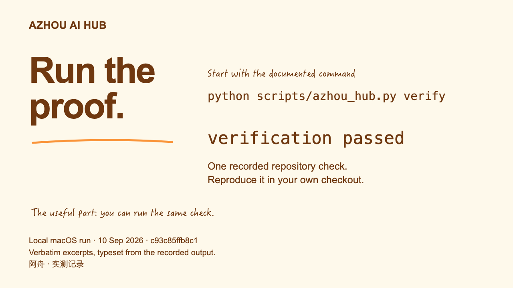

# 🦊 Azhou AI Hub · 阿舟 AI 能力站

**不止能演示，更要经得起真实任务。**

足够小，可以改；足够严，可以验；足够中立，可以跨 Agent harness 使用。

[English](README.md) · [安装](docs/installation.md) · [支持矩阵](docs/support-matrix.md) · [参与贡献](CONTRIBUTING.md)

https://github.com/user-attachments/assets/38a350d6-ddb3-40cf-a878-9ee5005ce993

> 🦊 主视觉按 `github_readme_image_16_9` profile 合同重设计生成（1280×720，无损 PNG）：阿舟狐狸（canonical 参考）在暖灯桌前盖验收章、深青星墙为背景，由本地 Azhou imagegen 流水线生成（Qwen-Image-2.1 edit，canonical 角色参考，final 档，1536×864 原生降采样至 1280×720，seed 7，批次 `hub-hero-12-redesign-001`，2026-11-09），十二包主张文字为确定性叠加（Arial Rounded Bold 贴纸配方）。120/240/360 px 缩略图已复核；维护者（IP 权利人）视觉批准记录于 2026-11-09。

很多 skill 仓库停在提示词。Azhou AI Hub 把每个 skill 当成产品：触发准确、运行包可移植、依赖可复现、检查可执行、评测不造假、来源可追踪、演化受人类控制。

这里不做接管一切的通用框架，不为每个模型复制一份 skill，也不把 benchmark 答案藏进运行包。

产品方向：[Myself first, community-ready](docs/principles.md)，以 human-facing Skills、尊重 harness 的 UI personalization、显式质量约束下的 Orchestrator Kit efficiency 互补。Planned 工作见 [roadmap](docs/roadmap.md)；原则不扩展支持声明或改变已有 license。

## 安装路径

每条命令安装一个包：

~~~bash
npx skills add TeFuirnever/azhou-ai-hub --skill super-repo-pedant
npx skills add TeFuirnever/azhou-ai-hub --skill super-excalidraw-diagram
npx skills add TeFuirnever/azhou-ai-hub --skill super-azhou-info
npx skills add TeFuirnever/azhou-ai-hub --skill super-azhou-doctor
npx skills add TeFuirnever/azhou-ai-hub --skill super-azhou-setup
npx skills add TeFuirnever/azhou-ai-hub --skill super-azhou-verify
npx skills add TeFuirnever/azhou-ai-hub --skill super-eli5
npx skills add TeFuirnever/azhou-ai-hub --skill super-ask-azhou
npx skills add TeFuirnever/azhou-ai-hub --skill super-arch-doc
npx skills add TeFuirnever/azhou-ai-hub --skill super-session-insights
npx skills add TeFuirnever/azhou-ai-hub --skill super-asd-ste100
npx skills add TeFuirnever/azhou-ai-hub --skill super-archify
~~~

包管理器安装解析的是可变默认分支；请按[安装指南](docs/installation.md#verify-what-you-installed)对照已发布 tag 校验安装内容，或改用带回据的 checkout 托管路径。

以上是文档化的包管理器路径；完成时间和 harness 发现能力取决于宿主，这里不承诺固定秒数。

只选一种安装方式。同一 canonical name 下，不要叠加包管理器安装、checkout 托管安装、手工复制和开发软链接。四个 `azhou-*` 包负责让 harness 发现对应的 `SKILL.md` 工作流；它们不内置 Foundation CLI，仍需要显式本地 checkout。完整安装路径和依赖见[安装指南](docs/installation.md)。

当主机必须在无网络环境下安装时，[离线恢复](docs/installation.md#offline-recovery)手册给出从本地副本恢复 uv、npm 与 Playwright 浏览器缓存的步骤。

## 检查、配置或验证当前 checkout

四个可移植阿舟 Agent Skills 提供 checkout 工作流入口，但不复制执行逻辑。通过当前 harness 原生的 Skill 入口调用它们，并在 Azhou AI Hub checkout 中运行，或显式提供 checkout 路径。每个适配器都委派给该 checkout 的零依赖 Foundation CLI：

| Agent Skill | CLI 权威命令 | 修改边界 |
|---|---|---|
| `super-azhou-info` | `info`、`version` | 只读报告项目、运行时、Git revision 和 dirty state。 |
| `super-azhou-doctor` | `doctor` | 只读诊断仓库、显式安装 target、可选 Treehouse lease 和宿主陈旧安装迁移。 |
| `super-azhou-setup` | `setup`、`repair`、`migrate`、`uninstall` | 先 dry-run；只有经过核对的精确计划带 `--apply` 才能修改显式 target。 |
| `super-azhou-verify` | `verify` | 运行可公开复现的仓库完整性 gate。 |

~~~bash
python scripts/azhou_hub.py info --json
python scripts/azhou_hub.py version --json
python scripts/azhou_hub.py doctor --json
python scripts/azhou_hub.py setup --skill super-repo-pedant --target /absolute/path/to/harness/skills --json
python scripts/azhou_hub.py verify
~~~

`setup`、`repair`、`migrate` 和 `uninstall` 在出现 `--apply` 前保持只读。Setup 可重复收敛，遇到不同安装会拒绝覆盖；当目标符号链接已解析到另一 checkout 的相同 canonical 包内容时，dry-run 会报告 `conflict-same-source` 并以退出码 `3` 结束而不是失败，`--apply` 仍会拒绝执行。Receipt-owned 生命周期命令要求再次提供同一显式 target，并独立校验 canonical source 与安装身份；不会强制覆盖 drift、跨 harness root 迁移、安装 hook、重写宿主配置、访问 registry 或自更新。各 harness 共用同一批包，但发现、调用、权限和可选集成仍由宿主负责；完整边界见[支持矩阵](docs/support-matrix.md)与[基础 CLI 合同](docs/foundations.md)。

变更计划和 review 可以使用实验性的[变更范围命令](docs/foundations.md#experimental-change-scope)，以显式 ref 区分 Git 各层；结果是有明确边界的一次观察，不是锁或语义依赖图。

Setup 的 dry-run 会输出确定性的 `planId`；审核后必须使用 `--apply --plan-id <reviewed-planId>`，源、目标、模式或执行前状态发生变化都会拒绝执行。

## 可选能力接入

三个完整项目位于 `packages/`，保留各自的原生目录、工具链与来源记录。`skills/` 下十二个 canonical Skills 继续使用原有的独立安装和调用合同。这些项目不是 Skill；安装 Hub 的 Skill 不会启用任何集成。

| 入口 | 完整项目包 | 当前边界 |
|---|---|---|
| `pstack` | [pstack-agent-harness](packages/pstack-agent-harness/README.md) | `pstack-azhouzhou` 0.15.37 **候选版**：Codex／Claude 原生插件、zcode 仅含 commands 的插件，以及 MiMo、DeepSeek Harness 的共享 Skills 发现能力；ZCode 图形界面调用尚未验收，宿主调用、hook 信任和发布批准仍需独立证据；拟议的 `resume.mjs` 检查点工具尚未交付。 |
| `model-router` | [Agent Orchestration Kit](packages/agent-orchestration-kit/README.md) | 可选地安装原生 Codex 配置；每个任务只保留一个工作流负责人。 |
| `agent-skin` | [阿舟 AI 实验室 for Codex](packages/agent-skin/README.md) | Codex 桌面身份，外加 ZCode 桌面入口与可组装的 DeepSeek Harness 插件包；当前源码版本为 `0.9.0/build 41`。应用本地化显示名为 `阿舟 AI 实验室 for Codex` / `Azhou AI Lab for Codex`，原生入口仍为 `~/Applications/阿舟 AI 实验室.app`；先验证新入口，再退役已核实归属的旧名入口。使用阿舟 bot 外观入口，中英界面跟随官方应用的语言与深浅色，不另设偏好。“主题与外观”统一展示身份、启动、背景和继承状态，由 `theme-config.json` 定义构建默认值；安装身份需重建安装后生效。build 23 将 Codex 显示名与固定安装文件名分离，Finder 本地化仍跟随 macOS 语言；维护提示跟随系统语言。build 24 在页面内控件可见且可命中之前隐藏 Appearance 备用入口；Home 导航未出现时，备用位置避开 composer，导航出现后回到 Your dot 下方。build 25 兼容 Your dot 按钮位于导航列表包装中的结构。C0 定义共享宿主合同和按操作能力门；build 39 携带钉住桌面 3.17.2.9661 指纹的 ZCode driver；build 38 通过含主区像素护栏的真实宿主生产 UI 验收，原生冷启动入口打开用户日常 profile（2026-11-07 维护者确认）；热附着激活同一实例且无重播（2026-11-08 维护者确认）。build 40 将普通双击启动的全部启动事件落到 `~/Library/Logs/AzhouZCodeStartup/events.jsonl`（Codex 宿主为 `AzhouCodexStartup`），静默失败可读出诊断点与原因。build 30 加入启动遮罩移除后的焦点恢复、避免预览状态与进度覆盖插画、将折叠外观入口限制在导航栏内，以及保持窄窗口壁纸焦点。build 32 通过稳定的导航标签识别带无障碍未读提示的 Your dot，Appearance 紧随其后并保留 6 像素上间距。ZCode 宿主已有 2026-11-06/07 build 35–38 真实验收回执与 ChatGPT-desktop 一致风格入口。DeepSeek Harness 形态以 `azhou-agent-skin` 插件包交付（`tools/build-dsh-plugin.py`），本地组装确定、校验器通过，已在一次性 profile 上用随应用打包的 CLI 验证官方安装路径（安装、清单、移除、重装与层栈组合），并在真实 DSH web 客户端与真实桌面 carrier 上完成机器级验证：控制器注册、动画自然收束、主题跟随宿主、默认壁纸应用并经用户验收（2026-11-07）、`Azhou appearance` 设置行出现在宿主设置弹窗且同一面板嵌入、阿舟侧栏胶囊为该设置行让路而移除（[组装回执](evidence/dsh-agent-skin-assembly-2026-11-05.md)、[安装回执](evidence/live-dsh-plugin-install-2026-11-05.md)、[宿主回执](evidence/live-dsh-plugin-host-2026-11-05.md)、[设置行回执](evidence/live-dsh-settings-section-2026-11-07.md)）。壁纸导入对话框与插件管理页展示仍开放；生产 desktop profile 经 profile workspace 符号链接实时运行（2026-11-06 起）。保留 12 秒动画及现有设置事务；Hub adapter 的状态检查保持只读。安装归属需单独核验；程序再分发尚未获授权。 |

更新本机 Codex、ZCode 和 DSH 的 Agent Skin 时，按 [本地安装 SOP](packages/agent-skin/docs/local-install-sop.md) 执行；分别记录安装文件、实际加载版本与实机验证，不代表已有统一安装器或发行渠道。

~~~bash
python scripts/azhou_hub.py integrations list --json
python scripts/azhou_hub.py integrations pstack --help
python scripts/azhou_hub.py integrations model-router --help
python scripts/azhou_hub.py integrations agent-skin --help
~~~

每次壁纸请求在等待宿主及图片解码时，都会保持图片、外观参数、已校验样式、取消检查和宿主适配器的关联；等待期间若适配器发生变化，请求会安全停止。Agent Skin 原生维护 helper 新增显式[壁纸重试](packages/agent-skin/README.md#wallpaper-recovery)：沿用已完成控制器最近请求的图片和强度，不重播动画。状态检查仍只读，并报告有限的失败原因码；不替换不受支持或其他所有者的控制器。

Agent Skin 会在清理旧入口前核验并隔离副本；如果清理部分文件后中断，剩余临时内容会保留，需人工处理。维护期间请避免其他进程同时改动安装目录。详见[安装说明](packages/agent-skin/README.md#安装升级与旧入口清理)。

Agent Skin 构建发布会保留无法核验的注册工具、DSH 输出和暂存目录，供核对。旧产物完全一致时可原样复用，但不据此认领来源；内容不同且没有匹配回执时会阻止替换。安装回执发布也会保留无法核验的临时文件待核对。请避免并发更改 `.build` 和安装记录；核验不能排除最后一次检查与文件操作之间的替换。详见[构建恢复说明](packages/agent-skin/docs/installation-lifecycle.md)和 [DSH 构建约定](packages/agent-skin/docs/dsh-plugin.md)。

当前源码增加设置键盘隔离、跟随主题的背景预览、可操作的图片错误提示，以及启动壁纸失败时的页面内重试。能从有限文件头解析尺寸的图片会在解码前检查；最终解码和尺寸校验仍然保留。真实宿主、无障碍和用户验收与自动检查分别记录。

`python scripts/azhou_hub.py integrations ...` 仍是稳定的操作入口。命令默认使用仓库内对应项目；可选 `--source` 只能断言其规范包路径。计划会为当前 `runtime_paths` 输入计算指纹，并把私有快照和恢复回据存入被忽略的 `.azhou/hub/`。详见[接入操作说明](docs/integrations.md)、[来源说明](docs/integration-provenance.md)和[支持矩阵](docs/support-matrix.md#optional-integrations)。两个编排包同时交付任务归属合同——普通任务沿用 Kit 命名角色，用户明确选定的 pstack 工作流负责该任务，并以显式模型与 effort 派发且不选命名角色——并在隔离 Codex 环境留有有界派发回据（[证据](evidence/pstack-orchestrator-dispatch-2026-10-26.md)）。两个包也可共享同一受控 Codex 环境：Hub 与 Kit 两个入口共用同一兼容判定（原生注册加上模型表 `session hook: off` 行共同决定），其安装生命周期既经确定性测试验证，也在已记录的 Codex 客户端上原生验证过——一次性环境中的两种安装顺序、重复安装、armed 目标转换与两种移除顺序（[原生验收](evidence/pstack-orchestrator-native-acceptance-2026-10-26.md)）；五个任务边界行为——普通任务默认路径、同任务追问保持负责人、pstack 任务完成后恢复默认规则、中途切换先处理在途子代理、显式模型被拒时明确阻塞并报告原因——已在一次性受控环境中真机观测（[live 会话记录](evidence/pstack-orchestrator-live-sessions-2026-10-27.md)）。每个入口也都具备属主明确的退出方式——Hub `uninstall-plan`/`uninstall` 与 Kit `--uninstall`——只恢复各自记录的受管范围，保留另一模块与用户后续修改，并以差异报告代替强制覆盖。既有安装——Kit 加共享 pstack Skills、原生插件或本地改过的共享 Skills——先经只读 `transition-plan` 入口审阅：逐状态标明实际来源、内容差异、owner 与恢复依据；仅当原生注册表能把当前注册解析回 Hub 回据的快照时才给出可应用的转换；绝不凭同名或字节相同接管未知安装；该入口本身不授权对主环境应用任何变更。

`pstack-azhouzhou` 0.15.37 当前为**候选版本**，统一从 Hub 维护的本地项目包交付；维护目标为 Codex、Claude Code、MiMo Code（`mimo`）、zcode 和 DeepSeek Harness（`dsh`）。Codex／Claude Code 使用原生插件，zcode 使用仅含 commands 的插件与共享 Skills；MiMo 和 DeepSeek 目前仅有共享 Skills 的发现证据，不声称存在原生 pstack 插件或完成模型调用验收。[安装说明](packages/pstack-agent-harness/README.md#install)使用本地包来源；上游链接保留作署名和源码更新依据。Codex 的 `--codex-home` 决定插件装入哪份配置；自定义目录需要通过对应的 `CODEX_HOME` 启动 Codex，不会自动在默认桌面配置中启用插件。

通过 Hub 移除 pstack 期间，请确保目标 `CODEX_HOME` 没有其他原生插件或 marketplace 变更；计划会提示此要求，但无法验证其他进程。

原始 startup-animation 来源目前没有已记录的开源授权。单独署名的 Dream 图片解析器采用 MIT 许可，但这一授权不覆盖 Agent Skin 的其他部分。Hub 根目录许可证不覆盖两个原始包源；组合包的再分发授权明确前，不要公开发布其源代码或二进制文件。个人素材留在 Git 之外。2026-10-25 验收报告和 [2026-10-26 本地交接](evidence/optional-integrations-local-handoff-2026-10-26.md)只描述当时检查的输入与宿主，不代表当前安装归属；维护或迁移前须分别核查已安装 App 和 Pet 的回执。合成适配器测试及过去的宿主观察不能证明后续构建已完成完整冷启动、无障碍、视觉或用户验收。

2026-10-26 的 Pet 回执指向保留的 `codex-startup-animation` 源目录；将源码复制到 Agent Skin 不会转移 Pet 属主。维护前核查当前 Pet 回执，并在必要的接管经过审阅前保留旧源目录。详见[Pet 维护边界](docs/integrations.md#pet-maintenance-after-the-import)。安装字节核验不能证明宿主已选择或播放。

Pet 准备完成前会复验冻结输入、当前主题和生成说明；冲突内容保留待核对。Pet 发布依赖 macOS 或 Linux 支持的排他重命名，不支持时会停止；Linux 路径尚未实测。Pet 选择记录必须与目录名、已验证主题和图集一致，冲突时停止并保留待核对。已安装 Pet 若图集和主题相同但 manifest 不同，也会保留待核对。Pet 恢复需要事务绑定的图集、主题和 manifest 证据；缺少绑定的旧候选、空暂存、旧日志及无法核验的临时回执会保留待核对。详见 [Pet 恢复约定](packages/agent-skin/docs/codex-pet.md#锁事务与恢复范围)。

## Skills

| Skill | 解决的真实任务 | 验证依据 |
|---|---|---|
| [Azhou Info](skills/super-azhou-info/SKILL.md) | 报告 checkout、运行时、支持范围和可证明的 Git revision，不虚构发布状态。 | 委派给稳定的 `info` / `version` JSON 合同；只读包检查与仓库策略检查。 |
| [Azhou Doctor](skills/super-azhou-doctor/SKILL.md) | 只读诊断仓库、显式安装 target、可选 Treehouse lease 和宿主陈旧安装迁移健康。 | 只读 doctor 合同、真实 Treehouse 2.3.0 smoke、fail-closed target 检查和只读宿主迁移探测。 |
| [Azhou Setup](skills/super-azhou-setup/SKILL.md) | 先规划再显式执行 checkout-assisted 安装或 receipt-owned 生命周期操作。 | dry-run-first setup、mutation lock、身份防护、rollback 与 receipt 回归。 |
| [Azhou Verify](skills/super-azhou-verify/SKILL.md) | 执行公开全仓完整性 gate。 | 委派给仓库策略、单元测试、benchmark integrity 和空白检查。 |
| [Super Repo Pedant](skills/super-repo-pedant/SKILL.md) | 明确任务结束时，用当前代码校正文档、项目规则、交接状态和已绑定项目 memory。 | 28/28 项 <code>neat-freak</code> 能力有机器映射（基线为仓库稳定 release v1.2.0／skill 3.1.1 <code>cfa3436d</code>，选定快照哈希锁定；2026-11-10 同步，原引入 <code>bab17831</code> 与前基线 <code>322346de</code> 均保留为 lineage）；4 个注册行为 case（注册与完整性覆盖）；固定执行协议与 memory inventory 证明。 |
| [Excalidraw Diagram](skills/super-excalidraw-diagram/SKILL.md) | 生成或编辑可继续修改的图，渲染真实产物、查看成图，并按需交付 CJK-safe SVG/PNG。 | 5 个冻结 benchmark case；风格、场景、重叠和 same-DOM 确定性 gate。沙箱拦截预览时降级为几何与哈希校验，并以显式 hold 报告，不做静默跳过。仓库 reference 只证明接线，不冒充模型效果。 |
| [Eli5](skills/super-eli5/SKILL.md) | 像讲给完全零基础的人一样解释主题：交付一份自带全部内容、大图少字的独立 HTML，遇到精度关键的请求会显式拒绝，不把精读内容降级成图片。 | 上游行为句在锁定上游 commit 上逐字保留，并有可复现的 SHA-256 源校验；本地层增加主题边界、带固定受众声明与词量预算的自包含产物合同、品牌协议和稳定收据，收据判定层带确定性的受众与风格读回断言，并有正负例测试覆盖。尚无行为 benchmark。最小行为 eval-case 路径见 `docs/eval-case-contract.md`。 |
| [Ask Azhou](skills/super-ask-azhou/SKILL.md) | 全目录路由：说清意图，得到技能、模式与边界。只推荐不代调用；路由覆盖由仓库门禁强制。 | 路由模式改编自锁定上游；路由图奇偶校验是带负控的仓库门禁检查。尚无行为 benchmark。最小行为 eval-case 路径见 `docs/eval-case-contract.md`。 |
| [Arch Doc](skills/super-arch-doc/SKILL.md) | 从上游真源文档端到端产出、校准与评审架构设计文档：带出处的研究笔记、受控证据词表的基线骨架、PlantUML 唯一图纪律（四联注与时序图规范）、回源交叉校准和两条最佳实践评审线。 | 沉淀自 MCC ARCH-2026-001 v0.1–v0.17 流水线（团队上游研读、可读性审计、最佳实践评审与 architect 批准的 20 项改进）；五张已验证时序图与两份评审指南作为 references 随包交付；附确定性脚手架（`new_doc.py`）、收尾门检查器（`verify_doc.py`）与 `benchmarks/super-arch-doc/` 黄金用例。 |
| [Session Insights](skills/super-session-insights/SKILL.md) | 从本机 agent 会话存储产出事实绑定的使用洞察报告（Claude Code 与 Codex 适配器；zcode 适配器 fail closed——探测确认其存储无明文转写）；只做聚合，原始转写永不出本机。 | 合成存储上的接线完整性套件：golden 聚合、窗口/上限裁剪、收据摘要稳定性、隐私与 fail-closed 负控。不含摘录的聚合运行复用可丢弃的逐文件元数据缓存，冷、热、删除、损坏四种缓存状态产出字节一致的结果；roast 语气、离线 HTML 产物与 Codex rollout 适配器均在 golden parity 与 fail-closed 负控之下交付，zcode hold 即使面对更丰富但未核实的存储形状也保持不动。尚无行为 benchmark。最小行为 eval-case 路径见 `docs/eval-case-contract.md`。 |
| [ASD-STE100](skills/super-asd-ste100/SKILL.md) | 按源自 ASD-STE100 的受控英语结构规则，以 Strict 或 STE-flavored 模式改写面向 agent 的英文——工具描述、错误消息、inter-agent 指令、状态报告；保留每个 hedge、事实和范围限定语，不可再分发的 ASD 词典按设计排除。 | 在锁定的上游 commit 上 faithful 导入，vendored 文件钉有 SHA-256 完整性测试；`scripts/ste-lint.py` 把可机械核验的结构规则变成确定性标准库门禁（硬违规退出码、`--baseline`、`--json`、`--selftest`），配正负测试。尚无行为 benchmark。最小行为 eval-case 路径见 `docs/eval-case-contract.md`。 |
| [Archify](skills/super-archify/SKILL.md) | 把系统、计划或代码库变成成品级交互图示地图——从 architecture、workflow 到 ERD、tree、timeline、waterfall 共十种 typed-JSON 模式，交付为自包含可探索 HTML（主题、pan/zoom、引导视图、诚实导出）；可编辑 .excalidraw 源场景仍归 super-excalidraw-diagram。 | 同步到正式稳定版 v3.2.0（<code>208acba8</code>），选定子树有 SHA-256 完整性校验；保留十种图模式，并纳入 explainer 各自的验证门禁。浏览器与视觉验收按实际产物分别报告，未跑浏览器的 explainer 不标为浏览器已验证。阿舟品牌与收据保留；本地文本/CSS/CDP 边界、引用 revision 一致性及剪贴板回退修复单列于来源记录；不宣称模型质量提升。最小行为 eval-case 路径见 `docs/eval-case-contract.md`。 |

十二个包都能作为独立 package surface 安装和发现。目录按[技能标准](docs/skill-standard.md) §2.2 的调用类轴组合：[Ask Azhou](skills/super-ask-azhou/SKILL.md) 是 user-invoked 前门，每个包都在各自 `SKILL.md` frontmatter 声明调用类（user-invoked orchestrator 或双类面）——orchestrator 可以指向 discipline，任何东西不得链入另一个 orchestrator，但这不代表四个 Foundation 适配器是独立控制面：它们仍需要显式本地 checkout，并编排该 checkout 的仓库级 CLI，而不是在 prompt 中复制生命周期逻辑。运行时材料在 <code>skills/</code>；prompt、assertion、fixture 和 judge record 在仓库级 <code>benchmarks/</code>。

Canonical 名字统一使用 `super-` 品牌前缀。与上游材料的 fidelity 写在各包 provenance，不再决定目录名。仓库门禁强制品牌前缀，并对已改名旧名字在文档兼容面之外的残留直接 fail。

## 试用三个任务型 Skill

| Skill | 复制给 Agent | 必须返回什么 |
|---|---|---|
| Super Repo Pedant | <code>这个阶段做完了，跑一次 super-repo-pedant reconcile。</code> | 已对齐的知识面、具名检查、明确 hold 和稳定收据。[运行 demo](docs/demos/super-repo-pedant.md)。 |
| Excalidraw Diagram | <code>用 super-excalidraw-diagram 画登录时序图，交付可编辑源图和 PNG。</code> | 可编辑 <code>.excalidraw</code>、真实渲染/导出、确定性 gate、视觉复核状态和稳定收据。[运行 demo](docs/demos/super-excalidraw-diagram.md)。 |
| Arch Doc | <code>用 super-arch-doc 从这个仓库的上游设计文档产出架构说明书。</code> | 带出处的研究笔记、图注入账的模板骨架、仅 PlantUML 的图纪律、确定性收尾门禁和稳定收据。[运行 demo](docs/demos/super-arch-doc.md)。 |

Demo 严格区分产品行为与 benchmark 主张：合成 fixture 只证明合同和 verifier 接线，只有冻结的 attempt-1 运行才算模型证据。

## 为什么可信

- **现役行为优先。** 代码、机器配置和真实运行证据定义 current truth；未实现 spec 保留为 reminder。
- **主张必须有 gate。** 仓库权威 gate 执行完整确定性测试套件、4-case Super Repo Pedant 套件、5-case Excalidraw benchmark 完整性检查、Session Insights 合成会话存储接线完整性套件、JSON/链接/来源/凭据策略和空白检查。
- **不伪装各宿主能力完全等价。** 当前维护的目标是 Codex、Claude Code、MiMo Code（命令 `mimo`）和 zcode；其他 harness 暂不支持。发现、调用、hook 与历史适配能力在[支持矩阵](docs/support-matrix.md)中分别列明。MiMo Code 有[本机 Skill 发现记录](evidence/mimocode-skill-discovery-2026-10-26.md)，模型调用及宿主适配尚未验证。
- **逐 skill 平台汇总。** [docs/skill-platform-view.md](docs/skill-platform-view.md) 从支持矩阵派生出每个 skill 在各 harness 与操作系统上的汇总表；支持矩阵仍是唯一权威。
- **历史不能静默改 live skill。** promotion 必须先有回归，再通过确定性检查、paired 多数、无安全回归和 exact-diff 人类批准。[范围与归因规则](docs/skill-standard.md#11-scope-and-attribution)将 pstack 排除在 Hub Skill 升级/演化之外，并将 hold 限于有证据关联的受影响动作；[评测规则](docs/skill-standard.md#41-evaluation-integrity)区分完整性修复与任务质量收益。
- **来源边界公开。** 上游快照、vendored 资产和未授权 prior art 的排除记录见[第三方声明](THIRD_PARTY_NOTICES.md)。

## Super Repo Pedant

> 🧹 代码是唯一现役答案，其他都要对齐。

任务确实结束时显式调用：

~~~text
这个阶段做完了，跑一次 super-repo-pedant reconcile。
~~~

只推测 milestone 时，skill 只提醒一次，不静默写仓库。明确 reconcile/handoff 默认覆盖三层项目知识：用户文档、<code>AGENTS.md</code>/<code>CLAUDE.md</code>、已证明属于当前项目的 memory。全局指令、归属不明 memory、整文件删除、发布和部署继续保留 checkpoint。

可选的演化命令在追加信号和归档时必须取得平台文件锁。若归档在多份状态文件更新之间中断，新信号写入会暂停，直到重试核对待完成归档并补完候选收据；证据冲突时会拒绝继续。

晋级现在将候选与补丁的实际字节绑定到精确基线及结果源码树：用 `bind` 准备绑定，`gate` 对照外部批准锚点检查干净基线，`verify-applied` 检查实际提交结果。只有声明摘要的旧调用无法通过源码门禁。这些只读命令不应用变更，也不认证批准者身份；详见[演化合同](skills/super-repo-pedant/references/evolution-contract.md)。

[兼容合同](skills/super-repo-pedant/references/neat-freak-compatibility.md) · [执行协议](skills/super-repo-pedant/references/execution-protocol.md)

> 🦊 效果图由 Azhou Scenes skill 生成。机器颜色门禁已通过；身份、手部和文字仍保留人工复核 checkpoint。

## Excalidraw Diagram

> ✏️ 先让结构讲清关系，再让文字补充证据。

JSON 可解析不等于完成。这个 skill 要求交付可编辑源图，用官方引擎渲染，实际查看图片，从源场景修复，再重跑 gate。离线字体、官方引擎、转换器和 231 个 MIT 许可的组件库随运行包提供。

> ✏️ 效果图由 Azhou Scenes skill 生成。机器颜色门禁已通过；身份、手部和文字仍保留人工复核 checkpoint。

[运行包](skills/super-excalidraw-diagram/SKILL.md) · [依赖安装](skills/super-excalidraw-diagram/references/setup.md) · [来源说明](skills/super-excalidraw-diagram/references/provenance.md)

## Arch Doc

> 🏛️ 每个事实都标出处，每张图都配得上注。

Arch Doc 从上游真源文档端到端产出、校准与评审架构设计文档：带出处的研究笔记、受控证据词表的基线骨架、PlantUML 唯一图纪律、回源交叉校准和两条最佳实践评审线。

> 🦊 效果图由 Azhou Scenes skill 生成，人工视觉 P0 已通过；正式色彩门禁仍待在整理区补跑。

[运行包](skills/super-arch-doc/SKILL.md) · [运行 demo](docs/demos/super-arch-doc.md)

## Eli5

> 🖼️ 大图、少字——讲不清楚就老实说不能画。

Eli5 把主题讲到读者零门槛：一份自包含 HTML，只有大图和极少文字；对精度关键的请求宁可拒绝，也不降级成画。

> 🦊 效果图由 Azhou Scenes skill 生成，人工视觉 P0 已通过；正式色彩门禁仍待在整理区补跑。

[运行包](skills/super-eli5/SKILL.md)

## Ask Azhou

> 🧭 说意图，拿 skill、模式和边界。

Ask Azhou 是目录的用户入口：描述意图，得到一个 skill 推荐及其模式和边界。只做推荐，不代执行；全 canonical skill 覆盖由仓库门禁强制。

> 🦊 效果图由 Azhou Scenes skill 生成，人工视觉 P0 已通过；正式色彩门禁仍待在整理区补跑。

[运行包](skills/super-ask-azhou/SKILL.md)

## Session Insights

> 🔢 汇总出得了机器，原始 transcript 出不了。

Session Insights 把本地 Agent 会话存储变成事实约束的使用洞察报告：只出聚合，数字可复验；存储没有明文 transcript 时适配器 fail-closed。

> 🦊 效果图由 Azhou Scenes skill 生成，人工视觉 P0 已通过；正式色彩门禁仍待在整理区补跑。

[运行包](skills/super-session-insights/SKILL.md)

## ASD-STE100

> 🎯 一词一义，一句一事，agent 无从误读。

ASD-STE100 用源自 ASD-STE100 的受控英语结构规则改写面向 agent 的英文——工具描述、错误消息、inter-agent 指令、状态报告：主动语态、一句一事、句长与名词堆叠封顶、同义词不轮换。Strict 模式管机器要解析的文本；STE-flavored 模式保留结构纪律、对叙述文放宽词汇规则。标准库 linter `ste-lint.py` 把可机械核验的结构规则变成确定性门禁；每次改写都保留原有的 hedge、事实和范围限定语，不升格、不加料。不可再分发的 ASD 词典按设计排除在外。

> 🦊 效果图由 Azhou Scenes skill 生成，人工视觉 P0 已通过；正式色彩门禁仍待在整理区补跑。

[运行包](skills/super-asd-ste100/SKILL.md)

## Archify

> 🗺️ 一张图讲清一个系统，交给读者去探索。

Archify 把系统、计划或代码库变成交互图示地图与解释页面。稳定版 v3.2.0 保留十种 typed-JSON 图模式并加入 explainer；两类产物遵守各自的验证与交付门禁，浏览器与视觉验收按实际运行记录。可编辑的 .excalidraw 源场景仍归 super-excalidraw-diagram。

> 🦊 效果图由 Azhou Scenes skill 生成，人工视觉 P0 已通过；正式色彩门禁仍待在整理区补跑。

[运行包](skills/super-archify/SKILL.md)

## 一套架构

~~~text
docs/skill-standard.md ── 约束 ──> skills/<name>/       可安装运行包
          │                              │
          ├── 分配 ──────────────────> .azhou/<name>/      私有运行状态
          ├── 约束 ──────────────────> tests/              确定性证明
          └── 约束 ──────────────────> benchmarks/<name>/  隔离行为证据

历史信号 ──> 隔离 candidate ──> paired review ──> 人类 promotion
                    永远不直接写 live skill
~~~

[Azhou Skill Standard](docs/skill-standard.md) 是项目唯一准则。[架构说明](docs/architecture.md)解释边界，[治理规则](GOVERNANCE.md)解释决策方式。

可安装包继续放在 `skills/`。项目内 Azhou 运行状态统一使用 `.azhou/<skill-name>/`；`.azhou/hub/` 专门保存 checkout-managed 生命周期 receipt。宿主配置、宿主缓存和用户选择的交付物都留在这个命名空间之外。

## 开发

仓库在 [`.agents/skills/`](.agents/skills/) 中提供项目本地工程工作流。这些工作流只用于当前 checkout，保留上游来源记录，与 `skills/` 下可独立安装的包分开维护。各宿主的发现与调用能力可能不同；具体依赖见各工作流。GIF 编码器的媒体测试需要支持 `libvpx` 的 `ffmpeg` 和 `ffprobe`；工具不可用时测试会跳过。

仓库级验证只需要 Python 3.11+：

~~~bash
python scripts/verify.py
~~~

同一条命令不依赖私有输入，检查仓库策略、全部单元测试、三套公开 benchmark 完整性和 Git 空白。门禁会把每个检查跑完，并始终以单一聚合终判行收尾，因此管道或 tail 消费不会在运行实际失败时读到通过措辞；`python scripts/verify.py --print-summary` 会在终判行前输出机器可读的 JSON 汇总（`azhou-hub.verify-summary.v1`）。它在 CI 的 Ubuntu 与 windows-latest runner 上强制执行，并在维护者的 macOS checkout 上验证，因此 [docs/support-matrix.md](docs/support-matrix.md) 中的 OS 支持主张始终有据可查。Windows 上的完整托管流程（info → setup → doctor → 仓库门禁）已在真实 runner、默认 Git Bash 控制台编码下取得全绿回据（[evidence/windows-full-flow-receipt-2026-10-17.md](evidence/windows-full-flow-receipt-2026-10-17.md)）。Excalidraw 真渲染需要额外锁定的 Python/Node 依赖，按自己的 setup 文档安装。

## 项目入口

Agent Skin 另有包级门禁：在 macOS 执行 `python packages/agent-skin/tools/test-unit-coverage.py`，要求每种生产语言及完整包的 UT 行覆盖率至少 95%。该 Required CI 作业与浏览器功能回归、已安装应用验收分别判定。完整统计范围、依赖及 Finder/Dock、冷启动、壁纸、安装升级用例见 [Agent Skin 测试与验收](packages/agent-skin/docs/testing.md)。

- [路线图](docs/roadmap.md)
- [变更记录](CHANGELOG.md)
- [安全政策](SECURITY.md)
- [支持方式](SUPPORT.md)
- [基础 CLI](docs/foundations.md)
- [Treehouse worktree 规范](docs/worktree-policy.md)
- [本次开源化对标研究](docs/research/2026-08-23-open-source-benchmark.md)
- [2026-11-10 稳定来源升级与候选审查](docs/research/2026-11-10-skill-upgrade.md)：来源 pin、配对运行证据、pstack 保护与已获 exact-diff 批准的 C2 实现记录。

贡献应从真实失败或真实任务开始，以可复现证据结束。先读 [CONTRIBUTING.md](CONTRIBUTING.md)。

## 许可证

阿舟自研代码使用 [MIT](LICENSE)。第三方组件保留自己的版权与许可证：[THIRD_PARTY_NOTICES.md](THIRD_PARTY_NOTICES.md)。
