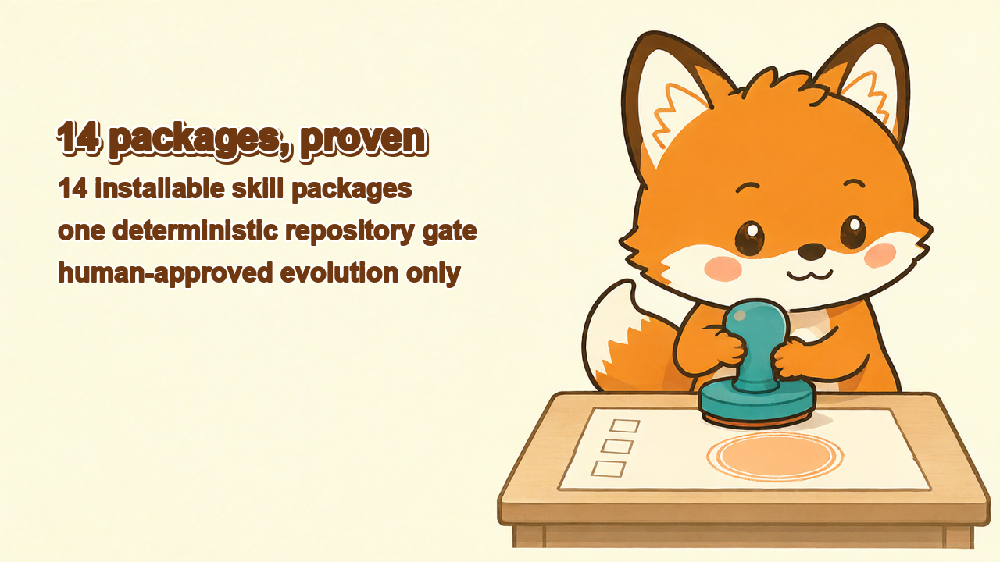
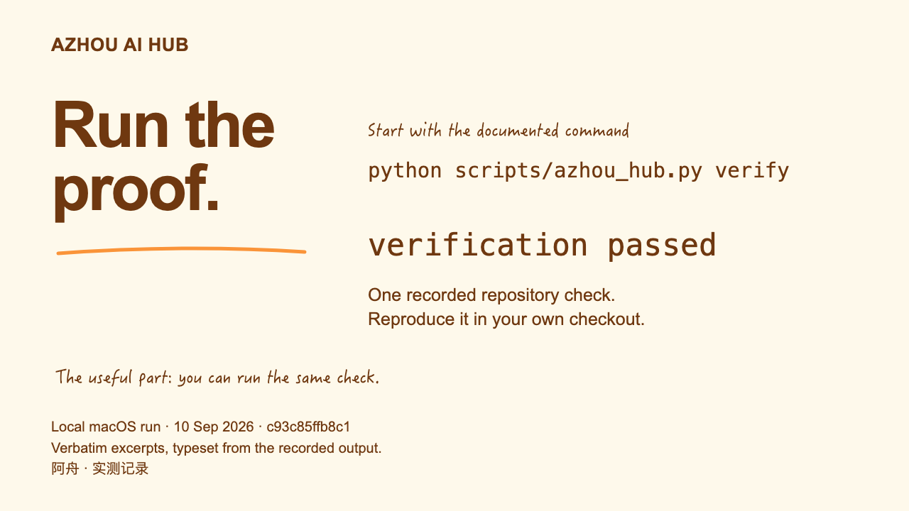

# 🦊 Azhou AI Hub · 阿舟 AI 能力站

**不止能演示，更要经得起真实任务。**

足够小，可以改；足够严，可以验；足够中立，可以跨 Agent harness 使用。

[English](README.md) · [安装](docs/installation.md) · [支持矩阵](docs/support-matrix.md) · [参与贡献](CONTRIBUTING.md)

https://github.com/user-attachments/assets/38a350d6-ddb3-40cf-a878-9ee5005ce993

> 🦊 主视觉按 `github_readme_image_16_9` profile 合同生成（1280×720，无损 PNG）：阿舟狐狸（canonical 参考）盖章批准的画面由本地 Azhou imagegen 流水线生成（Qwen-Image-2.1 edit，2026-10-25 批次 seed 7），三条主张文字为确定性叠加。120/240/360 px 缩略图已复核；维护者（IP 权利人）视觉批准记录于 2026-10-25。

很多 skill 仓库停在提示词。Azhou AI Hub 把每个 skill 当成产品：触发准确、运行包可移植、依赖可复现、检查可执行、评测不造假、来源可追踪、演化受人类控制。

这里不做接管一切的通用框架，不为每个模型复制一份 skill，也不把 benchmark 答案藏进运行包。

## 安装路径

每条命令安装一个包：

~~~bash
npx skills add TeFuirnever/azhou-ai-hub --skill super-repo-pedant
npx skills add TeFuirnever/azhou-ai-hub --skill super-excalidraw-diagram
npx skills add TeFuirnever/azhou-ai-hub --skill super-azhou-info
npx skills add TeFuirnever/azhou-ai-hub --skill super-azhou-doctor
npx skills add TeFuirnever/azhou-ai-hub --skill super-azhou-setup
npx skills add TeFuirnever/azhou-ai-hub --skill super-azhou-verify
npx skills add TeFuirnever/azhou-ai-hub --skill super-llm-wiki
npx skills add TeFuirnever/azhou-ai-hub --skill super-lavish
npx skills add TeFuirnever/azhou-ai-hub --skill super-eli5
npx skills add TeFuirnever/azhou-ai-hub --skill super-ask-azhou
npx skills add TeFuirnever/azhou-ai-hub --skill super-arch-doc
npx skills add TeFuirnever/azhou-ai-hub --skill super-session-insights
npx skills add TeFuirnever/azhou-ai-hub --skill super-asd-ste100
npx skills add TeFuirnever/azhou-ai-hub --skill super-archify
~~~

包管理器安装解析的是可变默认分支；请按[安装指南](docs/installation.md#verify-what-you-installed)对照已发布 tag 校验安装内容，或改用带回据的 checkout 托管路径。

以上是文档化的包管理器路径；完成时间和 harness 发现能力取决于宿主，这里不承诺固定秒数。

只选一种安装方式。同一 canonical name 下，不要叠加包管理器安装、checkout 托管安装、手工复制和开发软链接。四个 `azhou-*` 包负责让 harness 发现对应的 `SKILL.md` 工作流；它们不内置 Foundation CLI，仍需要显式本地 checkout。完整安装路径和依赖见[安装指南](docs/installation.md)。

当主机必须在无网络环境下安装时，[离线恢复](docs/installation.md#offline-recovery)手册给出从本地副本恢复 uv、npm 与 Playwright 浏览器缓存的步骤。

## 检查、配置或验证当前 checkout

四个可移植阿舟 Agent Skills 提供 checkout 工作流入口，但不复制执行逻辑。通过当前 harness 原生的 Skill 入口调用它们，并在 Azhou AI Hub checkout 中运行，或显式提供 checkout 路径。每个适配器都委派给该 checkout 的零依赖 Foundation CLI：

| Agent Skill | CLI 权威命令 | 修改边界 |
|---|---|---|
| `super-azhou-info` | `info`、`version` | 只读报告项目、运行时、Git revision 和 dirty state。 |
| `super-azhou-doctor` | `doctor` | 只读诊断仓库、显式安装 target、可选 Treehouse lease 和宿主陈旧安装迁移。 |
| `super-azhou-setup` | `setup`、`repair`、`migrate`、`uninstall` | 先 dry-run；只有经过核对的精确计划带 `--apply` 才能修改显式 target。 |
| `super-azhou-verify` | `verify` | 运行可公开复现的仓库完整性 gate。 |

~~~bash
python scripts/azhou_hub.py info --json
python scripts/azhou_hub.py version --json
python scripts/azhou_hub.py doctor --json
python scripts/azhou_hub.py setup --skill super-repo-pedant --target /absolute/path/to/harness/skills --json
python scripts/azhou_hub.py verify
~~~

`setup`、`repair`、`migrate` 和 `uninstall` 在出现 `--apply` 前保持只读。Setup 可重复收敛，遇到不同安装会拒绝覆盖；当目标符号链接已解析到另一 checkout 的相同 canonical 包内容时，dry-run 会报告 `conflict-same-source` 并以退出码 `3` 结束而不是失败，`--apply` 仍会拒绝执行。Receipt-owned 生命周期命令要求再次提供同一显式 target，并独立校验 canonical source 与安装身份；不会强制覆盖 drift、跨 harness root 迁移、安装 hook、重写宿主配置、访问 registry 或自更新。各 harness 共用同一批包，但发现、调用、权限和可选集成仍由宿主负责；完整边界见[支持矩阵](docs/support-matrix.md)与[基础 CLI 合同](docs/foundations.md)。

Setup 的 dry-run 会输出确定性的 `planId`；审核后必须使用 `--apply --plan-id <reviewed-planId>`，源、目标、模式或执行前状态发生变化都会拒绝执行。

## 可选能力接入

三个完整项目位于 `packages/`，保留各自的原生目录、工具链与来源记录。`skills/` 下十四个 canonical Skills 继续使用原有的独立安装和调用合同。这些项目不是 Skill；安装 Hub 的 Skill 不会启用任何集成。

| 入口 | 完整项目包 | 当前边界 |
|---|---|---|
| `pstack` | [pstack-agent-harness](packages/pstack-agent-harness/README.md) | 可选地安装为原生 Codex 插件，目标路径必须显式指定；hook 信任需单独检查。 |
| `model-router` | [Agent Orchestration Kit](packages/agent-orchestration-kit/README.md) | 可选地安装原生 Codex 配置；每个任务只保留一个工作流负责人。 |
| `startup-animation` | [codex-startup-animation](packages/codex-startup-animation/README.md) | macOS 播放器与隔离测试入口；原生安装器可接管一个已严格核实的本地入口，通用正式安装计划和卸载仍暂停。程序再分发尚未获授权。 |

~~~bash
python scripts/azhou_hub.py integrations list --json
python scripts/azhou_hub.py integrations pstack --help
python scripts/azhou_hub.py integrations model-router --help
python scripts/azhou_hub.py integrations startup-animation --help
~~~

`python scripts/azhou_hub.py integrations ...` 仍是稳定的操作入口。命令默认使用仓库内对应项目；可选 `--source` 只能断言其规范包路径。计划会为当前 `runtime_paths` 输入计算指纹，并把私有快照和恢复回据存入被忽略的 `.azhou/hub/`。详见[接入操作说明](docs/integrations.md)、[来源说明](docs/integration-provenance.md)和[支持矩阵](docs/support-matrix.md#optional-integrations)。两个编排包同时交付任务归属合同——普通任务沿用 Kit 命名角色，用户明确选定的 pstack 工作流负责该任务，并以显式模型与 effort 派发且不选命名角色——并在隔离 Codex 环境留有有界派发回据（[证据](evidence/pstack-orchestrator-dispatch-2026-10-26.md)）。两个包也可共享同一受控 Codex 环境：Hub 与 Kit 两个入口共用同一兼容判定（原生注册加上模型表 `session hook: off` 行共同决定），其安装生命周期经确定性测试验证；不主张真实宿主共存会话。

pstack 统一从当前 Hub 维护的项目包安装，维护目标为 Codex、Claude Code、MiMo Code（`mimo`）和 zcode。[安装说明](packages/pstack-agent-harness/README.md#install)使用本地包来源；上游链接保留作署名和源码更新依据。Codex 的 `--codex-home` 决定插件装入哪份配置；自定义目录需要通过对应的 `CODEX_HOME` 启动 Codex，不会自动在默认桌面配置中启用插件。

动画程序目前没有已记录的开源授权；Hub 根目录许可证不覆盖该包。再分发授权明确前，不要公开发布其源代码或二进制文件。个人素材留在 Git 之外。2026-10-25 验收报告只记录当时检查的输入和宿主。2026-10-26 已从本地 Hub 包构建并接管原有唯一启动 App 和 Pet 安装，原生来源、系统登记及安装字节检查通过。此次没有重启 Codex；冷启动宿主、壁纸实际应用、Pet 选择与播放、正式视觉审阅仍未验证。详见[本地接管记录](evidence/optional-integrations-local-handoff-2026-10-26.md)。

包内还保留了现有 Codex Pet 主题和维护工具；源码迁移本身没有转移私有已审阅候选或安装归属。独立导入工具可在审阅计划后，为新根目录复验已有候选并保留原始来源与 QA；原生管理器随后可把完全匹配的已安装 Pet 接管到新根目录，详见 [Pet 迁入后的维护边界](docs/integrations.md#pet-maintenance-after-the-import)。安装字节核验不能证明宿主已选择或播放。

## Skills

| Skill | 解决的真实任务 | 验证依据 |
|---|---|---|
| [Azhou Info](skills/super-azhou-info/SKILL.md) | 报告 checkout、运行时、支持范围和可证明的 Git revision，不虚构发布状态。 | 委派给稳定的 `info` / `version` JSON 合同；只读包检查与仓库策略检查。 |
| [Azhou Doctor](skills/super-azhou-doctor/SKILL.md) | 只读诊断仓库、显式安装 target、可选 Treehouse lease 和宿主陈旧安装迁移健康。 | 只读 doctor 合同、真实 Treehouse 2.3.0 smoke、fail-closed target 检查和只读宿主迁移探测。 |
| [Azhou Setup](skills/super-azhou-setup/SKILL.md) | 先规划再显式执行 checkout-assisted 安装或 receipt-owned 生命周期操作。 | dry-run-first setup、mutation lock、身份防护、rollback 与 receipt 回归。 |
| [Azhou Verify](skills/super-azhou-verify/SKILL.md) | 执行公开全仓完整性 gate。 | 委派给仓库策略、单元测试、benchmark integrity 和空白检查。 |
| [Super Repo Pedant](skills/super-repo-pedant/SKILL.md) | 明确任务结束时，用当前代码校正文档、项目规则、交接状态和已绑定项目 memory。 | 28/28 项 <code>neat-freak</code> 能力有机器映射（基线为上游 v3.0.0 <code>322346de</code>，快照哈希锁定；2026-10-07 审计、2026-10-18 重基线，吸收 pin <code>bab17831</code> 保留为 lineage）；3 个注册行为 case；固定执行协议与 memory inventory 证明。 |
| [Excalidraw Diagram](skills/super-excalidraw-diagram/SKILL.md) | 生成或编辑可继续修改的图，渲染真实产物、查看成图，并按需交付 CJK-safe SVG/PNG。 | 5 个冻结 benchmark case；风格、场景、重叠和 same-DOM 确定性 gate。沙箱拦截预览时降级为几何与哈希校验，并以显式 hold 报告，不做静默跳过。仓库 reference 只证明接线，不冒充模型效果。 |
| [Super LLM Wiki](skills/super-llm-wiki/SKILL.md) | 构建私有、持久的 Markdown 项目知识库，让 Agent 跨会话摄取、检索、读取和检查知识。 | 标准本地目录、8 个 MCP 工具与决策生命周期、原子迁移、隐私默认值和专项确定性合同测试。 |
| [Super Lavish](skills/super-lavish/SKILL.md) | 把复杂或视觉化的 Agent 回复变成富 HTML 产物，用户可以标注、排队 prompt 并通过 Lavish Editor CLI 反馈；Spec Relay relay 模式把 PRD、RFC、设计或技术 Spec 连同评论、选区批注、处置与下一责任人状态打包进一份可传递 HTML。 | 上游基线哈希锁定用于复现，CLI 锁定 <code>0.1.89</code>，本地层在其上加入 relay 模式；provenance 记录不可变上游 commit 与可复现源校验。relay 模式内嵌 <code>spec-relay.html-state.v1</code> 与乐观修订守卫；确定性检查覆盖反馈更新、旧副本拒绝、可见状态精确投影与响应式布局。本地审阅不是发布；<code>share</code> 需要单独授权。不主张 hosted-share receipt。 |
| [Eli5](skills/super-eli5/SKILL.md) | 像讲给完全零基础的人一样解释主题：交付一份自带全部内容、大图少字的独立 HTML，遇到精度关键的请求会显式拒绝，不把精读内容降级成图片。 | 上游行为句在锁定上游 commit 上逐字保留，并有可复现的 SHA-256 源校验；本地层增加主题边界、带固定受众声明与词量预算的自包含产物合同、品牌协议和稳定收据，收据判定层带确定性的受众与风格读回断言，并有正负例测试覆盖。尚无行为 benchmark。最小行为 eval-case 路径见 `docs/eval-case-contract.md`。 |
| [Ask Azhou](skills/super-ask-azhou/SKILL.md) | 全目录路由：说清意图，得到技能、模式与边界。只推荐不代调用；路由覆盖由仓库门禁强制。 | 路由模式改编自锁定上游；路由图奇偶校验是带负控的仓库门禁检查。尚无行为 benchmark。最小行为 eval-case 路径见 `docs/eval-case-contract.md`。 |
| [Arch Doc](skills/super-arch-doc/SKILL.md) | 从上游真源文档端到端产出、校准与评审架构设计文档：带出处的研究笔记、受控证据词表的基线骨架、PlantUML 唯一图纪律（四联注与时序图规范）、回源交叉校准和两条最佳实践评审线。 | 沉淀自 MCC ARCH-2026-001 v0.1–v0.17 流水线（团队上游研读、可读性审计、最佳实践评审与 architect 批准的 20 项改进）；五张已验证时序图与两份评审指南作为 references 随包交付；附确定性脚手架（`new_doc.py`）、收尾门检查器（`verify_doc.py`）与 `benchmarks/super-arch-doc/` 黄金用例。 |
| [Session Insights](skills/super-session-insights/SKILL.md) | 从本机 agent 会话存储产出事实绑定的使用洞察报告（Claude Code 与 Codex 适配器；zcode 适配器 fail closed——探测确认其存储无明文转写）；只做聚合，原始转写永不出本机。 | 合成存储上的接线完整性套件：golden 聚合、窗口/上限裁剪、收据摘要稳定性、隐私与 fail-closed 负控。不含摘录的聚合运行复用可丢弃的逐文件元数据缓存，冷、热、删除、损坏四种缓存状态产出字节一致的结果；roast 语气、离线 HTML 产物与 Codex rollout 适配器均在 golden parity 与 fail-closed 负控之下交付，zcode hold 即使面对更丰富但未核实的存储形状也保持不动。尚无行为 benchmark。最小行为 eval-case 路径见 `docs/eval-case-contract.md`。 |
| [ASD-STE100](skills/super-asd-ste100/SKILL.md) | 按源自 ASD-STE100 的受控英语结构规则，以 Strict 或 STE-flavored 模式改写面向 agent 的英文——工具描述、错误消息、inter-agent 指令、状态报告；保留每个 hedge、事实和范围限定语，不可再分发的 ASD 词典按设计排除。 | 在锁定的上游 commit 上 faithful 导入，vendored 文件钉有 SHA-256 完整性测试；`scripts/ste-lint.py` 把可机械核验的结构规则变成确定性标准库门禁（硬违规退出码、`--baseline`、`--json`、`--selftest`），配正负测试。尚无行为 benchmark。最小行为 eval-case 路径见 `docs/eval-case-contract.md`。 |
| [Archify](skills/super-archify/SKILL.md) | 把系统、计划或代码库变成成品级交互图示地图——从 architecture、workflow 到 ERD、tree、timeline、waterfall 共十种 typed-JSON 模式，交付为自包含可探索 HTML（主题、pan/zoom、引导视图、诚实导出）；可编辑 .excalidraw 源场景仍归 super-excalidraw-diagram。 | 在锁定的上游 tag 上 faithful 导入，裁剪后的 vendored 子树钉有 SHA-256 完整性测试（`doctor` 25/25）；确定性 `validate`/`deliver`/`finalize` 真浏览器门禁链原样保留，包装层只加阿舟品牌协议与 `super-archify.receipt.v1`。尚无行为 benchmark。最小行为 eval-case 路径见 `docs/eval-case-contract.md`。 |

十四个包都能作为独立 package surface 安装和发现。目录按[技能标准](docs/skill-standard.md) §2.2 的调用类轴组合：[Ask Azhou](skills/super-ask-azhou/SKILL.md) 是 user-invoked 前门，每个包都在各自 `SKILL.md` frontmatter 声明调用类（user-invoked orchestrator 或双类面）——orchestrator 可以指向 discipline，任何东西不得链入另一个 orchestrator，但这不代表四个 Foundation 适配器是独立控制面：它们仍需要显式本地 checkout，并编排该 checkout 的仓库级 CLI，而不是在 prompt 中复制生命周期逻辑。运行时材料在 <code>skills/</code>；prompt、assertion、fixture 和 judge record 在仓库级 <code>benchmarks/</code>。

Canonical 名字统一使用 `super-` 品牌前缀。与上游材料的 fidelity 写在各包 provenance，不再决定目录名。仓库门禁强制品牌前缀，并对已改名旧名字在文档兼容面之外的残留直接 fail。

## 试用五个任务型 Skill

| Skill | 复制给 Agent | 必须返回什么 |
|---|---|---|
| Super Repo Pedant | <code>这个阶段做完了，跑一次 super-repo-pedant reconcile。</code> | 已对齐的知识面、具名检查、明确 hold 和稳定收据。[运行 demo](docs/demos/super-repo-pedant.md)。 |
| Excalidraw Diagram | <code>用 super-excalidraw-diagram 画登录时序图，交付可编辑源图和 PNG。</code> | 可编辑 <code>.excalidraw</code>、真实渲染/导出、确定性 gate、视觉复核状态和稳定收据。[运行 demo](docs/demos/super-excalidraw-diagram.md)。 |
| Super LLM Wiki | <code>用 super-llm-wiki 保存这条已验证的架构决策，再检索回来并检查 wiki。</code> | 私有本地页面、来源与置信度、检索结果、健康报告和稳定收据。[运行 demo](docs/demos/super-llm-wiki.md)。 |
| Super Lavish | <code>用 super-lavish 的 relay 模式把这份 Spec 和审阅评论打包成一份可传递 HTML。</code> | 与来源关联的 HTML、可寻址分区、内嵌评论与批注、已处置反馈、未决责任人、明确的 transport/publication 状态和 relay 收据。[运行 demo](docs/demos/super-lavish.md)。 |
| Arch Doc | <code>用 super-arch-doc 从这个仓库的上游设计文档产出架构说明书。</code> | 带出处的研究笔记、图注入账的模板骨架、仅 PlantUML 的图纪律、确定性收尾门禁和稳定收据。[运行 demo](docs/demos/super-arch-doc.md)。 |

Demo 严格区分产品行为与 benchmark 主张：合成 fixture 只证明合同和 verifier 接线，只有冻结的 attempt-1 运行才算模型证据。

## 为什么可信

- **现役行为优先。** 代码、机器配置和真实运行证据定义 current truth；未实现 spec 保留为 reminder。
- **主张必须有 gate。** 仓库权威 gate 执行完整确定性测试套件、4-case Super Repo Pedant 套件、5-case Excalidraw benchmark 完整性检查、Session Insights 合成会话存储接线完整性套件、JSON/链接/来源/凭据策略和空白检查。
- **不伪装各宿主能力完全等价。** 当前维护的目标是 Codex、Claude Code、MiMo Code（命令 `mimo`）和 zcode；其他 harness 暂不支持。发现、调用、hook 与历史适配能力在[支持矩阵](docs/support-matrix.md)中分别列明。MiMo Code 有[本机 Skill 发现记录](evidence/mimocode-skill-discovery-2026-10-26.md)，模型调用及宿主适配尚未验证。
- **逐 skill 平台汇总。** [docs/skill-platform-view.md](docs/skill-platform-view.md) 从支持矩阵派生出每个 skill 在各 harness 与操作系统上的汇总表；支持矩阵仍是唯一权威。
- **历史不能静默改 live skill。** promotion 必须先有回归，再通过确定性检查、paired 多数、无安全回归和 exact-diff 人类批准。
- **来源边界公开。** 上游快照、vendored 资产和未授权 prior art 的排除记录见[第三方声明](THIRD_PARTY_NOTICES.md)。

## Super Repo Pedant

> 🧹 代码是唯一现役答案，其他都要对齐。

任务确实结束时显式调用：

~~~text
这个阶段做完了，跑一次 super-repo-pedant reconcile。
~~~

只推测 milestone 时，skill 只提醒一次，不静默写仓库。明确 reconcile/handoff 默认覆盖三层项目知识：用户文档、<code>AGENTS.md</code>/<code>CLAUDE.md</code>、已证明属于当前项目的 memory。全局指令、归属不明 memory、整文件删除、发布和部署继续保留 checkpoint。

可选的演化命令在追加信号和归档时必须取得平台文件锁。若归档在多份状态文件更新之间中断，新信号写入会暂停，直到重试核对待完成归档并补完候选收据；证据冲突时会拒绝继续。

[兼容合同](skills/super-repo-pedant/references/neat-freak-compatibility.md) · [执行协议](skills/super-repo-pedant/references/execution-protocol.md)

> 🦊 效果图由 Azhou Scenes skill 生成。机器颜色门禁已通过；身份、手部和文字仍保留人工复核 checkpoint。

## Excalidraw Diagram

> ✏️ 先让结构讲清关系，再让文字补充证据。

JSON 可解析不等于完成。这个 skill 要求交付可编辑源图，用官方引擎渲染，实际查看图片，从源场景修复，再重跑 gate。离线字体、官方引擎、转换器和 231 个 MIT 许可的组件库随运行包提供。

> ✏️ 效果图由 Azhou Scenes skill 生成。机器颜色门禁已通过；身份、手部和文字仍保留人工复核 checkpoint。

[运行包](skills/super-excalidraw-diagram/SKILL.md) · [依赖安装](skills/super-excalidraw-diagram/references/setup.md) · [来源说明](skills/super-excalidraw-diagram/references/provenance.md)

## Super LLM Wiki

> 📚 知识要留得住，也要经得起查证。

Super LLM Wiki 只把 Markdown 页面保存在 `<project>/.azhou/super-llm-wiki/`，维护自动索引和操作日志，并提供确定性的关键词、标签、CJK 检索与健康检查。CLI、8 工具 stdio MCP、生命周期事件、项目上下文和迁移共用同一 Python 核心。其他目录必须先 dry-run 再原子复制，源数据保留，会话采集重置为关闭。配置只生成供人工审核，不会静默安装。

> 🦊 效果图由 Azhou Scenes skill 生成，人工视觉 P0 已通过；正式色彩门禁仍待在整理区补跑。退役的端到端证据卡保留在 <code>assets/skills/super-llm-wiki-evidence-card.png</code>。

[运行 demo](docs/demos/super-llm-wiki.md) · [运行包](skills/super-llm-wiki/SKILL.md) · [品牌协议](skills/super-llm-wiki/references/brand-layer.md) · [生产设计](skills/super-llm-wiki/references/design.md) · [依赖安装](skills/super-llm-wiki/references/setup.md) · [来源说明](skills/super-llm-wiki/references/provenance.md)

## Lavish Editor

> 🪄 HTML 本身就是交接包。

Lavish Editor 是通用富 HTML 审阅面：artifact 模式服务复杂或视觉化回复，阿舟维护的 Spec Relay relay 模式服务 Spec 交接。两者共用上游浏览器审阅、专用 playbook、Mermaid/Excalidraw 可编辑审阅、单文件导出和可选分享。阿舟只出现在 Agent 进度锚点与收据中；可传递 HTML 不会被 Skill 注入阿舟身份、emoji、角色资产或配色。relay 模式把完整评论、选中文字批注、定位目标、处置状态和责任人写入 HTML-safe 的 <code>spec-relay.html-state.v1</code>。审阅者可以在保留原记录的同时改判反馈并把交接包移交下一责任人；状态修订号会拒绝旧副本静默覆盖。响应式可见台账必须与内嵌状态精确一致，同一份文件即可把 Spec 和审阅历史传给下一位队友或 Agent。本地审阅不等于发布；<code>share</code> 仍需单独授权，并会一并传递内嵌评论。

> 🦊 效果图由 Azhou Scenes skill 生成，人工视觉 P0 已通过；正式色彩门禁仍待在整理区补跑。

[运行包](skills/super-lavish/SKILL.md) · [Relay 协议](skills/super-lavish/references/spec-relay.md) · [依赖安装](skills/super-lavish/references/setup.md) · [来源说明](skills/super-lavish/references/provenance.md) · [上游兼容映射](skills/super-lavish/references/upstream-compatibility.md)

## Arch Doc

> 🏛️ 每个事实都标出处，每张图都配得上注。

Arch Doc 从上游真源文档端到端产出、校准与评审架构设计文档：带出处的研究笔记、受控证据词表的基线骨架、PlantUML 唯一图纪律、回源交叉校准和两条最佳实践评审线。

> 🦊 效果图由 Azhou Scenes skill 生成，人工视觉 P0 已通过；正式色彩门禁仍待在整理区补跑。

[运行包](skills/super-arch-doc/SKILL.md) · [运行 demo](docs/demos/super-arch-doc.md)

## Eli5

> 🖼️ 大图、少字——讲不清楚就老实说不能画。

Eli5 把主题讲到读者零门槛：一份自包含 HTML，只有大图和极少文字；对精度关键的请求宁可拒绝，也不降级成画。

> 🦊 效果图由 Azhou Scenes skill 生成，人工视觉 P0 已通过；正式色彩门禁仍待在整理区补跑。

[运行包](skills/super-eli5/SKILL.md)

## Ask Azhou

> 🧭 说意图，拿 skill、模式和边界。

Ask Azhou 是目录的用户入口：描述意图，得到一个 skill 推荐及其模式和边界。只做推荐，不代执行；全 canonical skill 覆盖由仓库门禁强制。

> 🦊 效果图由 Azhou Scenes skill 生成，人工视觉 P0 已通过；正式色彩门禁仍待在整理区补跑。

[运行包](skills/super-ask-azhou/SKILL.md)

## Session Insights

> 🔢 汇总出得了机器，原始 transcript 出不了。

Session Insights 把本地 Agent 会话存储变成事实约束的使用洞察报告：只出聚合，数字可复验；存储没有明文 transcript 时适配器 fail-closed。

> 🦊 效果图由 Azhou Scenes skill 生成，人工视觉 P0 已通过；正式色彩门禁仍待在整理区补跑。

[运行包](skills/super-session-insights/SKILL.md)

## ASD-STE100

> 🎯 一词一义，一句一事，agent 无从误读。

ASD-STE100 用源自 ASD-STE100 的受控英语结构规则改写面向 agent 的英文——工具描述、错误消息、inter-agent 指令、状态报告：主动语态、一句一事、句长与名词堆叠封顶、同义词不轮换。Strict 模式管机器要解析的文本；STE-flavored 模式保留结构纪律、对叙述文放宽词汇规则。标准库 linter `ste-lint.py` 把可机械核验的结构规则变成确定性门禁；每次改写都保留原有的 hedge、事实和范围限定语，不升格、不加料。不可再分发的 ASD 词典按设计排除在外。

> 🦊 效果图由 Azhou Scenes skill 生成，人工视觉 P0 已通过；正式色彩门禁仍待在整理区补跑。

[运行包](skills/super-asd-ste100/SKILL.md)

## Archify

> 🗺️ 一张图讲清一个系统，交给读者去探索。

Archify 把系统、计划或代码库变成成品级交互图示地图：十种 typed-JSON 图模式交付为自包含可探索 HTML（主题切换、pan/zoom、引导视图、诚实导出），背后是确定性的 `validate`/`deliver`/`finalize` 真浏览器门禁。可编辑的 .excalidraw 源场景仍归 super-excalidraw-diagram。

> 🦊 效果图由 Azhou Scenes skill 生成，人工视觉 P0 已通过；正式色彩门禁仍待在整理区补跑。

[运行包](skills/super-archify/SKILL.md)

## 一套架构

~~~text
docs/skill-standard.md ── 约束 ──> skills/<name>/       可安装运行包
          │                              │
          ├── 分配 ──────────────────> .azhou/<name>/      私有运行状态
          ├── 约束 ──────────────────> tests/              确定性证明
          └── 约束 ──────────────────> benchmarks/<name>/  隔离行为证据

历史信号 ──> 隔离 candidate ──> paired review ──> 人类 promotion
                    永远不直接写 live skill
~~~

[Azhou Skill Standard](docs/skill-standard.md) 是项目唯一准则。[架构说明](docs/architecture.md)解释边界，[治理规则](GOVERNANCE.md)解释决策方式。

可安装包继续放在 `skills/`。项目内 Azhou 运行状态统一使用 `.azhou/<skill-name>/`；`.azhou/hub/` 专门保存 checkout-managed 生命周期 receipt。宿主配置、宿主缓存和用户选择的交付物都留在这个命名空间之外。

## 开发

仓库级验证只需要 Python 3.11+：

~~~bash
python scripts/verify.py
~~~

同一条命令不依赖私有输入，检查仓库策略、全部单元测试、三套公开 benchmark 完整性和 Git 空白。门禁会把每个检查跑完，并始终以单一聚合终判行收尾，因此管道或 tail 消费不会在运行实际失败时读到通过措辞；`python scripts/verify.py --print-summary` 会在终判行前输出机器可读的 JSON 汇总（`azhou-hub.verify-summary.v1`）。它在 CI 的 Ubuntu 与 windows-latest runner 上强制执行，并在维护者的 macOS checkout 上验证，因此 [docs/support-matrix.md](docs/support-matrix.md) 中的 OS 支持主张始终有据可查。Windows 上的完整托管流程（info → setup → doctor → 仓库门禁）已在真实 runner、默认 Git Bash 控制台编码下取得全绿回据（[evidence/windows-full-flow-receipt-2026-10-17.md](evidence/windows-full-flow-receipt-2026-10-17.md)）。Excalidraw 真渲染需要额外锁定的 Python/Node 依赖，按自己的 setup 文档安装。

## 项目入口

- [路线图](docs/roadmap.md)
- [变更记录](CHANGELOG.md)
- [安全政策](SECURITY.md)
- [支持方式](SUPPORT.md)
- [基础 CLI](docs/foundations.md)
- [Treehouse worktree 规范](docs/worktree-policy.md)
- [本次开源化对标研究](docs/research/2026-08-23-open-source-benchmark.md)

贡献应从真实失败或真实任务开始，以可复现证据结束。先读 [CONTRIBUTING.md](CONTRIBUTING.md)。

## 许可证

阿舟自研代码使用 [MIT](LICENSE)。第三方组件保留自己的版权与许可证：[THIRD_PARTY_NOTICES.md](THIRD_PARTY_NOTICES.md)。
