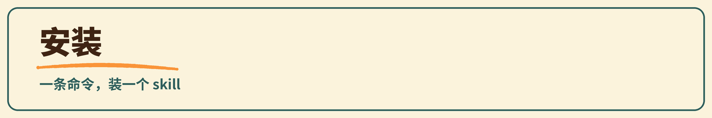
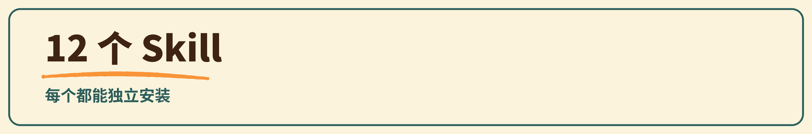
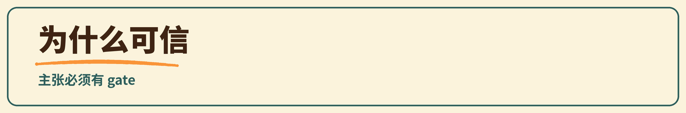
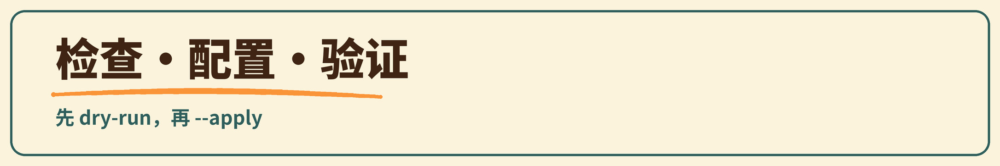
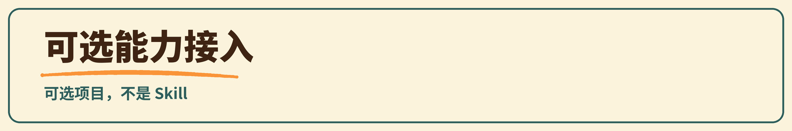
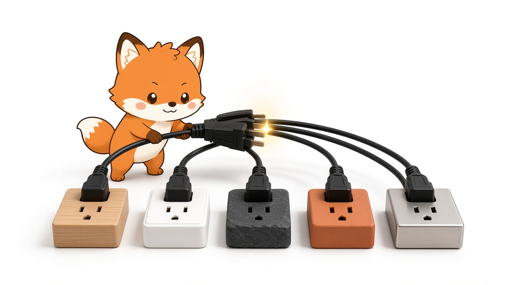

# 🦊 Azhou AI Hub · 阿舟 AI 能力站

**不止能演示，更要经得起真实任务。**

足够小，可以改；足够严，可以验；足够中立，可以跨 Agent harness 使用。

[English](README.md) · [安装](docs/installation.md) · [支持矩阵](docs/support-matrix.md) · [参与贡献](CONTRIBUTING.md)

https://github.com/user-attachments/assets/35c1a361-d494-437f-ad6c-0049f6828fd3

<picture>
  <source media="(prefers-color-scheme: dark)" srcset="assets/github/readme-banner-install.zh-CN-dark.jpg">
  
</picture>

~~~bash
npx skills add TeFuirnever/azhou-ai-hub --skill super-repo-pedant
npx skills add TeFuirnever/azhou-ai-hub --skill super-excalidraw-diagram
npx skills add TeFuirnever/azhou-ai-hub --skill super-azhou-info
npx skills add TeFuirnever/azhou-ai-hub --skill super-azhou-doctor
npx skills add TeFuirnever/azhou-ai-hub --skill super-azhou-setup
npx skills add TeFuirnever/azhou-ai-hub --skill super-azhou-verify
npx skills add TeFuirnever/azhou-ai-hub --skill super-eli5
npx skills add TeFuirnever/azhou-ai-hub --skill super-ask-azhou
npx skills add TeFuirnever/azhou-ai-hub --skill super-arch-doc
npx skills add TeFuirnever/azhou-ai-hub --skill super-session-insights
npx skills add TeFuirnever/azhou-ai-hub --skill super-asd-ste100
npx skills add TeFuirnever/azhou-ai-hub --skill super-archify
~~~

每个 skill 只选一种安装方式。包管理器安装解析的是可变默认分支；四个 `super-azhou-*` 包仍需要显式本地 checkout。

[校验安装内容](docs/installation.md#verify-what-you-installed) · [安装指南](docs/installation.md) · [离线恢复](docs/installation.md#offline-recovery)

<picture>
  <source media="(prefers-color-scheme: dark)" srcset="assets/github/readme-banner-skills.zh-CN-dark.jpg">
  
</picture>

| Skill | 解决的真实任务 | 验证依据 |
|---|---|---|
| [Azhou Info](skills/super-azhou-info/SKILL.md) | 报告 checkout、运行时、支持范围和可证明的 Git revision，不虚构发布状态。 | 委派给稳定的 `info` / `version` JSON 合同；只读包检查与仓库策略检查。 |
| [Azhou Doctor](skills/super-azhou-doctor/SKILL.md) | 只读诊断仓库、显式安装 target、可选 Treehouse lease 和宿主陈旧安装迁移健康。 | 只读 doctor 合同、真实 Treehouse 2.3.0 smoke、fail-closed target 检查和只读宿主迁移探测。 |
| [Azhou Setup](skills/super-azhou-setup/SKILL.md) | 先规划再显式执行 checkout-assisted 安装或 receipt-owned 生命周期操作。 | dry-run-first setup、mutation lock、身份防护、rollback 与 receipt 回归。 |
| [Azhou Verify](skills/super-azhou-verify/SKILL.md) | 执行公开全仓完整性 gate。 | 委派给仓库策略、单元测试、benchmark integrity 和空白检查。 |
| [Super Repo Pedant](skills/super-repo-pedant/SKILL.md) | 明确任务结束时，用当前代码校正文档、项目规则、交接状态和已绑定项目 memory。 | 28/28 项 <code>neat-freak</code> 能力有机器映射（基线为上游 <code>neat-freak</code> release v1.2.0／skill 3.1.1）；4 个注册行为 case（注册与完整性覆盖）；固定执行协议与 memory inventory 证明。 |
| [Excalidraw Diagram](skills/super-excalidraw-diagram/SKILL.md) | 生成或编辑可继续修改的图，渲染真实产物、查看成图，并按需交付 CJK-safe SVG/PNG。 | 5 个冻结 benchmark case；风格、场景、重叠和 same-DOM 确定性 gate。仓库 reference 只证明接线，不冒充模型效果。 |
| [Eli5](skills/super-eli5/SKILL.md) | 像讲给完全零基础的人一样解释主题：交付一份自带全部内容、大图少字的独立 HTML。 | 上游行为句在锁定上游 commit 上逐字保留，并有可复现的 SHA-256 源校验。尚无行为 benchmark。 |
| [Ask Azhou](skills/super-ask-azhou/SKILL.md) | 全目录路由：说清意图，得到技能、模式与边界。只推荐不代调用。 | 路由模式改编自锁定上游；路由图奇偶校验是带负控的仓库门禁检查。尚无行为 benchmark。 |
| [Arch Doc](skills/super-arch-doc/SKILL.md) | 从上游真源文档端到端产出、校准与评审架构设计文档。 | 沉淀自 MCC ARCH-2026-001 v0.1–v0.17 流水线；附确定性脚手架（`new_doc.py`）、收尾门检查器（`verify_doc.py`）与 `benchmarks/super-arch-doc/` 黄金用例。 |
| [Session Insights](skills/super-session-insights/SKILL.md) | 从本机 agent 会话存储产出事实绑定的使用洞察报告（Claude Code 与 Codex 适配器；zcode 适配器 fail closed）；只做聚合，原始转写永不出本机。 | 合成存储上的接线完整性套件：golden 聚合、隐私与 fail-closed 负控。尚无行为 benchmark。 |
| [ASD-STE100](skills/super-asd-ste100/SKILL.md) | 按源自 ASD-STE100 的受控英语结构规则改写面向 agent 的英文；保留每个 hedge、事实和范围限定语。 | 在锁定的上游 commit 上 faithful 导入，vendored 文件钉有 SHA-256 完整性测试；`scripts/ste-lint.py` 是确定性标准库门禁，配正负测试。尚无行为 benchmark。 |
| [Archify](skills/super-archify/SKILL.md) | 把系统、计划或代码库变成交互图示地图——共十种 typed-JSON 模式，交付为自包含可探索 HTML。 | 同步到正式稳定版 v3.2.0（<code>208acba8</code>），选定子树有 SHA-256 完整性校验；浏览器与视觉验收按实际产物分别报告。不宣称模型质量提升。 |

<picture>
  <source media="(prefers-color-scheme: dark)" srcset="assets/github/readme-banner-try.zh-CN-dark.jpg">
  
</picture>

| Skill | 复制给 Agent | 必须返回什么 |
|---|---|---|
| Super Repo Pedant | <code>这个阶段做完了，跑一次 super-repo-pedant reconcile。</code> | 已对齐的知识面、具名检查、明确 hold 和稳定收据。[运行 demo](docs/demos/super-repo-pedant.md)。 |
| Excalidraw Diagram | <code>用 super-excalidraw-diagram 画登录时序图，交付可编辑源图和 PNG。</code> | 可编辑 <code>.excalidraw</code>、真实渲染/导出、确定性 gate、视觉复核状态和稳定收据。[运行 demo](docs/demos/super-excalidraw-diagram.md)。 |
| Arch Doc | <code>用 super-arch-doc 从这个仓库的上游设计文档产出架构说明书。</code> | 带出处的研究笔记、图注入账的模板骨架、仅 PlantUML 的图纪律、确定性收尾门禁和稳定收据。[运行 demo](docs/demos/super-arch-doc.md)。 |

## Super Repo Pedant

> 🧹 代码是唯一现役答案，其他都要对齐。

## Excalidraw Diagram

> ✏️ 先让结构讲清关系，再让文字补充证据。

[依赖安装](skills/super-excalidraw-diagram/references/setup.md) · [来源说明](skills/super-excalidraw-diagram/references/provenance.md)

## Arch Doc

> 🏛️ 每个事实都标出处，每张图都配得上注。

## Eli5

> 🖼️ 大图、少字——讲不清楚就老实说不能画。

## Ask Azhou

> 🧭 说意图，拿 skill、模式和边界。

## Session Insights

> 🔢 汇总出得了机器，原始 transcript 出不了。

## ASD-STE100

> 🎯 一词一义，一句一事，agent 无从误读。

## Archify

> 🗺️ 一张图讲清一个系统，交给读者去探索。

🦊 效果图由 Azhou Scenes skill 生成。Repo Pedant 与 Excalidraw Diagram：机器颜色门禁已通过；身份、手部和文字仍保留人工复核 checkpoint。Arch Doc、Eli5、Ask Azhou、Session Insights、ASD-STE100 与 Archify：人工视觉 P0 已通过；正式色彩门禁仍待在整理区补跑。

<picture>
  <source media="(prefers-color-scheme: dark)" srcset="assets/github/readme-banner-trust.zh-CN-dark.jpg">
  
</picture>

- **现役行为优先。** 代码、机器配置和真实运行证据定义 current truth；未实现 spec 保留为 reminder。
- **主张必须有 gate。** 仓库权威 gate 执行完整确定性测试套件、4-case Super Repo Pedant 套件、5-case Excalidraw benchmark 完整性检查、Session Insights 合成会话存储接线完整性套件、JSON/链接/来源/凭据策略和空白检查。
- **不伪装各宿主能力完全等价。** 当前维护的目标是 Codex、Claude Code、MiMo Code（命令 `mimo`）、DeepSeek Harness（命令 `dsh`）和 zcode；其他 harness 暂不支持。见[支持矩阵](docs/support-matrix.md)与[逐 skill 平台汇总](docs/skill-platform-view.md)。
- **历史不能静默改 live skill。** promotion 必须先有回归，再通过确定性检查、paired 多数、无安全回归和 exact-diff 人类批准。
- **来源边界公开。** 上游快照、vendored 资产和未授权 prior art 的排除记录见[第三方声明](THIRD_PARTY_NOTICES.md)。

<picture>
  <source media="(prefers-color-scheme: dark)" srcset="assets/github/readme-banner-checkout.zh-CN-dark.jpg">
  
</picture>

每个适配器都委派给该 checkout 的零依赖 Foundation CLI：

| Agent Skill | CLI 权威命令 | 修改边界 |
|---|---|---|
| `super-azhou-info` | `info`、`version` | 只读报告项目、运行时、Git revision 和 dirty state。 |
| `super-azhou-doctor` | `doctor` | 只读诊断仓库、显式安装 target、可选 Treehouse lease 和宿主陈旧安装迁移。 |
| `super-azhou-setup` | `setup`、`repair`、`migrate`、`uninstall` | 先 dry-run；只有经过核对的精确计划带 `--apply` 才能修改显式 target。 |
| `super-azhou-verify` | `verify` | 运行可公开复现的仓库完整性 gate。 |

~~~bash
python scripts/azhou_hub.py info --json
python scripts/azhou_hub.py version --json
python scripts/azhou_hub.py doctor --json
python scripts/azhou_hub.py setup --skill super-repo-pedant --target /absolute/path/to/harness/skills --json
python scripts/azhou_hub.py verify
~~~

[基础 CLI 合同](docs/foundations.md)

<picture>
  <source media="(prefers-color-scheme: dark)" srcset="assets/github/readme-banner-integrations.zh-CN-dark.jpg">
  
</picture>

两个完整项目位于 `packages/`。这些项目不是 Skill；安装 Hub 的 Skill 不会启用任何集成。

| 入口 | 完整项目包 | 当前边界 |
|---|---|---|
| `pstack` | [pstack-agent-harness](packages/pstack-agent-harness/README.md) | `pstack-azhouzhou` 0.15.37 **候选版**：Codex／Claude 原生插件、zcode 仅含 commands 的插件，以及 MiMo、DeepSeek Harness 的共享 Skills 发现能力；ZCode 图形界面调用尚未验收，宿主调用、hook 信任和发布批准仍需独立证据。 |

| 入口 | 完整项目包 | 当前边界 |
|---|---|---|
| `agent-skin` | [阿舟 AI 实验室 for Codex](packages/agent-skin/README.md) | Codex 桌面身份，外加可组装的 DeepSeek Harness 插件包；当前源码版本为 `0.9.0/build 41`。更新按[本地安装 SOP](packages/agent-skin/docs/local-install-sop.md) 执行。代码自 #441 重写后采用 MIT；随附的阿舟素材采用 CC BY-NC-ND 4.0，新 clone 即可构建阿舟皮肤。 |

🦊 Foundation CLI、pstack 与 Agent Skin 效果图为生成插图，未经 Azhou Scenes 流水线，也没有色彩门禁；维护者视觉批准已于 2026-11-12 记录。

~~~bash
python scripts/azhou_hub.py integrations list --json
python scripts/azhou_hub.py integrations pstack --help
python scripts/azhou_hub.py integrations agent-skin --help
~~~

pstack 保留其上游 MIT 声明。Agent Skin 代码自 #441 独立重写后由 Hub 根 MIT 许可证覆盖。`packages/agent-skin/assets/azhou/` 的阿舟素材采用 CC BY-NC-ND 4.0，阿舟名称、标识与角色见 [TRADEMARKS.md](TRADEMARKS.md)。

[接入手册](docs/integrations.md) · [来源记录](docs/integration-provenance.md) · [支持矩阵](docs/support-matrix.md#optional-integrations)

2026-11-11 的只读宿主清单发现，Codex 与 Claude Code 均已列出 `0.15.37` pstack 插件处于**已安装状态**。这不等于已证明安装文件字节、真实 pstack 任务执行、SessionStart hook 信任或发布批准。详见[宿主只读验收清单](evidence/pstack-host-readonly-inventory-2026-11-11.md)及[镜像 GAP 审查](docs/research/2026-11-11-pstack-upstream-gap.md)；原始上游源码与 23 项补丁队列均未改变。

通过 Hub 移除 pstack 期间，请确保目标 `CODEX_HOME` 没有其他原生插件或 marketplace 变更；计划会提示此要求，但无法验证其他进程。

### 退役面

三个面已于 2026-11-11 至 2026-11-12 的一次物理删除切割中离开本仓库：维护范围收敛到维护者实际支持的面——此前的每次改动仍要为不再打算支持的代码支付门禁、文档与评审成本。最后支持版本与已装用户处置如下：

- **agent-skin 的 ZCode 宿主层**——最后支持版本 `0.9.0/build 41`。ZCode driver、页面适配器、测试、文档与 CI 线已删除；Codex 与 DSH 宿主及共享核心行为不变。已安装的 ZCode 皮肤作为冻结安装继续可用，但不再有新构建；退出时恢复安装事务保留的原始启动器，或连同回执一并移除阿舟入口。
- **Agent Orchestration Kit（model router）**——从未发布（`version: unreleased`），末态即 2026-11-12 删除的目录树；model-router Hub 入口与共存判定一并移除，不留探测 stub。机器上仍存在的安装不再由本仓库管理：请使用保留的切割前字节中该包自带的卸载路径移除。**装过 model-router 的用户请先卸载它再安装 pstack**——pstack 适配器会拒绝仍在 `config.toml` 中提及已退役 router 且无 Hub 归属回执的目标。
- **旧 `codex-startup-animation` 包**——末版 `0.7.1/build 8`，经维护者审阅的回执属主交接后于 2026-11-12 删除。受维护的 Pet 工具链在 [agent-skin](packages/agent-skin/README.md)；已安装的 App 或 Pet 继续可用，历史工具链可从保留的切割前字节取回。

旧 release 与 tag 全量保留。两个退役包合入仓库的时间晚于最新已发布 release，因此对它们而言，切割前的 Git 修订（可由[来源记录](docs/integration-provenance.md)各历史行记载的删除日期与溯源 commit 定位）是具体的卸载锚点。已安装态迁移依赖的持久化/协议标识按历史原名冻结；该取舍记录于 [HUB-RET-001](docs/decisions/hub-retirement-physical-deletion.md)。

## 一套架构

~~~text
docs/skill-standard.md ── 约束 ──> skills/<name>/       可安装运行包
          │                              │
          ├── 分配 ──────────────────> .azhou/<name>/      私有运行状态
          ├── 约束 ──────────────────> tests/              确定性证明
          └── 约束 ──────────────────> benchmarks/<name>/  隔离行为证据

历史信号 ──> 隔离 candidate ──> paired review ──> 人类 promotion
                    永远不直接写 live skill
~~~

[Azhou Skill Standard](docs/skill-standard.md) 是项目唯一准则。[架构说明](docs/architecture.md)解释边界，[治理规则](GOVERNANCE.md)解释决策方式。

## 开发

仓库级验证只需要 Python 3.11+：

~~~bash
python scripts/verify.py
~~~

## 项目入口

[文档](docs/README.md) · [产品原则](docs/principles.md) · [路线图](docs/roadmap.md) · [变更记录](CHANGELOG.md) · [安全政策](SECURITY.md) · [支持方式](SUPPORT.md) · [参与贡献](CONTRIBUTING.md)

## 许可证

阿舟自研代码使用 [MIT](LICENSE)。阿舟素材使用 [CC BY-NC-ND 4.0](packages/agent-skin/assets/azhou/NOTICE.md)。名称、标识与角色见 [TRADEMARKS.md](TRADEMARKS.md)。第三方组件保留自己的版权与许可证：[THIRD_PARTY_NOTICES.md](THIRD_PARTY_NOTICES.md)。
