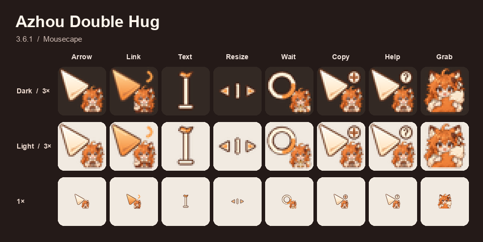

# Azhou Double Hug 3.6.1

A standalone Mousecape theme for macOS with 41 cursor states and 32 px and 64 px image strips. The ordinary arrow is still. Links and waiting use short loops, and the grab state shows Azhou hugging her tail.



## Install / 安装

[Download the theme](https://tefuirnever.github.io/azhou-ai-hub/#cursor-theme) · [下载主题](https://tefuirnever.github.io/azhou-ai-hub/zh/#cursor-theme) · [Browse the .cape file / 查看主题文件](Azhou-Double-Hug-3.6.1.cape) · [Get Mousecape / 获取 Mousecape](https://github.com/alexzielenski/Mousecape/releases) · [Restore / 恢复](#restore)

1. Open Mousecape and import the downloaded `.cape` file.
2. Select **百变阿舟 · 抱一下 3.6.1** and choose **Apply**. Check the arrow and text selection in Finder or a document.

1. 打开 Mousecape，导入下载的 `.cape` 文件。
2. 选中「百变阿舟 · 抱一下 3.6.1」并点击 **Apply**。在访达或文档里检查箭头和文字选择指针。

## Restore

To switch back to another theme, select it and choose **Apply**. To restore the macOS system cursors, use Mousecape’s reset command. In versions that show **Cape → Reset to Default**, choose that menu item.

要换回原来的主题，选中它并点击 **Apply**。要恢复 macOS 系统指针，用 Mousecape 的恢复默认功能。如果菜单里有 **Cape → Reset to Default**，就点这一项。

## Rebuild

With Python 3 and Pillow 13.0.0, run from this directory:

```sh
python3 build.py --output /tmp/Azhou-Double-Hug-3.6.1.cape
cmp Azhou-Double-Hug-3.6.1.cape /tmp/Azhou-Double-Hug-3.6.1.cape
```

Both source atlases are required. The builder draws the symbols and assembles the 1× and 2× strips without fonts or network access. Byte-for-byte results were checked with CPython 3.15.2, Pillow 13.0.0 and its bundled zlib-ng 1.3.1. Different encoders may produce different PNG bytes.

The repository's unit suite checks the delivered file's identifier, role set, animation timing, hotspots and PNG strip dimensions. Mousecape export and desktop appearance are separate checks.

## Rights

Code follows the repository MIT license. Source atlases, preview and artwork embedded in the cape are © 2026 小亮 (阿舟 / Azhou), CC BY-NC-ND 4.0. See the [artwork license](../../../assets/azhou/LICENSE) and [brand terms](../../../TRADEMARKS.md).

未经许可，请勿修改并再分发阿舟素材或用于商业用途。阿舟名称与形象属于作者品牌。
