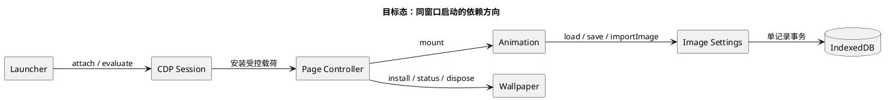
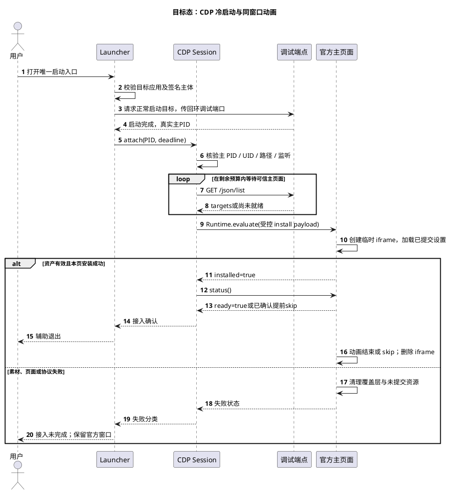
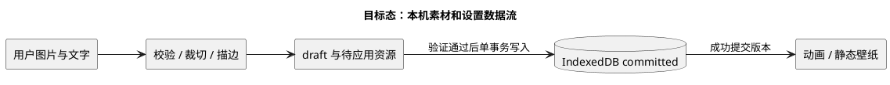

# 功能详细设计：Agent Skin 首期 Codex 适配

2026-10-27 实机反馈后的设置入口与验收变更见[冷启动验收修订](host-acceptance-fixes.md)；其中的点击入口替代本文历史的 Command-Option-B 约定。

## 0. 文档控制与阅读入口

| 字段 | 内容 |
|---|---|
| Detail ID / 版本 | `DETAIL-2026-001` / `0.5` |
| 状态 / 日期 | Draft / 2026-10-27 |
| 产品 / 包名 | Agent Skin / `agent-skin`；名称与首期范围已经用户确认，更名尚未实施 |
| 产品范围 / 首期宿主 | 面向 AI 工具的启动动画、壁纸与外观设置；本轮只实现 Codex 适配 |
| 目标 | 从指定源项目蒸馏行为，在 Hub 中实现 Agent Skin 的 Codex 同窗口动画、设置和静态壁纸 |
| 当前阶段 | Agent实施基线；目标代码为Planned，实际验证记录与生产门分别见下方链接 |
| 文档剖面 | Baseline；模板符合性映射见 §17 |
| 模板来源 | [feature-detailed-design v2.3](../../../skills/super-arch-doc/references/templates/feature-detailed-design.md)，按 [design-doc](../../../skills/super-arch-doc/references/templates/design-doc.md) 受控剪裁 |
| 写作依据 | `writing-for-agents` 的信息层级、按分支披露、单一真源和逐步完成判据；本机规范来源为 `writing-for-agents/SKILL.md（本机安装的写作规范）` |
| 设计 / 实现 Owner | 本文由 Codex 编写；未来实现 Owner 由维护者指定 |
| 决策 / 视觉 / 发布 Owner | 仓库维护者；已确认产品名、包名、首期宿主与9票粒度/依赖，其余设计及视觉/生产门仍按各自判据批准 |
| 关联 PRD / 上位架构 | 无独立 PRD/ARCH；需求来自本次用户指令，约束来自 [AGENTS.md](../../../AGENTS.md)、[集成约定](../../integrations.md)、[安装生命周期](../../../packages/codex-startup-animation/docs/installation-lifecycle.md) |
| 源基线 | [研读 §1](source-analysis.md#1-证据身份与读取范围)；S 与 H 分别固定，不以共同导入 commit 推定相同 |
| 实现 / 测试结果 | 目标实现尚未开始；各轮文档及基线验证见[交付记录](acceptance.md)和[评审记录](REVIEW.md)，生产晋级规则见[生产操作](production-runbook.md) |
| 取代关系 | 本文是目标态补充，不覆盖 H 已发布契约和历史验收记录 |

本文中“必须”表示 MUST，“应”表示 SHOULD。`Planned` 表示有设计、未实现；`Implemented` 表示有代码、未证明通过；`Verified` 只用于明确提交和环境下的测试结果；`Production` 需要真实发布及使用证据。当前 H 和 S 的代码事实最高记为 Implemented；目标设计一律 Planned。

下文`RCn`表示运行契约第n节，`Tnn`表示验收表中的测试ID，`FRnn`表示本文件需求ID；这些都是定位简写，不是新增运行协议。

**实现者按以下顺序进入：**

1. **接手**：读§1–§4及[执行指南§1](implementation-guide.md#1-接手与基线)，核对S/H与工作区。完成条件：回执记录实际HEAD、工作树差异、工作区归属；相关基线变化已经回源核对。
2. **选单并读契约**：从[工作单及依赖](implementation-guide.md#3-agent工作单)选择前置已满足的一单，先读该单指定的输入章节。涉及字段、消息、状态或算法时读[运行契约](runtime-contracts.md)对应节；涉及构建或adapter时读[执行指南§2](implementation-guide.md#2-构建与集成衔接)。完成条件：本单Owner、允许改动的文件、Interface、对应T编号和验收方式均可定位。
3. **实现并交接**：通过本单指定的Interface建立红绿测试，完成改动，按[执行指南§4](implementation-guide.md#4-每单交接与继续条件)记录结果。完成条件：该单全部交付物、适用测试及回执字段满足；有未满足项时保留该单状态，只继续不依赖它的工作。
4. **生产验收**：A–E集成完成后，按[生产操作§1](production-runbook.md#1-晋级门与完成判据)核对晋级门，再执行对应章节。完成条件：每个必需门具有其规定的本轮证据和结论，真实宿主操作在当前有效授权范围内。

| 读者 / 关注点 | 本文位置 | 记法 |
|---|---|---|
| 维护者：范围、路线、风险 | §1–§4、§11–§15 | 决策表、风险表 |
| 实现者：控制、数据与错误 | §5–§10、运行契约 | Module 表、PlantUML、字段表 |
| QA：可执行验收 | §13、[验收矩阵](acceptance.md#1-未来实现验收矩阵planned) | 输入—期望—证据矩阵 |
| 视觉评审者：节奏与阿舟身份 | [动画契约](runtime-contracts.md#3-动画算法和时间轴)、[视觉与资源验收](production-runbook.md#4-g4视觉性能与交互) | 时间轴、真实窗口截图/录像 |

## 1. 功能摘要与已确定决策

产品名称为 **Agent Skin**，包名为 `agent-skin`。产品面向 AI 工具，包含启动动画、壁纸与外观设置；Codex 是本轮唯一适配宿主。名称中立化不表示其他宿主已经支持，本轮不建设尚无调用方的通用插件框架。

目标是在官方 Codex 主窗口就绪后，通过经核验的本机 CDP 连接安装一个临时 iframe，播放可跳过的约 12 秒动画；结束后删除 iframe 和动画资源，仅保留静态壁纸、设置快捷键及页面会话控制器。官方应用与动画并行加载。官方包、聊天、模型和工具逻辑保持原状。

采用S的CDP同窗口方案。实现工作区按执行指南§1取得；本地安装、视觉与外部分发分别满足生产操作中的相应门。此前文档专用的工作区例外只记录在交付回执中，不作为实现授权。

核心取舍：同窗口连续体验需要适配官方页面，并留下随官方进程存活的 CDP 端口。恢复外观只撤销页面修改；关闭调试状态需要用户完整退出官方应用，再从官方入口正常打开。

## 2. 背景、范围与需求追溯

当前 S 已有同窗口动画、两图自定义和设置；H 已有独立 7.8 秒原生动画、成熟的静态壁纸核查与唯一安装入口。**H 当前壁纸已经使用 CDP；需要替换的是动画接入及页面生命周期组合，不是再次引入第二套壁纸控制器。** 事实和出处集中于[研读 §2–§3](source-analysis.md)。

| 需求 | 必须提供的行为 | 设计落点 | 最小验收 |
|---|---|---|---|
| FR01 | 冷启动后在官方主窗口播放，非独立动画窗口 | §6、RC1 | T01 |
| FR02 | 已运行时激活现有实例，不重启、不默认重播 | §6.3 | T02 |
| FR03 | 12 秒阶段动画，可点击或 Esc 跳过，尊重减少动态效果 | RC3 | T03–T05 |
| FR04 | 本机自定义头像、背景、线稿、三段文字及背景强度 | RC2、RC4 | T06–T10 |
| FR05 | ⌘⌥B 打开设置；保存成功后重播，关闭放弃草稿 | RC1、RC4 | T08–T10 |
| FR06 | 动画结束移除覆盖层，保留静态壁纸；恢复外观保留保存值 | RC5 | T11–T12 |
| FR07 | 可信应用、进程、端口、页面和消息来源逐层核验 | §11、RC6 | T13–T16 |
| FR08 | 失败后释放阻塞层；辅助进程有限退出，无后台重注入 | §10 | T17–T19 |
| FR09 | 独立预览使用同一动画实现，隔离设置和真实宿主 | §7、RC4 | T20 |
| FR10 | 产品包更名为 agent-skin，保持安装所有权、来源、私有素材与旧快照清理边界 | §12、§14 | T21–T23、T28–T29 |
| FR11 | 完整定义构建资源、原生/页面协议与adapter评估，不能套用原生播放器日志判CDP结果 | RC7、执行指南§2 | T24–T26 |
| FR12 | agent可逐单实现并按可复现门进入本地生产使用，出错可恢复官方入口 | 执行指南§3、生产操作 | T27–T29 |

范围外：其他 AI 工具的宿主实现、Windows、官方插件/API 扩展、聊天主题重写、官方 CSP 修改、修改 `app.asar`、重载后自动重注入、Pet 制作/安装、模型或 API 路由。保持 H 的 Pet 与其收据原样独立。重实现不自动迁移 S 的 IndexedDB 或旧安装归属。

## 3. 原则、不变量与词汇表

1. **可信连接**：签名主体、真实路径、UID、PID、监听地址和页面身份全部匹配后才执行脚本。无法核验时停止注入。
2. **页面所有权**：一个主页面最多一个启动控制器、一个动画 iframe、一个 owned 壁纸实例。旧壁纸清理由其自身 dispose 完成。
3. **短命辅助进程**：辅助进程只负责启动和接入，按RC7的接入终态退出。页面播放、超时和设置独立由页面内事件驱动。
4. **事务设置**：草稿、临时预览与已提交设置分离。保存失败保持旧记录和旧壁纸可用。
5. **定点恢复**：仅恢复本实现拥有且仍保持本次写入值的 DOM、属性和样式；保留宿主后续变更。
6. **独立证据**：协议测试、模拟宿主、真实官方窗口、视觉、安装与权利分别验收。

| 术语 | 唯一定义 |
|---|---|
| Agent Skin | 面向 AI 工具的视觉定制产品，能力包含启动动画、壁纸和外观设置；不以某一宿主命名整个产品 |
| 宿主适配 | 产品在某一 AI 工具中的接入及外观行为；本轮仅指 Codex，不等于已支持其他 AI 工具 |
| S / H | 研读 §1 指定的源仓与目标 Hub 基线 |
| Module / Interface / Implementation | 有一个调用表面的设计单元 / 调用方正确使用所需全部事实 / 内部实现 |
| Seam / Adapter | 可替换行为的位置 / 满足该位置 Interface 的具体实现；仅对真实变化轴建 Seam |
| Depth / Leverage / Locality | 小调用表面隐藏复杂行为 / 调用方获得的能力 / 变更知识集中程度 |
| 真源 | S/H 当前代码、配置及明确用户决定；本文不改变现役代码 |
| 派生面 | 由本地构建输入生成的 payload、安装载荷或状态摘要 |
| 页面会话 | 当前主文档实例；刷新或窗口销毁结束 |
| ready / complete | 当前轮资源已准备，按intent进入播放或设置 / 本轮已结束；都不表示聊天或模型就绪，具体字段与判据见RC1、RC7 |
| restore / dispose | 用户恢复官方外观动作 / 幂等释放本页 owned 修改的实现操作 |
| Receipt | 绑定本轮输入、命令、环境与结果的回执；私有路径和原始宿主证据留在 Git 忽略区 |

## 4. 实现路线与取舍

| 路线 | 效果 | 主要代价 | 结论 |
|---|---|---|---|
| S：CDP 注入临时 iframe + 静态壁纸 | 动画与工作界面在同一主窗口 | 官方 DOM 适配、调试端口寿命与安全核验 | 用户选择；本设计目标 |
| H：原生动画 + CDP 静态壁纸 | 动画可靠性与页面分离 | 独立窗口切换，无法提供同窗口连续动画 | 当前基线，待目标验收后替换 |
| 全部原生、无 CDP | 可独立启动动画 | 无法直接得到官方窗口内的背景 | 不满足当前目标 |

**执行器选择（Planned）：** 保留 Swift 启动入口，扩展 H 现有 Foundation CDP transport 来发送 payload、确认状态和退出；不再执行原生动画窗口。S 的 Node 程序用作行为参照，不依赖官方包内 Node 路径。CDP 方案与编程语言无绑定；本设计保留的是 S 的窗口位置、事件协议和生命周期。只有现有 Foundation transport 在目标版本无法可靠执行协议时才重开执行器决定。

动画与壁纸合为一个会话所有权，内部复用 H `wallpaper/renderer.js` 的窄表面核查和 dispose。删除这个会话 Module 会把资源、焦点、设置与壁纸清理扩散到播放器、快捷键和原生调用方，因此它有实际 Depth。预览与 CDP 页面是两个真实宿主；CDP transport 的真实与假连接是可测试 Seam。暂不建设通用插件层、跨平台框架或新增包管理器。

## 5. Module 与代码设计（Planned）

| Module | Interface / 状态所有权 | 职责与依赖 | 目标位置 |
|---|---|---|---|
| Launcher | 正常启动、`--preview`、`--probe`；拥有进程锁与总 deadline | 找目标、已有实例激活、冷启动、控制一次接入 | 现有 `Native/App.swift` |
| CDP Session | attach / evaluate / close；拥有 pending 请求 | 重组H现有一次性WallpaperTransport，复用身份和监听验证；它目前不是通用Session | 现有 `Native/Wallpaper.swift` 内重组；仅明显改善 Locality 时再拆文件 |
| Page Controller | `install/openSettings/status/dispose`；拥有页面会话、iframe、焦点、watchdog | 组合动画和壁纸，验证消息身份，结束后保留设置 | 新 `extension/renderer.mjs` |
| Animation | 同一闭包 mount 与 launcherUI；拥有时钟、Path2D、位图和帧句柄 | 动画、跳过、减少动态效果；不拥有原生或 CDP 权限 | 改 `animation.js`，保留 `index.html/style.css` |
| Image Settings | load / save / importImage；拥有存储事务与图像处理 | 裁切、轮廓、文本校验、提交和回滚 | 新 `image-settings.js` |
| Wallpaper | install / status / dispose；拥有宿主表面变更 | 保留 H 图片解码、decorations 和实际样式验证 | 改 `wallpaper/renderer.js` 和 CSS |
| Builder | 受控本地输入 → 单一 payload | 将 HTML/CSS/脚本/图片封装为自包含注入表达式 | 新 `tools/build-startup.py`；复用现有构建与核验流程 |

图1：目标依赖方向。目的：确定权限与状态所有权；范围：目标实现，不含安装器内部；版本：0.1 / 2026-10-26；结论：只有 Launcher/CDP Session 接触原生进程和调试端口，页面仅处理受控载荷。

表中“新”路径表示Planned目标；当前源码由[研读](source-analysis.md)定位，完整资源与消费方变更见[执行指南§2](implementation-guide.md#2-构建与集成衔接)，文件Owner见其§3。最终文件拆分可在不改Interface的前提下收敛，尚未创建的入口不作为可执行命令。

## 6. 控制流、状态与取消（Planned）

### 6.1 冷启动

图2：冷启动接入时序。目的：固定可信核验、注入和退出顺序；范围：单主页面、一次启动；版本：0.2 / 2026-10-26；结论：目标态中ready或已确认提前跳过后辅助退出，complete由页面清理处理。参与者映射：用户→调用方；Launcher→原生入口；CDP Session→可信连接Seam；调试端点→官方进程CDP；官方主页面→Page Controller/Animation/Wallpaper宿主。

每轮检查必须扣除统一剩余时间；校验不通过时不得先执行脚本再补检查。安装返回 true 只表示控制器创建，ready 才是动画启动确认。完整播放是另一个验收信号。

### 6.2 页面状态

| 当前状态 | 事件 / 守卫 | 下一状态 | 必须发生的副作用 |
|---|---|---|---|
| 控制器不存在 | install，顶层主页面，owned 全局不存在 | loading | 保存原焦点，创建唯一 iframe 和 25 s watchdog |
| loading | 素材解码、路径和设置完成 | playing或settings | 预热后ready；intent=play才计时，intent=settings打开设置不自动播放 |
| loading / playing | assetError / watchdog / iframe 丢失 | failed / timeout | 移除覆盖层、帧和临时 URL；失败不阻塞官方 UI |
| loading / playing | complete / skip | complete | 动画停止、iframe删除、skipped=true时允许先于ready结束；保留已成功应用的静态状态 |
| playing | settings-open | settings | 当前iframe打开面板，暂停动画并取消watchdog；不创建第二份iframe |
| complete | ⌘⌥B | loading | 创建intent=settings的iframe并启动准备watchdog；ready后进settings，载入committed副本且不自动播放 |
| settings | 保存和写库成功 | loading | 提交新设置，销毁旧设置iframe并创建新runId播放iframe；ready后进入playing |
| settings | 关闭 / Esc，发送complete(skipped=true) | complete | 丢弃draft，移除iframe，不写库、不重播 |
| 任一 owned 状态 | restore | disposed | 移除本实现的样式、壁纸、快捷键和全局，保存值保留 |
| owned控制器存在 | 重复同版本 install | 原状态 | 返回 alreadyActive，不重播、不新建 iframe |

状态中的ready/completed属于当前runId；重播必须清零completed。父watchdog和动画时钟分开：设置打开时停止动画并取消watchdog，取消关闭设置时直接返回官方UI；成功保存则按表新建播放轮次。

Native调用不能假设一定观察到playing：一次状态查询间隔内可能发生ready→complete，或用户在loading提前skip。退出成功条件见RC7，任何失败和timeout都不得归类为用户跳过。

### 6.3 热启动、预览与取消

已有官方实例时，普通启动只激活经真实路径核验的实例并退出。已有实例是否带CDP、是否曾注入都不改变该默认。该页仍保留控制器时，⌘⌥B打开设置，“保存并预览”使用已提交设置重播；不承诺未定义的独立replay接口。没有控制器时不自动重启；需要加载美化时用户保存工作后自行冷启动。

原生预览仅加载本地页面，使用隔离存储，不发现或连接官方应用。关闭原生启动器或CDP断开只释放原生Session、pending和deadline timer；正常ready后断开绝不取消页面播放。页面帧与timer由complete、skip、watchdog、dispose或该文档销毁收束；辅助已经退出时，iframe仍会自行完成和清理。接入失败需按RC7尝试已识别控制器的dispose；页面刷新后不自动重注入。

## 7. Interface 契约（Planned）

完整字段、动作、顺序、错误和边界以[运行契约](runtime-contracts.md)为唯一细节定义；本节只定位调用表面。

| Interface | 调用方 → 被调用方 | 权限 / 幂等 / 完成条件 |
|---|---|---|
| 正常启动 / probe / preview | 用户 → Launcher | 单实例锁；probe 和 preview 不注入；现有生产安装入口保持唯一 |
| CDP attach/evaluate/close | Launcher → Session | 当前用户的可信应用主 PID；限定回环和主页面；任何协议失败都关闭 pending |
| `__azhouStartup` | Session / 快捷键 → Page Controller | owned/version 校验；同版本安装幂等；dispose 幂等 |
| `azhou-startup` 消息 | 当前 iframe → Page Controller | 严格 source/frame 身份；只允许动作白名单，无任意脚本执行能力 |
| load/save/importImage | Animation → Image Settings | 本机存储；写事务完成才成功；输入不提升权限 |
| wallpaper status/dispose | Page Controller → Wallpaper | 只操作 owned 样式；实际状态核查与历史记录分离 |

## 8. 数据、配置与迁移（Planned）

页面本机设置包括头像、背景、同图轮廓、三段文字与背景强度；字段、范围和默认值以[RC2](runtime-contracts.md#2-设置-schema输入与默认值)为准。草稿仅在内存，成功提交值保存在自己的IndexedDB。动画计时和端口号不持久化。关闭外观保留设置；“恢复默认”修改草稿，保存后才生效。

首次安装采用独立数据库名，避免覆盖 S 数据。H 当前没有同类设置库，故无需数据迁移框架；保持稳定页面源时普通 App 升级可继续读取设置，但官方源/分区变化可能导致不可见，不承诺跨官方存储迁移。源预览和正式页面设置不共享。安装器只更换程序，不碰浏览器数据；新增导出/跨机同步不在本次范围。

图3：设置提交数据流。目的：固定图像与轮廓一致性和提交点；范围：一个设置事务；版本：0.1 / 2026-10-26；结论：同一裁切图生成预览、轮廓和背景，写库成功才替换 committed。

## 9. 图像与动画算法（Planned）

按[动画契约RC3](runtime-contracts.md#3-动画算法和时间轴)重实现S的阶段结构和确定性时间轴；按[图像输入RC2](runtime-contracts.md#2-设置-schema输入与默认值)裁切，使用同一背景坐标生成线稿。算法在本机确定性执行；AI Eval不适用。阿舟默认图由授权来源单独准备。

## 10. 失败、并发、降级与恢复（Planned）

| 失败 / 竞态 | 处理 | 用户可见结果 / 恢复 |
|---|---|---|
| 找不到应用、签名或身份错误 | 启动前停止；不执行包内第三方运行时 | 明确报告身份检查失败；用户使用官方入口 |
| 端口被抢占、UID/PID/路径不符 | 拒绝连接；不得换到未核验端口 | 本轮接入失败；不杀官方进程 |
| 主页面迟到或仅发现辅助窗口 | 在预算内等待；到期关闭连接 | 官方应用继续运行，说明动画未接入 |
| 壁纸不兼容但动画已 ready | 保留窄范围失败分类，允许完整播放 | 不宣称壁纸成功；结束后仍能使用官方页面 |
| 素材损坏 / IDB 读失败 | 退回有效默认；默认也失败则清理覆盖层 | 不保持黑屏；不删除用户旧记录 |
| IDB quota / tx abort | committed及已应用壁纸保持不变；候选尚未应用，面板显示失败 | 不重播；用户可缩小图片或取消 |
| 连点启动、重复注入 | 原生进程锁 + 页面 owned/version 检查 | 激活已有入口或返回 alreadyActive |
| 设置导入尚未完成时关闭 | busy期间本地×/Esc不关闭、不提交；完成、失败或RC4超时后恢复可取消 | 无并行提交；外部dispose仍可使任务失效，Esc不触发半提交 |
| 页面刷新 / 新窗口 | owned 资源由旧文档销毁；不监听重注入 | 本轮会话美化结束；下次明确启动再接入 |
| dispose 与异步导入/解码竞争 | 回调检查 generation/disposed，撤销候选 URL | 销毁后不能重新挂回样式或 iframe |

超时、重试、图像容量和帧工作预算以[RC6](runtime-contracts.md#6-安全验证预算与错误)为准。恢复外观是本页owned dispose，CDP端口寿命仍由官方进程决定。失败处理保持现有官方会话运行；生产包替换沿用现有安装器事务。

## 11. 安全、隐私与可观测性（Planned）

信任层次：本机文件 → 已核验原生入口 → 当前用户的可信主 PID / 回环端口 → 符合路由的主页面 → 本实现的当前 iframe。任一层的字符串声明不能代替上层验证。

| STRIDE 类别 | 本任务实际威胁 | 控制与验证 |
|---|---|---|
| Spoofing | 假 App、被抢占端口、假 page、伪造 iframe 消息 | 身份链核验 + source 白名单；T13–T15 |
| Tampering | 错载荷、冲突控制器、宿主样式并发改变 | 保留现有构建输入摘要核验；owned/version、条件恢复；T12、T21 |
| Repudiation | 历史成功冒充本轮接入成功 | 日志分 installed/ready/complete/wallpaper；状态实际读取；T01、T11 |
| Information disclosure | 本机 CDP 可被同机进程利用；图片或聊天进入日志 | 明示端口寿命；不记录脚本/图片/聊天，不把资源当网络服务提供；T16 |
| Denial of service | 巨图、坏轮廓、失效帧、无穷等待 | 输入和解码门限、父 watchdog、统一 deadline、dispose；T06、T17–T19 |
| Elevation of privilege | 页面消息触发任意原生命令 | 载荷无通用原生命令桥；source/action 白名单；T15 |

日志字段与退出判据以[RC7.2](runtime-contracts.md#72-原生日志和退出语义)为准；原生本地记录可含路径，公开报告需脱敏。状态查询只读取当前状态，不写日志或重新注入。私有证据按[生产操作§6](production-runbook.md#6-失败处置与支持期)保留或清理。

无需远程遥测、账户、常驻服务或任意 JS 输入。CDP 使用 `Runtime.evaluate` 是经过核验的集成动作，不能写成“没有执行脚本”；保持父页面 CSP 不变也不使 CDP 变成安全沙箱。

## 12. 兼容、发布与回滚（Planned）

产品包与 Hub 组件的目标名称统一为 `agent-skin`（Planned），目标 canonical 目录为 `packages/agent-skin/`。当前真实目录仍为 `packages/codex-startup-animation/`，Hub 组件仍为 `startup-animation`；文中当前命令与证据路径继续指向实际对象，更名完成时同步更新调用方与文档，不把目标路径写成已存在。

Codex 专用的 Bundle ID、主可执行文件、唯一安装入口、安装器所有权与 build/test-install 行为保持。它们标识宿主适配或既有安装，不随产品包名做字符串替换。现有页面协议、事件 schema、IndexedDB 名和历史来源同样不因品牌更名而改名；确有行为变化时才单独修改契约和验收。

包更名需要核对 canonical 路径、Hub 组件选择、manifest、现有安装 source 标记和旧 receipt/snapshot 的绑定。前置更名票须在隔离环境证明新入口及旧快照清理；旧 plan 不可假装仍适用于新输入，必须重新生成并审核。已有安装仍需要旧来源实体时，在明确接管和核验之前保留它，不通过删除旧目录、修改历史 receipt 或降低来源检查完成更名。真实日常安装的切换仍受 G5 约束；安全顺序未闭合时，更名票保留未完成。

内部运行路线从原生播放器切到 CDP Page Controller。预览继续由同一 App 的 `--preview` 提供。`--wallpaper-status` 仍为只读状态检查，目标扩展报告增加启动控制器状态，但旧字段不能悄悄换义。

保留接口不等于保留旧的资源与日志断言：`inspect_bundle`、`verify-artifacts.py`、`execution_plan/assess_execution`必须按[执行指南§2](implementation-guide.md#2-构建与集成衔接)同步更新。旧计划、旧snapshot、旧收据使用其原核验器完成清理；新版本不得用放宽旧核验来取得成功。

重实现上线前更新包 manifest 的 `runtime_paths/build_inputs`，使新输入参与现有计划指纹；只修改历史 `commit` 会破坏来源语义，应保留并补充维护说明。产品、安装、兼容或安全公开说明变化时，同步两份 README、support matrix 和 integrations 文档。本轮文档交付尚不改变这些现役声明。

运行中回退先在当前页面dispose；必要时由用户保存工作并完整退出，再从官方入口正常启动，立即脱离本功能。程序回退采用**前向修复版本**：从已验证的旧行为重建、使用高于当前安装的版本/构建号，并重新经过现有安装器检查；不能直接把旧版本App交给安装器降级。H安装器拒绝降级，成功升级后也不保留旧可运行包；本文不宣称已有recover/uninstall命令。若需要真正旧包恢复，先补独立设计和隔离测试，不绕过来源或版本门。不要通过删除用户设置“修复”程序。

程序和源素材均缺少对外分发授权。重写行为并不自动解除既有派生代码或素材许可问题；发布前维护者核对新实现与沿用部分的权利。当前允许本地设计和试验，不能据本文发布源码包、App、私有素材或原始回执。

## 13. 测试与验证设计

测试ID、场景、期望和证据要求以[验收矩阵](acceptance.md#1-未来实现验收矩阵planned)为准；新增开发测试入口及CI接线见[执行指南§2.3](implementation-guide.md#23-新测试入口实施时创建)，现场操作命令见[生产操作](production-runbook.md)。通过调用表面检验同版本幂等、消息身份、watchdog、草稿提交/失败和owned dispose，并保留现有安装与壁纸反例回归。

生产完成条件由[生产操作§1](production-runbook.md#1-晋级门与完成判据)定义。文档经过检视只能证明设计完整性；代码、真实宿主和本地生产使用分别需要自己的门。不得将“补到生产设计深度”改写成当前程序已是Production。

| 质量场景 | 刺激源 / 刺激 | 环境 | 响应及度量 | 验证 / 优先级 |
|---|---|---|---|---|
| 可靠性 | 用户冷启动，iframe 不发送 ready | 模拟主页面 | ≤25 s 移除阻塞层；原生总预算内退出 | T17 / Must |
| 隐私 | 导入文件与任意文本 | 预览及真实主页面 | 功能新增的外部网络请求为 0，日志中图片/聊天字节为 0 | T16 / Must |
| 可用性 | 用户按Esc | playing / 非busy的settings | playing结束本轮；非busy设置取消丢弃draft；busy边界以RC4为准 | T04、T09 / Must |
| 可维护性 | 官方页面有未知不透明装饰 | 模拟新版 DOM | 壁纸报告不兼容；不全局透明化；官方输入可操作 | T11 / Must |
| 性能 | 正常授权默认素材播放 | 记录机器、窗口、DPR | 目标 60 Hz，p95 JS 帧工作≤16.7 ms；警告/中断见 RC6；不能当 GPU 指标 | T19 / Should |

## 14. 实施顺序与文件变更

前置命名/迁移工作与A–F的输入、文件Owner、依赖和完成判据维护在[执行指南§3](implementation-guide.md#3-agent工作单)；构建资源和所有消费方的同步改动见[执行指南§2](implementation-guide.md#2-构建与集成衔接)。用户于2026-10-27确认9票粒度及00→01→02→03→04→05→06→07→08完成依赖；票据编号和执行状态以GitHub为准，映射见执行指南§3。选择下一单前核对依赖和当前回执，按该单列出的完整T范围验收。

§5的Module表定义职责与调用表面，不代替工作单的文件归属和测试要求。集成先证明可信接入与页面清理，再接动画、设置和构建；可并行部分以执行指南列出的真实依赖边为准。进入真实宿主和日常入口前，转到[生产操作](production-runbook.md)核对相应门与当前授权。

## 15. 风险、开放问题与决定

| ID | 风险 / 问题 | 处理或重开条件 | Owner / 阻断点 |
|---|---|---|---|
| R01 | 官方窗口、DOM、CSP 或 CDP 能力变化 | 每个支持版本重新验证；拒绝未知页面，不扩大透明化范围 | 实现 Owner / 版本支持 |
| R02 | 同机进程访问长期调试端口 | 使用前解释端口寿命；关闭外观后仍披露风险；普通官方重开终止调试状态 | 维护者 / 使用告知 |
| R03 | 阿舟默认两图和12秒新画面未获视觉确认 | 只使用授权本地素材；缩略图、真实窗口和动作独立评审 | 视觉 Owner / 切换日常实现 |
| Q01 | 具体支持哪一版官方应用 | 候选版本与发现日期见[生产操作§1](production-runbook.md#1-晋级门与完成判据)；真实验收通过后才进入支持矩阵 | 维护者 / 真实宿主验收 |
| Q02 | 独立实现与沿用代码的许可状态 | 本文不能解决程序和资产再分发权 | 维护者 / 对外分发 |
| Q03 | 官方源/分区变化后的设置可见性 | 暂不迁移；升级前在隔离配置中验证，新增需要时再设计导出 | 实现 Owner / 出现真实迁移需要时 |

架构决定：`AD-01` CDP 同窗口，用户已决定；`AD-02` 优先复用 H Foundation transport，目标设计；`AD-03` 单页面控制器组合壁纸，目标设计。此变更局限于现有可选包，不另立全 Hub 架构；后续改变包安装所有权或支持平台时，先记录独立 ADR。

本文件用单一目标实现，不增加原生/CDP 双路线切换开关。目标实现尚未开始，因此目前没有获批设计与实际实现偏差。

## 16. 不适用项与证据缺口

任职资格和个人贡献映射不适用：本任务是工程设计交付，没有资格认证目标。大模型、Prompt、模型路由、AI Eval 和生产流量灰度不适用：运行时为本机确定性图像与 UI 代码。替代它们的发布门是隔离测试、单机自愿试用和明确切换；不为模板齐套增加模型评测或远程 canary。

尚无本目标的真实宿主、GPU/峰值内存、视觉、安装升级和发布证据。本文不因有验证计划而声明这些项目已达标。

## 17. 评审、模板映射与变更记录

| 模板部分 | 本文落点 | 受控剪裁理由 |
|---|---|---|
| 0–4：控制、摘要、追溯、原则、取舍 | §0–§4 | 合并重复的背景与方案描述 |
| 5–8：Module、行为、Interface、数据 | §5–§8 + runtime-contracts | 字段与算法按分支披露，保持一处定义 |
| 9：算法与 AI | §9 + RC3 | AI 不适用；保留图像算法和性能预算 |
| 10–12：故障、安全、兼容 | §10–§12 | 本机功能不建设远程运维体系 |
| 13–15：测试、计划、风险 | §13–§15 + acceptance、implementation-guide、production-runbook | 测试矩阵、工作单与生产门各自一处定义；结果与计划分开 |
| 16：任职资格 | §16 | 不适用及原因明确 |
| 17：评审与记录 | 本节 + [REVIEW](REVIEW.md) | 独立评审与确定性校验单独记录 |

- [ ] 维护者批准字段、状态、资源预算与替换范围。
- [x] 用户确认 Agent Skin / agent-skin 面向 AI 工具，首期只完成 Codex 适配；此确认不代替其他设计、票据或生产门批准。
- [x] 用户确认9票粒度与完成依赖，授权创建GitHub issues；此确认不授权实现、真实宿主操作、安装或发布。
- [ ] 目标支持版本和授权默认素材已明确。
- [x] PlantUML 已真实渲染检查，图文一致（本机已有@plantuml/core，4张；不是CLI gate运行）。
- [ ] 每项 Must 需求有实现及本轮验证证据。
- [ ] 已单独完成真实宿主、视觉、安装与权利门。

上述批准/实现门仍为空是状态事实；不妨碍agent依据已闭合契约先做隔离实现。任何后续批准只适用于当时明确的代码、素材、支持版本与操作范围。

| 版本 | 日期 | 变更 | 原因 / 批准状态 |
|---|---|---|---|
| 0.1 | 2026-10-26 | 初稿；全部三张图和附录；回源及写作评审 | 按用户最终选择采用 CDP；设计保持 Draft |
| 0.2 | 2026-10-26 | 生产校准：原生/页面schema、早退/跳过、构建/adapter衔接、agent工作单及生产操作；修订图2并补设置时序 | 用户要求补到可指导agent进入生产；实现与人工门仍分开 |
| 0.3 | 2026-10-26 | writing-for-agents终检：先读契约再实现、修正章节指针、统一工作单真源、消除状态和busy措辞歧义；图与技术契约未改 | 用户要求最后检查agent可执行性 |
| 0.4 | 2026-10-27 | 明确 Agent Skin / agent-skin 产品定位和 Codex 首期范围；补包更名、旧安装及快照衔接边界，保持宿主运行协议与图不变 | 用户已确认名称与首期范围；更名未实施，票据粒度和依赖待确认 |
| 0.5 | 2026-10-27 | 记录用户批准9票粒度和完成依赖，补唯一工作单映射；公开设计副本去除本机路径，运行契约与图不变 | 仅授权立票；更名、代码和生产操作未实施 |
