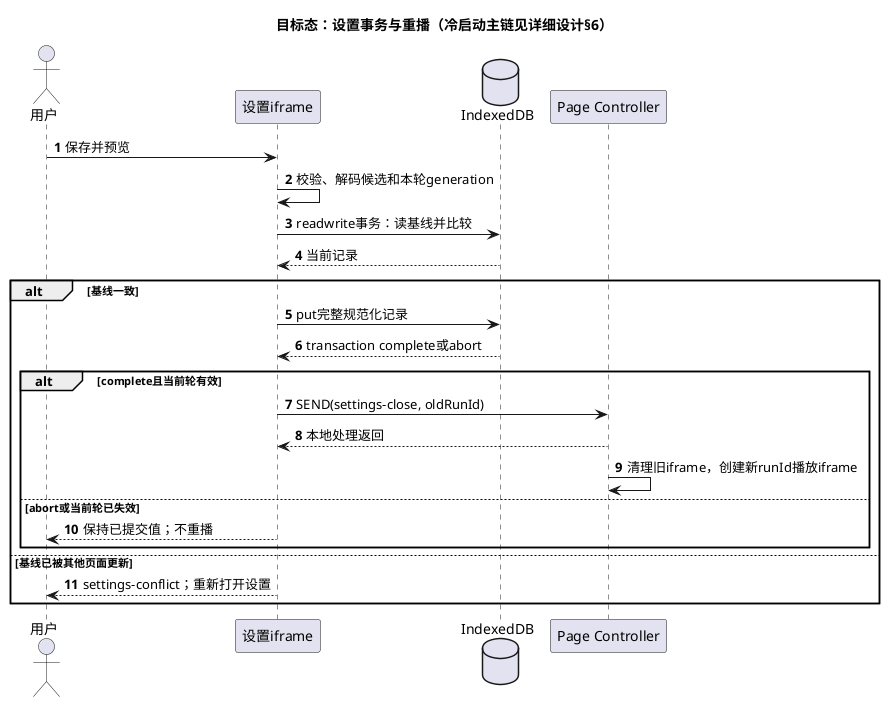

# CDP 同窗口启动：运行契约

2026-10-27 验收修订：设置入口以[冷启动验收修订](host-acceptance-fixes.md)为准，替代下文历史的 Command-Option-B 约定；其余运行协议保持有效。

2026-10-28 体验修订：保存设置后应用工作区背景并结束设置，不自动重播；动画预览独立使用草稿。以下保存状态和消息规则已相应更新。

本文所有 MUST 均是 `DETAIL-2026-001` 的 **Planned（目标态）** 契约，不是 H 当前实现声明。S 参数快照和出处见[研读](source-analysis.md)；本文选择在 H 重实现的值以此处为准。入口、步骤和追溯见[详细设计](detailed-design.md)。

产品已命名为 Agent Skin / `agent-skin`，首期只适配 Codex。该命名决定不改变本文的Codex页面全局、owner、消息、事件schema、数据库或App安装身份；包目录/Hub入口及旧来源衔接以详细设计§12和执行指南前置单N为准。

## 1. 源消息与目标消息

### 1.1 接入结果与页面控制器

目标顶层全局为 `globalThis.__azhouStartup`，不使用 S 的品牌全局。其 `owner="azhou-codex-startup"`、`version=1` 表示本页协议归属，不是 App 版本。内部仍可复用 H 的 `__azhouWallpaper`，但由同一个启动控制器组合，禁止旧辅助任务再次独立抢占同页壁纸。

| Interface | 输入 | 返回 / 副作用 |
|---|---|---|
| `install(payload)` | 构建器生成的本地受控表达式 | `{installed:true,alreadyActive:false}`，或已有同版本时 `{installed:true,alreadyActive:true}`；未知 owned 冲突返回 `{installed:false,reason:"owner-conflict"}`，不删除未知对象 |
| `status()` | 无 | 只读快照；不注入、不重播、不写日志 |
| `openSettings()` | 无 | 已dispose或loading时无操作；已有playing iframe时调用其本地openSettings；已有settings时无操作；complete时创建设置iframe |
| `dispose()` | 无 | 幂等；移除本实现的覆盖层、壁纸、快捷键、URL、监听与 owned 全局；不删 IndexedDB |

`status()` 的必需字段：`owner`、`version`、`phase`、`runId`、`ready`、`completed`、`overlay`、`wallpaper`、`reason`。`phase` 为 `loading|playing|settings|complete|failed|timeout|disposed`；reason 成功时为空串，失败时为固定错误分类。wallpaper 是对象，含 `applied`、`reason`、`imageDecoded` 及 H 现有实际样式核查结果，不用单个 true 遮蔽部分失败。清理后可由 dispose 的返回值报告 disposed；全局已删除时，外部查询应识别“未安装”，不访问旧闭包。

补齐字段类型：owner为上文固定string，version为整数1，runId为本页正整数，ready/completed/overlay为boolean，reason为RC6固定string；增加`completion:null|{cause:"natural"|"skip"|"settings-cancel"|"settings-save",beforeReady:boolean}`，每轮开始置null。wallpaper至少含`{applied:boolean,reason:string,imageDecoded:boolean}`；图片、轮廓和用户文字不进入status。只允许unknown optional字段前向扩展，必需字段缺失/类型错误不能当作旧版本成功。

每次创建iframe传入`{runId,intent:"play"|"settings",protocolVersion:1,assets}`。首次冷启动intent=play；完成后打开设置intent=settings。settings意图也要载入有效资源再开放交互，但不自动播放。ready只在loading接受一次：play进入playing，settings进入settings并取消watchdog；settings-open仅在resourcesReady且已ready的playing/settings接受。父与iframe都必须在resourcesReady=false时忽略⌘⌥B，避免子页绕过父端loading守卫。

CDP `Runtime.evaluate` 必须使用 `returnByValue=true`；安装可 `awaitPromise=true`。同时检查 CDP error、`exceptionDetails`、返回对象和字段类型。`installed=true` 不代表 ready；`ready=true` 也不代表 complete 或 wallpaper.applied。重复安装成功不得拿历史 runId 当新一轮播放。

### 1.2 iframe 消息

消息对象：`{type:"azhou-startup", action, runId, ...details}`。父端仅接受当前 iframe 的 `contentWindow`、当前 runId 和允许的 action。runId 在父端创建新轮次时递增，传入 mount；它防止旧回调污染本轮，不是授权凭证。source 身份才是消息准入条件。

| action | 来源 / 顺序 | 载荷 | 父端行为 |
|---|---|---|---|
| `background` | 当前 iframe；素材解码与设置加载后 | `image` 为规范化图片 data URL；`strength` 为整数 | 验证后委托 Wallpaper；失败不授予额外原生能力 |
| `ready` | 每轮最多一次；首次布局和预热完成后 | 无额外必需字段 | ready=true；play进入playing，settings保持settings不自动播放；首次play允许原生辅助退出 |
| `complete` | 播完、skip，或settings的×/Esc取消 | `skipped:boolean`；settings取消必须为true | loading/playing的skip与settings取消均可接受；记录completion，completed=true并删除iframe；取消不写库、不重播 |
| `assetError` | 解码或默认路径不可用 | 固定 `reason` | 标失败并清理覆盖层；若该runId已终结则忽略迟到消息；不输出图像字节 |
| `settings-open` | 设置框打开成功 | 无 | 暂停动画，取消本轮 watchdog |
| `settings-close` | 保存已提交，背景应用流程结束或用户关闭提示 | 无 | 结束当前设置 iframe，记录 `settings-save` 完成状态；不创建新播放轮次 |
| `restore` | 用户点击恢复外观 | 无 | dispose；不等待 complete |

保存成功的 iframe 发出 `settings-close` 后必须停止自己的工作，不在旧 iframe 上调用 replay。预览使用隔离的草稿副本，不保存设置或修改工作区背景。S 的 `reveal` 是旧原生预览交接动作；同窗口正式运行不隐藏应用，也不需要 reveal。未知 action 忽略并在测试断言无副作用；不把 action 字符串用作原生命令或 JS 源码。

`⌘⌥B` **同时在父页面和当前iframe的window注册**；键盘事件不会跨文档冒泡。父页面处理器调用Page Controller的openSettings；iframe处理器调用同一个面板的本地openSettings，再发settings-open；两处均preventDefault且不重复打开。完整结束后只保留父页面监听。动画开始后默认隐藏设置按钮，允许快捷键打开。设置面板通过dialog焦点约束；进入前记住activeElement。删除iframe时，只在原元素仍连接且用户焦点仍在owned iframe/文档失焦时归还，避免抢走用户后来选择的官方输入焦点。

### 1.3 注入与构建约定

构建器输入是仓库受控的 HTML/CSS/JS、已授权本地默认图片和匹配轮廓，不接受任意网页作为模板。剥离外链 script/link 和默认素材路径；图片以内联 data 输入，运行时壁纸转为短 Blob URL。仅移除载荷自己模板中的 CSP meta，**不改官方页面 CSP**。

使用 `about:blank` 临时 iframe、父 realm 编译的闭包和显式绑定的 iframe `document/performance/indexedDB/Image/Path2D/URL/requestAnimationFrame/cancelAnimationFrame`，避免删除 iframe 后动画仍在父 realm 调度。闭包 bridge 为当前 iframe 附加 source 身份；真实 `message` 监听也执行相同检查。不得仅凭 type、origin 字符串或 runId 信任消息。

生产采用S同类闭包bridge：父端在mount时绑定`SEND(data)`，由该闭包补入source=currentFrame.contentWindow并调用统一handler；不依赖跨文档冒泡，也不接受data自报source。预览Adapter才用postMessage，必须仍以event.source核对其测试iframe；两条transport共享同一action/schema校验。mount显式设置`module=undefined`，绑定`window/document/location/performance/indexedDB/Image/Path2D/URL/requestAnimationFrame/cancelAnimationFrame/setTimeout/clearTimeout`；timer、事件监听及临时对象均登记在当前iframe清理域。这个同源about:blank是受信任载荷的执行环境，不是安全沙箱，禁止在其中运行用户脚本或任意HTML。

生产闭包的`SEND(data)`保留统一handler的返回值；`background`返回当前父端核验后的壁纸结果，已提交设置的子页据此显示“已保存、壁纸未应用”等部分成功状态。该返回值沿用原bridge和source/runId校验，不新增消息通道；旧run或非当前frame的结果不得更新状态。

在发ready前验证动画样式哨兵computedStyle、非零可视尺寸及两图实际解码；data图片或iframe样式被官方CSP阻断时返回page-unsupported/asset-invalid并清层。Blob壁纸的CSP/样式阻断只报告wallpaper-unsupported，不把它伪装成动画不可用。控制器可监听securitypolicyviolation作为诊断补充，但不能靠“未收到事件”判成功，不修改/放松宿主策略。生产验收同时检查这些策略在真实支持版本有效。

同一套 Animation/Image Settings 用于独立预览；预览宿主只模拟消息，不执行可信进程发现。开发预览可使用回环服务器；正式运行不启动资源服务器，不改变官方包或 CSP。

运行时生产payload只接受app主页面；预览构建注入不可被运行参数打开的fixture授权，或使用独立preview mount。不得为共用代码将`preview:true`选项留给正式CDP入口。独立文件预览同源存储受限时可提示暂存；持久化验收使用原生隔离data store或固定回环测试origin。

## 2. 设置 Schema、输入与默认值

数据库 `azhou-codex-startup`，版本 1；store `settings`，key `images`；单记录事务。`schemaVersion=1` 在首次成功保存写入；读取旧的不认识的 schema 时保留原记录、退回默认，不盲目改写。无需为尚无历史版本的库建设迁移框架。

| 字段 | 类型 / 可选性 | 默认 / 规则 |
|---|---|---|
| `schemaVersion` | 保存时必需整数 | 1 |
| `avatar` | 可选 string | 缺失用授权阿舟默认头像；规范化为 512×512 PNG data URL |
| `artwork` | 可选 string | 缺失用授权阿舟默认背景；规范化为 1536×1024 PNG data URL |
| `contours` | 自定义 artwork 时必需二维坐标路径数组 | 默认背景用构建匹配路径；自定义图与轮廓必须成对 |
| `introTitle` | 可选 string | 默认“阿舟的 Agent 实验室”；最多 16 UTF-16 code units |
| `introCaption` | 可选 string | 默认“AZHOU / AGENT LAB”；最多 48 UTF-16 code units |
| `artworkSubtitle` | 可选 string | 默认“和阿舟一起，把想法做出来。”；最多 60 UTF-16 code units |
| `wallpaperStrength` | 可选整数 | 默认 42；0–75，0 关闭本实现壁纸 |

缺失文字采用默认，空串隐藏对应文字；使用 `textContent` 输出，绝不作为 HTML。输入控件 maxlength 与保存校验使用同一计数方式；截断时不得留下孤立 surrogate。emoji/组合字符可能占多个 code units，UI 明示“字符上限”，不承诺按汉字或可见字素计数。

单文件允许 `image/png|image/jpeg|image/webp`，≤30 MiB（31,457,280 bytes，等于上限可接受）；最终以实际解码结果验证，不只信扩展名或 MIME。非正尺寸拒绝。一次只处理一张图片；Busy 禁用并行导入和保存。输入原始像素>16 MP 提示可能较慢，>48 MP 在尺寸可获得后拒绝；浏览器解码可能在尺寸判断前分配内存，所以该限制不构成峰值内存保证，T19 要测实际峰值。

中心 cover 裁切：`scale=max(W/w,H/h)`，绘制尺寸 `w*scale,h*scale`，偏移 `(W-w*scale)/2,(H-h*scale)/2`。目标底色为固定深色，透明输入先合成到该底色；头像与背景都不把透明度作为独立图层语义。背景的色图和线稿始终来自同一裁切结果，避免二次不同裁切。导入完成后撤销输入 Blob URL；失败不改变 committed。

序列化后的头像 data URL≤2 MiB，背景 data URL≤12 MiB，记录总大小≤20 MiB；超出时要求更换素材，不静默降质或写入半记录。轮廓≤1200条，每条≥2点；总点数≤300,000；坐标有限且在 `0..1536`、`0..1024`。这些是新增的目标防失控门限，不冒充 S 的既有校验。

## 3. 动画算法和时间轴

### 3.1 同图轮廓

背景缩为 768×512 处理。灰度使用 RGB 权重 0.299/0.587/0.114，Sobel 得梯度幅值与方向；方向量化为四类，非极大抑制且幅值>32 保留边缘。先从端点再从剩余闭环沿 8 邻接追踪，优先延续方向；至少8个原始点的路径每隔一点采样，按长度排序最多1200条，坐标映射回1536×1024。无有效路径拒绝该背景，原设置保留。

上述是 S 的可复现算法基线，不要求复制源实现。默认图可在构建时预计算同算法路径，避免引入第二种视觉基线；若继续使用 Vision 离线工具，T07 只要求同图配准和有效路径，不声称在线/离线路径逐点一致。处理时间/空间均为 O(W×H+P)，P 为追踪点；分辨率固定，且后置点数门限约束播放成本。

### 3.2 碎片和时间采样

将完整路径按 `span=max(18,totalLength/1400)` 切成相近弧长片段，位置、角度和散开位置使用固定种子确定性生成；不在帧循环创建 DOM 或随机分配粒子。头像及圆环、文字先画成一次性位图切块，碎片从身份位图位置散开，再向同一背景线稿位置聚合。

描线前沿随目标 x 从左向右推进，`front=1.5*p-0.25`；到达比例使用平滑插值。`smooth(u)=c²(3−2c)`，`c=clamp(u,0,1)`。时间使用 `performance.now()` 和单一 rAF 时钟，暂停/拖动改变 elapsed 和 origin，不能叠加第二套时钟。UI 数字按约60ms节流，不让文字更新决定动画帧率。

| 时间 / stage | 目标动作 | 完成判据 |
|---|---|---|
| 0–1.15 s / pulse | 脉冲与系统线条 | 不把演示日志或百分比称为真实加载状态 |
| 1.15–4.18 s / identity | 头像、圆环、标题、小字 | 头像与位图采样位置一致 |
| 4.18–4.74 s / dispersing | 身份位图散开 | 来源必须是当前头像/文字，不是另一张预录图 |
| 4.74–5.08 s / scattered | 散线漂浮，释放身份位图 | 位图不再被引用，正式转场无同步预热 |
| 5.08–7.18 s / drawing | 从左到右汇聚 | 7.18s前背景色图不提前显现 |
| 7.18–7.43 s / colorize | 同图彩色背景淡入 | 与线稿配准；色图稳定前不缩放 |
| 7.43–11 s / portrait | 背景、字幕与进度展示 | 可读、无遮挡官方页面的永久元素 |
| 11–12 s / shutter | 向中央收拢 | 12s complete；移除 iframe，官方页面可输入 |

百分比仅为动画时间插值：归一化时间与进度锚点为 `(0,0),(.12,.06),(.35,.41),(.56,.76),(.66,.924),(.72,.97),(.77,1),(1,1)`，段内 smooth。不得把它绑定到模型或工具请求。

正式播放前准备头像位图、Path2D和固定粒子；预热完成才发ready并启动elapsed=0。这是对S顺序的有意改进：S的ready()先send ready，再在play()中预热；不据此声称已证实S原生进程在同步预热中途退出。Canvas主坐标1536×1024，场景cover映射一致；窗口变化只使布局和依赖布局的位图失效，不重复导入或描边。完成、skip、dispose、重播前都释放帧句柄、旧位图和短期URL。

### 3.3 输入和无障碍

playing 时点击跳过/Esc 立即走统一 finish：停止调度、completed=true、发送 complete，父端移除覆盖层；重复 finish 无二次副作用。settings 打开时 Esc 只取消草稿并关闭，不触发保存。浏览器独立预览可暂停、拖动和重播；正式开场不显示调试时间轴，空格不抢占官方输入。

读取并监听 `prefers-reduced-motion` 的 change：减少位移、旋转、碎片、闪光与粒子，只保留必要透明度及阶段提示；运行中开启立即切换，完成/跳过行为相同。S 仅初始化读取，动态监听是沿用 H 能力的目标要求。不得以减少动态效果为由把恢复外观和设置取消路径改掉。

## 4. 设置事务与存储

唯一状态：`committed` 是最后成功读取/保存的记录，`draft` 是设置面板副本，`candidate` 是本次已校验且可解码的新资源。关闭面板丢弃 draft/candidate；`restore defaults` 只把 draft 置空，不立即覆盖 committed。

本地×/Esc只在非busy时取消；导入/保存期间阻止本地关闭和再次提交，仍由本节预算结束busy，超时后用户可取消。外部dispose、页面销毁不受busy阻挡，按generation与事务规则清理；“可取消”不表示保存事务中途的Esc可以同时提交或关闭。

保存顺序：

1. 规范化字段、检查容量、解码候选图并验证轮廓；成功才允许提交。完成条件：所有候选可渲染且没有原生副作用。
2. 把完整记录写入一个 readwrite transaction；`oncomplete` 为持久化提交点，request success 不够。完成条件：事务 complete；abort/error 仍使用旧 committed。
3. 更新 committed，应用候选动画/壁纸，关闭设置并重播。完成条件：播放使用新记录且 background 状态可读；壁纸独立不兼容时提示其失败，记录已保存不假装写库失败。

设置成功事件只通知父控制器创建新轮次，旧iframe不再自行replay；新iframe从已提交记录应用背景。下面图不重复冷启动，只放大提交点。

图4：设置提交与重播。目的：防止写库失败触发重播或先改宿主；范围：当前面板的一次保存；版本：0.2 / 2026-10-26；结论：目标态只有事务完成才通知父控制器重建播放iframe。参与者映射：用户→调用方；设置iframe→Animation/Image Settings；IndexedDB→持久化Seam；Page Controller→页面生命周期Owner。



为避免持久化成功后不可恢复的 UI 失败，步骤1必须先验证解码和轮廓；步骤3对宿主壁纸的失败按“已保存、壁纸未应用”处理，可恢复官方外观。不得把先更改宿主背景、后写库、失败再尽力恢复的中间状态当成原子提交。

读库失败时暂用默认并提示“本次使用默认，原保存值未删除”。读到无效图片/路径时整组回退有效默认；保留原记录供用户重选保存。新 App 构建升级不主动清空库。dispose 保留 committed 的持久化值，只释放内存引用。

异步操作必须有本轮generation：load/decode/contour/save的结果在应用前检查当前iframe、runId与disposed；已取消或被替换的任务只清资源。文件解码预算4s、单次图像准备总预算10s、IDB打开/读取/提交各5s；超时退出busy，面板可取消或重试。同步描边无法靠同线程timer抢占，因此固定768×512输入、分段检查取消；不得把Promise.race称为强制中止解码。保存期间dispose会尝试abort尚活跃事务；已提交的设置仍保留，迟到回调不得重新挂UI。`onversionchange`关闭连接，blocked/timeout不删除数据库。

同一官方origin的另一主页面可能有独立设置面板：草稿打开时记录基线；写事务内重新读取key，若与草稿基线不同则拒绝`settings-conflict`，保持旧壁纸并提示重新打开面板；不静默覆盖另一页提交。比较的是完整规范化记录，不增加独立版本根或跨页常驻监听。

正式 iframe 继承主页面存储上下文；独立预览使用独立 WKWebsiteDataStore 或独立浏览器 origin。两者不共享库，不从原生文件系统自动读取用户私有图。官方源/存储分区改变时可见性可能改变，本版本不实现自动迁移。

## 5. 壁纸、恢复外观与资源所有权

保留 H 的图片解码、shell surface、footer decoration、composer 背景和版本核查。新增强度0–75映射到随宿主浅/深色选择的 wash；明确 cover、固定视口背景、焦点裁切和 rasterScale。0 表示本实现不显示壁纸，不等于恢复全部控制器；仍保留设置快捷键。

父页面接收规范化 data URL，验证 MIME/base64/长度后创建短 Blob URL；新图解码和候选样式通过后才提交，并撤销旧 URL。wallpaper apply 失败保持上一个有效状态或官方原貌，返回固定 reason；不透明化未知容器，不去掉输入框、菜单、代码块和内部 mask。

新 Page Controller 组合现有 Wallpaper 的 owner/status 和 restore/dispose，不新建第二个表面修改器。**精确旧版识别和条件恢复是新增要求**；H 当前仅检查 owner/dispose 可调用性，恢复快照时未检查宿主后来变更。目标实现只能接管经测试明确识别的旧版，调用其自己的 dispose；不认识的全局或未知版本返回 owner-conflict，保留页面不注入。来源或版本不能证明时，提示冷启动而不是强删 DOM。

| 资源 | 创建者 / 清理者 | complete | restore / dispose |
|---|---|---|---|
| iframe、其文档和动画帧 | Page Controller / Animation | 删除、停止 | 删除、停止 |
| 身份位图、Path2D、粒子 | Animation | 释放全部动画引用 | 释放 |
| input Blob URL | Image Settings | 导入结束已撤销 | 仍有的撤销 |
| wallpaper Blob URL、样式表 | Wallpaper | 保留一份静态已提交图 | 撤销/移除 |
| message、外观入口及其事件 | Page Controller | 移除消息监听；保留点击入口与焦点反馈，不拦截设置快捷键 | 移除入口及事件 |
| 有界 shell observer/timer | Builder wrapper / 当前轮次 | 已完成等待或随本轮 iframe 拆除取消 | 断开观察器、清除 timer，禁止迟到应用 |
| owned 全局 | Page Controller | 保留 status/openSettings/dispose | 仅 identity 仍匹配时删除 |
| 原始宿主属性/内联样式值及优先级 | Wallpaper | 保留 owned 快照 | 条件恢复，不覆盖宿主后来变更 |
| IndexedDB | Image Settings | 保留 | 保留 |
| CDP WebSocket、pending | 原生 Session | ready 后已关闭 | 接入失败时关闭 |
| 官方进程 CDP 监听端口 | 官方进程 | 仍存在 | 仍存在，完整退出官方进程才关闭 |

settings 状态没有持续动画，不运行常驻扫描。壁纸 status 在调用时核查 DOM。允许两类有界临时观察器：首次 document.body 尚未出现时等待 body，从安装开始计入 25 秒 watchdog，body 出现、超时或 dispose 时立即断开；本轮壁纸请求在 body 已存在但受支持 shell 尚未挂载时，最多等待 5 秒，继续沿用 renderer 的 root/frame/main-or-page 校验。shell 就绪或等待超时后断开并清 timer；skip、expire、dispose 拆除本轮 iframe 时，在该 DOM 变更回调中取消等待并清理。每个回调与委托 renderer 前均核验本轮仍有效，不得读取聊天文本、触发原生重注入或在后来挂载的页面上复活。

首次加载、保存后重播和设置资源准备共用一个`expire(runId)`转换：先设置phase=timeout/reason=overlay-timeout、终结本轮并使generation失效，再清理iframe与临时资源。禁止只删除iframe却让status仍报playing；settings已成功打开后没有播放watchdog，设置内部操作使用RC4各自预算。没有新增轮询来代替这些事件和timer。

## 6. 安全验证、预算与错误

### 6.1 可信目标

原生入口先解析真实 bundle 路径、拒绝自身/嵌套 Helper、核对 `com.openai.codex` 和有效主可执行文件；用现有签名核验补足预期签名主体。S 的 TeamIdentifier 为 `2DC432GLL2`；目标实现前须对所支持的官方版本实机复核并保留 evidence，不能仅凭路径或 Bundle ID 放行。

正常启动禁止创建额外官方实例；不搬用 S 的 `open -n`。收到真实启动 PID 后，核验 UID、真实 executable 路径、有效签名和监听端口归属。只接受明确的 `127.0.0.1:positive-port`，拒绝 wildcard、远端、其他 UID/PID。端口 bind-and-release 不提供排他保证，因此连接前及拿到目标页后都检查归属；变化即停止。

page target 仅接受 S 的主路由契约：type=page，协议 app:，主机 `-`，路径 `/index.html`，拒绝辅助 initialRoute。未知路由不得回退“第一个 page”。WebSocket 仅允许同一回环端口、无凭据、`/devtools/page/` 路径；拒绝重定向。多主页面时只选择明确主路由且稳定标识的一页，不对所有页面播放。

选择细化：过滤后有且仅有1个candidate才自动注入；0个在总预算内等待；多于1个返回`ambiguous-main-page`并停止，不用targets数组顺序或标题猜测。固定选中targetId后，在同一socket内再次核对顶层location和页面仍存活；页面导航、target更换或已安装控制器消失后不得在本轮重装。

此策略不宣称防御能完全控制当前用户进程空间的攻击者；同机其他进程仍可能访问官方 CDP。签名不授予读取聊天数据的额外业务权限。

现有显式helper入口的目标兼容规则：`--wallpaper-status`只读，保留既有wallpaper结果字段，另加startup状态，不触发安装；`--wallpaper-helper --action restore`在存在受支持启动控制器时调用其完整dispose，没有启动控制器时才委托已识别旧Wallpaper.dispose。显式apply遇到活动启动控制器时返回固定`startup-active`冲突，不用旧静态载荷覆盖当前设置；普通无控制器页面仍可执行既有壁纸apply。启动注入与显式apply/restore沿用同一目标PID的操作锁串行；未知owner/version不删除。T18覆盖这三种显式调用与自动接入的竞态。

### 6.2 目标预算（不是实测结果）

| 项目 | 警告线 / 目标 | 中断或降级线 | 动作 |
|---|---|---|---|
| 原生端到端 | 预检目标≤15 s；接入共享≤45 s | 总计60 s，子请求按剩余预算截断 | 关闭连接并报告接入未完成，不关官方应用 |
| CDP 请求 | 列表1.2 s；连接5 s；单 evaluate10 s | 到期，且最多重试至总预算 | 150ms间隔；身份/来源错误不可重试绕过 |
| iframe loading/playing watchdog | 12 s动画 + 余量 | 单轮25 s | 清理阻塞层；settings 打开时取消 |
| 原图 | >16 MP提示处理成本 | >30 MiB或获知尺寸>48 MP | 拒绝，不删除旧记录；解码峰值另测 |
| 存储记录 / 路径 | 记录>16 MiB提示；点数>200k提示 | 20 MiB / 300k点 / 1200路径 | 拒绝提交，不按比例默默删路径 |
| 播放 JS 帧工作 | 目标p95≤16.7ms（60Hz） | p95>33.3ms持续≥1s | 降低非必要装饰或减少动态模式；真实呈现需另验 |
| 资源释放 | complete后无动画rAF、无身份位图 | 保留动画循环或 URL 数随重播增长 | 阻断验收；不能用静态壁纸内存非零解释泄漏 |

性能测试记录机器、分辨率、DPR、素材和系统负载。无系统级测量时不填“峰值已达标”。可在真实证据支持下调整目标预算，修改时同时更改测试期望与文档。

### 6.3 固定错误分类

| reason | 条件 | 重试 / 返回 |
|---|---|---|
| `target-missing` / `target-identity` | 无应用或身份/签名主体不符 | 不注入；用户检查官方安装 |
| `listener-mismatch` | UID/PID/路径/回环监听不符 | 本轮停止，不回退未知端口 |
| `page-pending` | 主页面尚未就绪 | 总预算内有限重试 |
| `page-unsupported` | 路由或协议明确不支持 | 不注入；版本适配待处理 |
| `owner-conflict` | 已有未知控制器/版本 | 不删除；提示正常冷启动 |
| `protocol-error` / `attach-timeout` | CDP断开/坏响应/预算到期 | 关闭所有pending，原生非零退出 |
| `asset-invalid` / `storage-unavailable` | 图片、轮廓或存储失败 | 默认回退或保留设置面板，不能报告提交成功 |
| `wallpaper-unsupported` | 图片或实际表面核查失败 | 动画可继续；wallpaper.applied=false |
| `overlay-timeout` | watchdog到期 | 清理iframe，页面可用 |
| `ambiguous-main-page` / `startup-active` | 多个可信候选 / 显式壁纸apply碰到活动启动控制器 | 本轮拒绝，不猜测、不覆盖 |
| `settings-conflict` / `operation-timeout` | 其他页面已提交 / 设置操作超时 | 保留旧提交与壁纸，面板恢复可操作 |

已运行实例的普通激活成功是 Launcher 正常退出，不声称本轮安装成功。命令退出0可分别表示激活或 ready，日志必须区分 `target-activated` 与 `startup-ready`；完整播放由页面状态或专门验收回执证明。

## 7. 原生启动与adapter消费契约

### 7.1 一次接入的确定性步骤

```text
start: 取得原生单实例锁，记录monotonic deadline=现在+60s
preflight: 在剩余预算及15s阶段上限内核对目标路径、标识和签名主体
warm: 若目标已运行，核对真实PID后激活，记录target-activated并退出0
cold: 通过LaunchServices正常启动，禁止额外实例；记录真实PID与回环端口
attach: 取得目标PID操作锁，核验监听与主页面；只在尚未安装时重试page-pending
install: 对固定targetId evaluate一次受控载荷，要求installed=true并记录startup-installed
confirm: 每100ms读取同一控制器status，检查owner/version/runId与完整schema
  failed/timeout => 失败；绝不因历史ready=true放行
  ready=true且phase=playing/settings/complete => startup-ready，退出0
  completed=true且completion.cause=skip且overlay=false => startup-skipped，退出0
  控制器消失/页面导航/用户restore => startup-interrupted，退出2；不重新安装
  其余 => 在共享deadline内等待；超时清理已知owned覆盖层，退出1
finally: 释放socket、session、pending、操作锁和原生锁；不终止官方进程
```

完整schema校验成功后才可判断状态；终结状态优先于ready。确认中的runId固定为首次play轮次；用户保存设置造成换轮次时，若初始轮曾ready可按已确认ready结束；否则报告interrupted，不把新设置轮误当冷启动证据。恢复外观后不存在全局是正常结果，不能为改善日志额外重装或留永久终结标记。

H当前transport仅是Wallpaper helper的一次性evaluate。目标必须明确实现：单socket顺序请求（最多1个pending）、递增id匹配、忽略非当前id事件但仍扣除deadline、坏JSON/远端error/exceptionDetails拒绝、断开时结束pending、HTTP不走代理/缓存/cookie/重定向。出站表达式UTF-8≤24MiB；入站消息≤2MiB，status不回传图片或用户内容。阶段超时取min(阶段预算,总剩余)；取消必须关闭实际URLSessionTask，不能只结束等待Promise。

安装成功后只读查询，不因ready迟到重复evaluate install。接入失败且socket仍可信、文档仍为原目标、有剩余预算时，通过已经定义的dispose()清理同一owner/version控制器；不调用不存在的公共removeOverlay方法。预算耗尽或socket已断时不额外超时等待清理，只报告未确认清理，已安装的25s页面watchdog负责释放覆盖层。页面已导航时不向新文档执行旧脚本；正常ready后的Session.close绝不触发dispose。预检、端口或页面身份错误不可通过重试到别的未知对象绕过。

### 7.2 原生日志和退出语义

沿用JSON-lines日志形态，目标日志字段`schema="azhou-startup.event.v1"`、`event`、`seconds`（monotonic）、`launcherPID`、`launcherPath`；需要时加`targetPID/targetId/runId/phase/reason`。不把CDP异常全文、表达式、图片和聊天放进message。新schema只用于实际被adapter消费的事件，不再生成另一套审计链。

| 结果 | 必需事件顺序 | 原生exit / adapter结论 |
|---|---|---|
| 普通热激活 | launcher-start→target-activated→launcher-exit | 0 / activated；injection=not-attempted |
| 冷启动接入 | launcher-start→target-opened→startup-installed→startup-ready→launcher-exit | 0 / startup-ready；playback-completion=unobserved |
| loading提前跳过 | launcher-start→target-opened→startup-installed→startup-skipped→launcher-exit | 0 / skipped；不得伪造startup-ready或animation-complete |
| 接入中断 | launcher-start→startup-interrupted→launcher-exit | 2 / partial；官方应用状态独立保留 |
| 可信检查/协议失败 | launcher-start→startup-failed→launcher-exit | 1 / behavior-not-proven，带固定reason |
| 独立smoke | player-start→playback-start→animation-complete→preview-result→player-terminated | 0且completed=true/failed=false；无target-opened/installed事件 |

launcher-exit包含`outcome`和`exitCode`，failure/duplicate-entry/lock-error不能被后续success覆盖。外层Hub run继续报告命令原始returncode；其自身0仅表示plan/action完成，不能丢弃结果对象的activated/partial范围。`assess_execution(launch)`按目标App版本选择对应事件契约，不再要求原生hand-off-fade事件；旧版freeze snapshot仍用原评估路径。

辅助退出后没有原生日志animation-complete是设计事实。未来验收进程可在获准真实测试时独立读本页status和DOM，记录complete/overlay=false；它不是产品常驻监控。不能为了凑旧adapter事件而让产品辅助进程等满动画，或编造complete日志。

### 7.3 壁纸状态兼容

`--wallpaper-status`保持旧wallpaper验证字段与退出含义；在结果中增加可选`startup:{installed,owner,version,phase,runId,ready,completed,overlay,completion}`。即使动画已ready，wallpaper未应用仍按旧规则非零；不存在启动控制器时startup.installed=false，不凭最近日志补true。status与probe不登记、不写日志、不注入。`disable-wallpaper`通过显式restore清理完整新控制器时，scope必须更新为“移除本页启动美化及设置入口，保存值保留”，不得继续描述成只清一张壁纸。

## 8. 契约变更记录

| 版本 | 日期 | 变更 |
|---|---|---|
| 0.1 | 2026-10-26 | 初始字段、消息、图像、设置和资源预算 |
| 0.2 | 2026-10-26 | 完整status/FrameSpec、loading竞态、CSP/realm、原生日志/adapter、事务并发及图4 |
