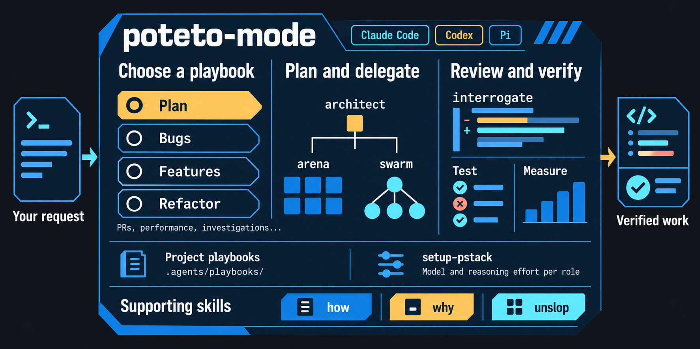

# pstack

[](https://buymeacoffee.com/codenyer)

Lauren Tan's [pstack](https://github.com/cursor/plugins/tree/main/pstack) is an opinionated skill stack that improves agent outcomes. This Hub-maintained package supports Codex and Claude Code through native plugins, and ZCode and MiMo Code through project-scoped skills. Other imported harness adapters remain in the package as source material, outside Hub support. The package tracks upstream and carries named policy forks, each declared in [`tools/forks.json`](tools/forks.json).

Inside Azhou AI Hub, this package root is `packages/pstack-agent-harness/`. Run its maintainer commands from that directory so paths such as `plugins/pstack` resolve within this package. The native marketplace and plugin identities remain `pstack-claude` and `pstack` (`pstack@pstack-claude` in Codex).

Tell `poteto-mode` your goal and it will invoke the correct workflow for the task. It keeps your code concise, simple and verified.

For concurrency bugs and invariants that tests cannot reach, `/create-formal-verification-skill` picks the riskiest property in your code, verifies it with a tool that fits, and leaves a project skill the next agent reruns. The separate [agent-formal-verify](https://github.com/michael-denyer/agent-formal-verify) plugin goes deeper on the method, with guided TLA+ model checking, Lean proofs, and Kani for Rust.

## Install

Set `PSTACK_PACKAGE` to the absolute path of this package in your current Hub checkout. Replace the example path with the path on your machine:

```shell
export PSTACK_PACKAGE="/absolute/path/to/azhou-ai-hub/packages/pstack-agent-harness"
test -f "$PSTACK_PACKAGE/hub-package.json"
```

This Hub package is the source for every install below. Hub-managed Codex installation uses the [Hub integration commands](../../docs/integrations.md#pstack-local-source-to-native-plugin), which target a dedicated `CODEX_HOME` and preserve any existing default configuration, including Agent Orchestration Kit. This is the only Hub-managed runtime installation path for pstack.

<details>
<summary><strong>Claude Code</strong></summary>

Run in a terminal with Claude Code 2.1.292 or later:

```shell
claude plugin marketplace add "$PSTACK_PACKAGE"
claude plugin install pstack@pstack-claude --scope user
```

After the Hub package is updated, refresh the local marketplace and update the plugin with Claude Code's native commands: `claude plugin marketplace update pstack-claude` and `claude plugin update pstack@pstack-claude`. Remove it with `claude plugin uninstall pstack@pstack-claude`.

</details>

<a id="codex"></a>
<details>
<summary><strong>Codex</strong></summary>

Use the Hub integration's plan, apply, and doctor commands linked above. Pass its explicit dedicated `CODEX_HOME`. When Agent Orchestration Kit is already installed in the default home, the current adapter requires a separate target.

</details>

<a id="zcode"></a>
<details>
<summary><strong>ZCode</strong></summary>

Run this from the project root. It links the canonical Hub skills into the project's `.agents/skills/` root, which ZCode discovers at project scope. Existing files, directories, and links stay untouched.

```shell
: "${PSTACK_PACKAGE:?Set PSTACK_PACKAGE to the absolute Hub package directory}"
case "$PSTACK_PACKAGE" in /*) ;; *) printf '%s\n' 'PSTACK_PACKAGE must be absolute' >&2; exit 2;; esac
test -d "$PSTACK_PACKAGE/plugins/pstack/skills" || { printf '%s\n' 'PSTACK_PACKAGE does not contain pstack skills' >&2; exit 2; }
PSTACK_PROJECT_ROOT="$(pwd -P)"
: "${PSTACK_PROJECT_ROOT:?Run from the project root}"
PSTACK_SKILLS_ROOT="$PSTACK_PROJECT_ROOT/.agents/skills"
case "$PSTACK_SKILLS_ROOT" in /*) ;; *) printf '%s\n' 'skill root must be absolute' >&2; exit 2;; esac
test -n "$PSTACK_SKILLS_ROOT" || exit 2
mkdir -p "$PSTACK_SKILLS_ROOT"
for source in "$PSTACK_PACKAGE"/plugins/pstack/skills/*/; do
  [ -d "$source" ] || continue
  skill="${source%/}"
  target="$PSTACK_SKILLS_ROOT/${skill##*/}"
  if [ ! -e "$target" ] && [ ! -L "$target" ]; then
    ln -s "$skill" "$target"
  fi
done
```

This is a project-scoped skills-only install; it does not install a pstack plugin or hook. Linked skills follow Hub package updates; rerun the loop to link new skills. Remove only a project skill link whose target points into this package.

</details>

<a id="mimo-code"></a>
<details>
<summary><strong>MiMo Code</strong></summary>

Run this from the project root. It links the canonical Hub skills into the project's `.mimocode/skills/` root. Existing files, directories, and links stay untouched.

```shell
: "${PSTACK_PACKAGE:?Set PSTACK_PACKAGE to the absolute Hub package directory}"
case "$PSTACK_PACKAGE" in /*) ;; *) printf '%s\n' 'PSTACK_PACKAGE must be absolute' >&2; exit 2;; esac
test -d "$PSTACK_PACKAGE/plugins/pstack/skills" || { printf '%s\n' 'PSTACK_PACKAGE does not contain pstack skills' >&2; exit 2; }
PSTACK_PROJECT_ROOT="$(pwd -P)"
: "${PSTACK_PROJECT_ROOT:?Run from the project root}"
PSTACK_SKILLS_ROOT="$PSTACK_PROJECT_ROOT/.mimocode/skills"
case "$PSTACK_SKILLS_ROOT" in /*) ;; *) printf '%s\n' 'skill root must be absolute' >&2; exit 2;; esac
test -n "$PSTACK_SKILLS_ROOT" || exit 2
mkdir -p "$PSTACK_SKILLS_ROOT"
for source in "$PSTACK_PACKAGE"/plugins/pstack/skills/*/; do
  [ -d "$source" ] || continue
  skill="${source%/}"
  target="$PSTACK_SKILLS_ROOT/${skill##*/}"
  if [ ! -e "$target" ] && [ ! -L "$target" ]; then
    ln -s "$skill" "$target"
  fi
done
```

This is a project-scoped skills-only install; it does not install a pstack plugin or hook. Choose the session model through MiMo Code's native settings and model catalogue; no pstack model-sheet loader or per-role mapping is verified. Linked skills follow Hub package updates; rerun the loop to link new skills. Remove only a project skill link whose target points into this package.

</details>

<a id="other-harnesses"></a>
### User-wide shared skills (optional)

The project-scoped roots above are the default. If you intentionally link skills into `~/.agents/skills/`, every runtime that discovers that directory can read them, including a Codex home isolated through `CODEX_HOME`. This affects all readers of that shared root; preserve existing entries and link only from the absolute `PSTACK_PACKAGE` source.

### Configure

The Claude Code and Codex native plugins route supported tasks to `poteto-mode` through their SessionStart hooks. Codex runs its hook only after you trust it through `/hooks`. The ZCode and MiMo Code project-skill installs do not install a pstack hook; invoke `poteto-mode` by name. Run `setup-pstack` where its runtime table defines model-sheet handling. MiMo Code uses its native settings and model catalogue, with no verified pstack sheet or hook.

## Getting started

```text
Use poteto-mode to fix the search filter resetting when I change pages.
```

For a bug, it reproduces the failure, uses `how` and `why` to investigate, delegates the fix, then reruns the failing case. If the fix crosses a function boundary, it brings in `architect` before implementation. You receive the fix and the failing and passing evidence.

[Other playbooks](plugins/pstack/skills/poteto-mode/SKILL.md#playbooks) cover planning, features, refactoring, performance issues, investigations, prototypes, PR maintenance, shipping, and longer projects.



## Details

- [Skills and slash commands](docs/reference.md#slash-commands)
- [Runtime setup](docs/reference.md#runtime-support)
- [Models and dependencies](docs/reference.md#configuration-and-dependencies)
- [Maintenance and port scope](docs/reference.md#maintenance)

## Data handling

pstack has no server or telemetry. Anything its skills ask your agent to read, including session transcripts, goes to your model provider. Scripts run locally, and PR tools use your GitHub CLI login.

## Contributing

Thanks for helping make this port better. Bug reports, documentation fixes, and runtime improvements are welcome. See [CONTRIBUTING.md](CONTRIBUTING.md) for the checks and where your change belongs. Report vulnerabilities privately as described in [SECURITY.md](SECURITY.md).

To support maintenance of this port, [buy the maintainer a coffee](https://buymeacoffee.com/codenyer).

## License

This port, including its modifications and additions, is also [MIT-licensed](LICENSE), © 2026 Michael Denyer. Original pstack © 2026 Lauren Tan; imported cursor-team-kit and thermos skills © 2026 Cursor. See [LICENSE-cursor-team-kit](LICENSE-cursor-team-kit), [LICENSE-thermos](LICENSE-thermos), and [NOTICE.md](NOTICE.md).
